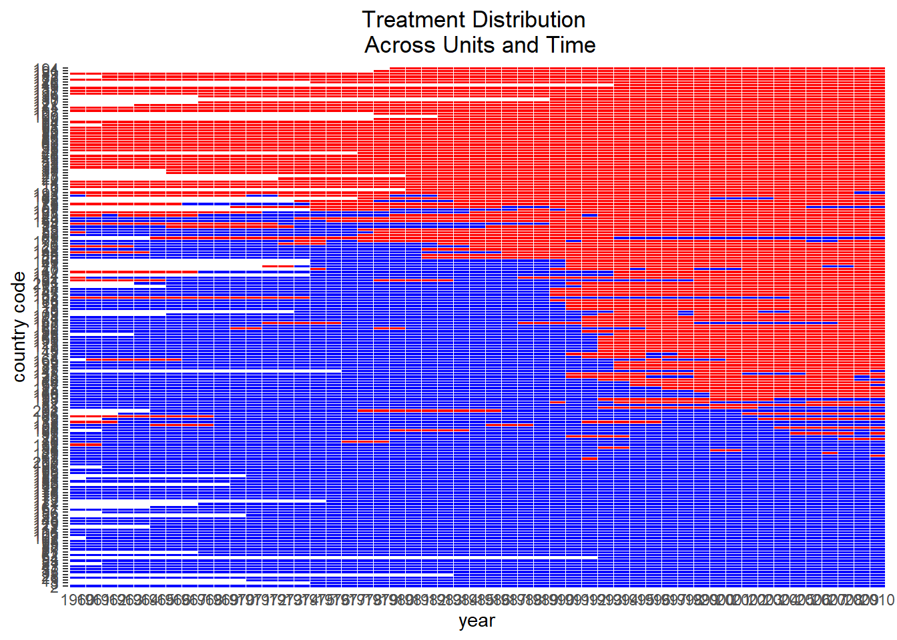
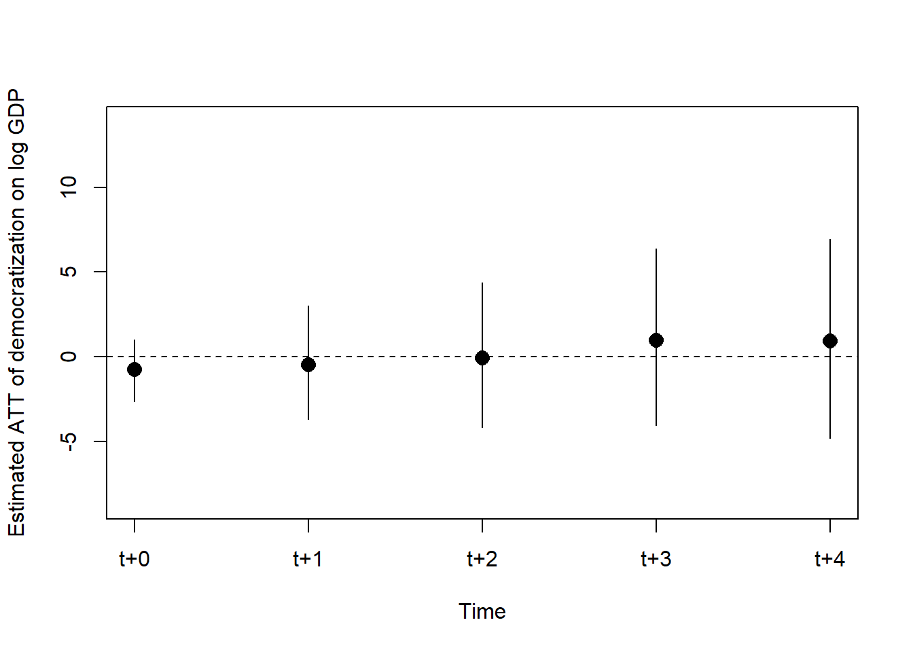

## Panel Matching for Time-Series Cross-Sectional Data {#sec-panel-matching}

The matching methods covered so far in this chapter treat each unit as a single cross-sectional observation. Time-series cross-sectional (TSCS) data, where the same units are observed repeatedly over time and treatment can switch on and off, calls for a different matching logic: instead of matching a treated unit to similar control units at a single point in time, we match a treated unit-period to control unit-periods that share its recent treatment history. Imai, Kim, and Wang (2023) formalize this as panel matching, implemented in the `PanelMatch` package, and show that a properly weighted matching estimator is what a dynamic two-way fixed-effects regression is implicitly trying, and often failing, to approximate under treatment effect heterogeneity [@imai2021matching].

This section develops the panel matching framework, replicates the package's canonical democratization-and-growth application, and works through the diagnostics that distinguish a credible panel matching estimate from an unweighted two-way fixed-effects regression that happens to produce a similar point estimate.

------------------------------------------------------------------------

### Why Two-Way Fixed Effects Is Not Enough

A common dynamic linear specification for TSCS data with a policy indicator $X_{it}$ regresses the outcome on current and lagged treatment, unit and time fixed effects, and lagged outcomes to soak up serial correlation:
$$
Y_{it} = \alpha_i + \gamma_t + \beta X_{it} + \sum_{\ell=1}^{L}\left(\rho_\ell Y_{i,t-\ell} + \zeta_\ell' Z_{i,t-\ell}\right) + \varepsilon_{it}.
$$
Imai and Kim (2019, 2021) show that this specification, and the simpler static two-way fixed-effects model without lagged outcomes, is approximately equivalent to a variance-weighted average of all pairwise comparisons between units and between time periods, and that these weights can be negative whenever treatment effects vary over time or across units [@imai2019should; @imai2021use]. When that happens, the sign of the estimated $\hat\beta$ can differ from the sign of every unit-level effect actually in the data, the same "forbidden comparison" problem that motivates the [Goodman-Bacon decomposition](#sec-goodman-bacon-decomposition) for two-period-style difference-in-differences. Panel matching addresses the same underlying problem from a design-based rather than a regression-based angle.

------------------------------------------------------------------------

### The Panel Matching Framework

Let $X_{it} \in \{0,1\}$ denote the treatment, $D_{it} = X_{it}(1-X_{i,t-1})$ the event of treatment onset, and $L$ the number of pre-treatment periods used to define comparability.

#### Matched Sets

For every treated onset $(i,t)$ with $D_{it}=1$, the matched set collects control units that share the treated unit's treatment history over the preceding $L$ periods and were themselves untreated at $t$:
$$
\mathcal{M}_{it} = \{\, i' : i' \neq i,\ X_{i't}=0,\ X_{i't'} = X_{it'} \text{ for } t'=t-1,\dots,t-L \,\}.
$$
This is the panel analogue of a risk set in survival analysis, restricted to comparisons with an identical recent treatment trajectory rather than merely a shared time index.

#### Refinement

Raw matched sets can be large and heterogeneous on other pre-treatment characteristics, so they are refined either by Mahalanobis distance,
$$
S_{it}(i') = \frac{1}{L}\sum_{\ell=1}^{L} \sqrt{(V_{i,t-\ell}-V_{i',t-\ell})' \Sigma_{i,t-\ell}^{-1} (V_{i,t-\ell}-V_{i',t-\ell})},
$$
or by a propensity score for treatment onset conditional on the same lagged covariate history, $e_{it}(\{V_{i,t-\ell}\}_{\ell=1}^L) = \Pr(X_{it}=1 \mid \{V_{i,t-\ell}\}_{\ell=1}^L)$, used either to keep the $J$ closest controls or to weight all controls in the set.

#### Estimator

The treatment effect at horizon $F$ periods after onset is the weighted difference-in-differences,
$$
\widehat{\text{ATT}}(F) = \frac{1}{\sum_i\sum_t D_{it}} \sum_i \sum_{t} D_{it}
\left[ (Y_{i,t+F}-Y_{i,t-1}) - \sum_{i' \in \mathcal{M}_{it}} w_{it}^{i'} (Y_{i',t+F}-Y_{i',t-1}) \right],
$$
which Imai, Kim, and Wang show is numerically equivalent to a properly weighted two-way fixed-effects regression, so panel matching does not discard the fixed-effects machinery, it corrects the implicit weights that machinery uses [@imai2021matching].

#### Identifying Assumptions

Three assumptions justify the estimator: no interference between units (a unit's outcome does not depend on other units' treatment status), limited treatment carryover (the effect of treatment onset is fully realized within the $L$-period matching window plus $F$-period lead), and parallel trends conditional on matched treatment history, meaning treated and matched control units would have followed the same outcome trajectory absent the treated unit's onset, given that both share the same treatment, outcome, and covariate history over the preceding $L$ periods.

------------------------------------------------------------------------

### Replication: Democratization and Economic Growth

We replicate the package's canonical application, based on Acemoglu, Naidu, Restrepo, and Robinson's data on democratic transitions and growth, bundled directly with the package. `PanelMatch` is Imai, Kim, and Wang's own official implementation, maintained at [github.com/insongkim/PanelMatch](https://github.com/insongkim/PanelMatch).


``` r
# install.packages("PanelMatch")
library(PanelMatch)
library(tidyverse)

data(dem)
head(dem[, c("wbcode2", "year", "dem", "y", "tradewb")])
#>   wbcode2 year dem  y  tradewb
#> 1       2 1960   0 NA       NA
#> 2       2 1961   0 NA 11.47824
#> 3       2 1962   0 NA 12.97522
#> 4       2 1963   0 NA 18.52119
#> 5       2 1964   0 NA 25.75280
#> 6       2 1965   0 NA 29.31384
```

`dem` is binary (democratization), `y` is log GDP per capita, and `tradewb` is a time-varying covariate (trade openness) used for refinement. Since version 3 of the package, the panel structure is declared once in a `PanelData` object, which every downstream function then consumes.


``` r
dem_panel <- PanelData(
    panel.data = dem,
    unit.id    = "wbcode2",
    time.id    = "year",
    treatment  = "dem",
    outcome    = "y"
)

DisplayTreatment(
    dem_panel,
    xlab = "year",
    ylab = "country code",
    legend.position = "none"
)
```



#### Constructing and Refining Matched Sets


``` r
pm_obj <- PanelMatch(
    lag = 4,
    panel.data = dem_panel,
    refinement.method = "mahalanobis",
    covs.formula = ~ tradewb,
    size.match = 5,
    qoi = "att",
    lead = 0:4,
    match.missing = TRUE,
    forbid.treatment.reversal = FALSE,
    use.diagonal.variance.matrix = TRUE
)

summary(pm_obj$att)
#> $overview
#>     wbcode2 year matched.set.size
#> 1         4 1992               74
#> 2         4 1997                2
#> 3         6 1973               63
#> 4         6 1983               73
#> 5         7 1991               81
#> 6         7 1998                1
#> 7        12 1992               74
#> 8        13 2003               58
#> 9        15 1991               81
#> 10       16 1977               63
#> 11       17 1991               81
#> 12       18 1991               81
#> 13       22 1991               81
#> 14       25 1982               72
#> 15       26 1985               76
#> 16       31 1993               65
#> 17       34 1990               79
#> 18       36 2000               57
#> 19       38 1992               74
#> 20       40 1990               79
#> 21       40 1996                1
#> 22       40 2002                1
#> 23       41 1991               81
#> 24       45 1993               65
#> 25       47 1999               59
#> 26       50 1978               63
#> 27       52 1979               60
#> 28       55 1978               63
#> 29       56 1992               74
#> 30       57 1995               57
#> 31       59 1990                1
#> 32       64 1995               57
#> 33       65 1970               58
#> 34       65 1979               60
#> 35       65 1996               57
#> 36       70 1994               58
#> 37       70 2005                1
#> 38       72 1975               61
#> 39       73 1984               74
#> 40       75 1966               46
#> 41       75 1986               77
#> 42       78 1992               74
#> 43       80 1982               72
#> 44       81 2000               57
#> 45       82 2006               49
#> 46       83 1990               79
#> 47       84 1999               59
#> 48       96 2002               58
#> 49       97 2005               54
#> 50      101 1988               80
#> 51      104 2005               54
#> 52      105 2004               57
#> 53      109 1993               65
#> 54      110 1993               65
#> 55      112 1993               65
#> 56      115 1994               58
#> 57      116 1993               65
#> 58      118 1997               58
#> 59      119 1991               81
#> 60      120 1992               74
#> 61      123 1993               65
#> 62      124 1994               58
#> 63      128 1994               58
#> 64      133 1991               81
#> 65      134 1979               60
#> 66      134 1999               59
#> 67      135 1990               79
#> 68      138 1991               81
#> 69      138 2006               49
#> 70      141 1972               63
#> 71      141 1988               80
#> 72      142 1994               58
#> 73      143 1980               61
#> 74      144 1987               78
#> 75      149 1976               63
#> 76      150 1993               65
#> 77      154 1990               79
#> 78      155 1993               65
#> 79      158 1965               40
#> 80      158 1986               77
#> 81      159 2000               57
#> 82      162 2004               57
#> 83      163 1996               57
#> 84      163 2001               59
#> 85      164 1982               72
#> 86      167 1988               80
#> 87      168 1993               65
#> 88      169 1992               74
#> 89      177 1974               62
#> 90      177 1978                1
#> 91      183 1983                2
#> 92      187 1994               58
#> 93      188 1985               76
#> 94      199 1994               58
#> 95      201 1991               81
#> 96      202 1978               63
#> 97       17 2009                0
#> 98       70 1999                0
#> 99       82 1994                0
#> 100     109 1999                0
#> 101     133 1999                0
#> 102     143 1993                0
#> 103     167 1991                0
#> 104     177 1992                0
#> 105     183 1973                0
#> 
#> $set.size.summary
#>    Min. 1st Qu.  Median    Mean 3rd Qu.    Max. 
#>    0.00   57.00   62.00   55.75   74.00   81.00 
#> 
#> $number.of.treated.units
#> [1] 105
#> 
#> $num.units.empty.set
#> [1] 9
#> 
#> $lag
#> [1] 4
```

`lag = 4` sets $L=4$: only control units with the same democratization status over the preceding four years enter a treated unit's matched set. `size.match = 5` keeps the five Mahalanobis-nearest controls per matched set.

#### Estimating the Treatment Effect

Figure \@ref(fig:panelmatch-att-path) traces the estimated effect across leads.


``` r
pe_obj <- PanelEstimate(
    sets = pm_obj,
    panel.data = dem_panel,
    se.method = "bootstrap",
    number.iterations = 1000
)

summary(pe_obj)
#>        estimate std.error      2.5%    97.5%
#> t+0 -0.74479358 0.9412098 -2.653301 1.018929
#> t+1 -0.49706679 1.7010163 -3.679214 3.013743
#> t+2 -0.06272069 2.2502818 -4.156670 4.378487
#> t+3  0.95377551 2.6702851 -4.039193 6.368515
#> t+4  0.91032290 2.9482252 -4.808743 6.932516
plot(pe_obj, ylab = "Estimated ATT of democratization on log GDP", main = "")
```

<div class="figure" style="text-align: center">

<p class="caption">(\#fig:panelmatch-att-path)Estimated average treatment effect on the treated of democratization on log GDP at each lead, with bootstrap confidence intervals. The path is built from matched-set weighted differences rather than from two-way fixed-effects coefficients, so it is free of the negative weighting that staggered adoption induces.</p>
</div>

The estimated effects at each lead $F=0,\dots,4$ trace out the dynamic path of democratization's effect on income, directly comparable to an event-study plot but built from matched-set weighted differences rather than TWFE regression coefficients.

------------------------------------------------------------------------

### Show and Tell: Covariate Balance and Comparison to TWFE

#### Balance Diagnostics

Refinement should bring the treated and matched-control groups close on pre-treatment covariate trajectories; this is checked directly rather than assumed.


``` r
balance_check <- get_covariate_balance(
    pm_obj,
    panel.data = dem_panel,
    covariates = c("tradewb")
)
summary(balance_check)
#> $pm_obj
#>     tradewb_unrefined    tradewb
#> t_4       -0.07245466 0.20189953
#> t_3       -0.20930129 0.06080927
#> t_2       -0.24425207 0.02641510
#> t_1       -0.10806125 0.08635853
#> t_0       -0.09493854 0.05376340
```

Standardized differences well outside $\pm 0.1$ at any lag indicate the refinement is not achieving comparability on that covariate, in which case the matching formula, the number of matches retained (`size.match`), or the lag window (`lag`) should be revisited before the effect estimate is treated as credible.

#### Comparison to a Naive Dynamic TWFE Regression

Table \@ref(tab:panelmatch-twfe) gives the static two-way fixed-effects estimate for comparison.


``` r
library(fixest)

twfe_fit <- feols(
    y ~ dem | wbcode2 + year,
    data = dem,
    cluster = ~wbcode2
)

modelsummary::modelsummary(
    list("Static TWFE" = twfe_fit),
    stars = TRUE,
    gof_omit = "IC|Log|Adj",
    output = "kableExtra",
    title = paste(
        "Static two-way fixed-effects estimate of the effect of democratization",
        "on log GDP, for comparison against the leadwise panel matching path."
    )
)
```

<table style="NAborder-bottom: 0; width: auto !important; margin-left: auto; margin-right: auto;" class="table">
<caption>(\#tab:panelmatch-twfe)Static two-way fixed-effects estimate of the effect of democratization on log GDP, for comparison against the leadwise panel matching path.</caption>
 <thead>
  <tr>
   <th style="text-align:left;">   </th>
   <th style="text-align:center;"> Static TWFE </th>
  </tr>
 </thead>
<tbody>
  <tr>
   <td style="text-align:left;"> dem </td>
   <td style="text-align:center;"> −10.112* </td>
  </tr>
  <tr>
   <td style="text-align:left;box-shadow: 0px 1.5px">  </td>
   <td style="text-align:center;box-shadow: 0px 1.5px"> (4.316) </td>
  </tr>
  <tr>
   <td style="text-align:left;"> Num.Obs. </td>
   <td style="text-align:center;"> 6934 </td>
  </tr>
  <tr>
   <td style="text-align:left;"> R2 </td>
   <td style="text-align:center;"> 0.970 </td>
  </tr>
  <tr>
   <td style="text-align:left;"> R2 Within </td>
   <td style="text-align:center;"> 0.011 </td>
  </tr>
  <tr>
   <td style="text-align:left;"> RMSE </td>
   <td style="text-align:center;"> 26.76 </td>
  </tr>
  <tr>
   <td style="text-align:left;"> Std.Errors </td>
   <td style="text-align:center;"> by: wbcode2 </td>
  </tr>
  <tr>
   <td style="text-align:left;"> FE: wbcode2 </td>
   <td style="text-align:center;"> X </td>
  </tr>
  <tr>
   <td style="text-align:left;"> FE: year </td>
   <td style="text-align:center;"> X </td>
  </tr>
</tbody>
<tfoot><tr><td style="padding: 0; " colspan="100%">
<sup></sup> + p &lt; 0.1, * p &lt; 0.05, ** p &lt; 0.01, *** p &lt; 0.001</td></tr></tfoot>
</table>


The static TWFE coefficient on `dem` collapses every lead and every matched-set weight into a single number; comparing it to the leadwise panel matching estimates from `pe_obj` shows directly whether the TWFE estimate is an artifact of its implicit weighting or a reasonable summary of the panel matching dynamic path. A substantial divergence, particularly a sign flip or an estimate outside the panel matching confidence bands, is the signature of the negative-weighting problem discussed above.

------------------------------------------------------------------------

### Extension: Refinement Choice and Robustness

Two robustness checks are standard before reporting a panel matching estimate.

1.  **Refinement method.** Reestimate with `refinement.method = "ps.match"` or `"ps.weight"` in place of `"mahalanobis"` and confirm the ATT path is qualitatively stable; propensity-score refinement can behave differently than distance matching when the covariate history is high-dimensional relative to the number of treated onsets.
2.  **Lag window.** Reestimate with `lag = 2` and `lag = 6` in place of `lag = 4`. A short lag window risks matching on too little treatment history to satisfy parallel trends; an overly long window shrinks the usable sample of matched sets and can induce more missingness in the refinement covariates.


``` r
pm_obj_ps <- PanelMatch(
    lag = 4,
    panel.data = dem_panel,
    refinement.method = "ps.weight",
    covs.formula = ~ tradewb,
    qoi = "att",
    lead = 0:4,
    match.missing = TRUE,
    forbid.treatment.reversal = FALSE
)

pe_obj_ps <- PanelEstimate(sets = pm_obj_ps, panel.data = dem_panel,
                           se.method = "bootstrap", number.iterations = 1000)
summary(pe_obj_ps)
#>       estimate std.error      2.5%     97.5%
#> t+0 -1.2468200 0.8237016 -2.885981 0.3238855
#> t+1 -1.4896010 1.4716245 -4.266342 1.3342736
#> t+2 -1.2236333 1.9835613 -5.254851 2.5480575
#> t+3 -0.7999444 2.3731603 -5.581403 3.7477144
#> t+4 -1.0413993 2.7104019 -6.621774 4.1042993
```

------------------------------------------------------------------------

### Applied Relevance

Panel matching is the natural tool whenever a policy or business intervention rolls out to different units at different times and the analyst wants to avoid the implicit, potentially negative weighting a dynamic fixed-effects regression can silently impose. Typical applications include state-level policy adoption studies, staggered product or feature launches across markets, and firm-level technology adoption, all settings already discussed from the difference-in-differences side in [Staggered Difference-in-Differences](#sec-staggered-difference-in-differences). Panel matching is a complementary, not competing, estimator in these settings: it targets the same group-time treatment effects as Callaway and Sant'Anna's estimator, but does so by explicit unit matching on treatment history rather than by group-time aggregation, and comparing the two is itself a useful robustness check when both are available.

> Key Takeaway: with repeated observations on the same units and treatment that turns on at different times, match unit-periods on their recent treatment history before comparing outcomes, rather than relying on a two-way fixed-effects regression to do that weighting implicitly. The two approaches coincide when treatment effects are homogeneous and diverge, sometimes in sign, when they are not.
