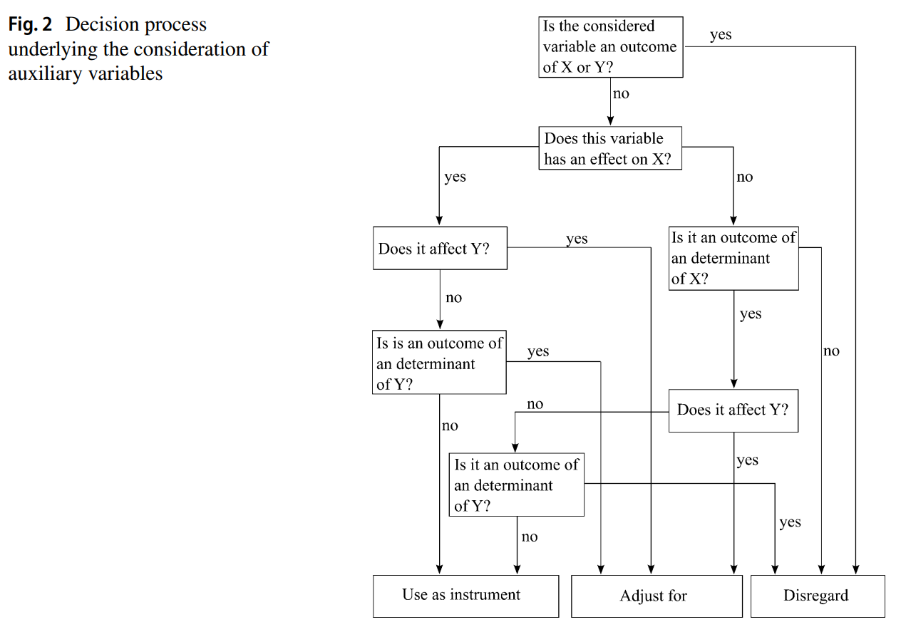

# Controls {#sec-controls}

::: {.chapter-abstract}
**Abstract.** Adding a covariate to a regression is not a neutral act. This chapter classifies control variables by the causal role they play and uses simulation to show what each choice does to bias and to precision. Bad controls come first, covering M-bias, bias amplification, overcontrol bias from conditioning on a mediator or a proxy for one, selection and collider bias, and case-control bias. Good controls follow, covering omitted variable correction with an observed confounder, with a latent common cause, and in the mediation setting where mediator and treatment share a confounder. Between these sit the neutral controls, which leave the causal estimate unbiased but move its standard error, and the chapter separates good predictive controls from bad ones by whether they absorb residual variance or variance in the treatment itself. A closing pipeline sets out how to choose a control set in practice, drawing on a causal diagram, algorithmic adjustment set tools, theoretical restrictions, sensitivity analysis, and the cases where the right decision is not to control at all.

**Keywords:** Control variables, Bad controls, Overcontrol bias, Bias amplification, Adjustment sets, Confounding
:::

The previous chapter established which variables a study must adjust for and
which it must leave alone. This one asks what each choice actually does. The
method throughout is simulation: build data in which the truth is known,
estimate the effect with and without the control in question, and read the
consequence off the comparison. That turns the graphical rules into quantities,
and exposes the cases where the rules and the intuition disagree.

The framework in this chapter follows the "good and bad controls" treatment of @cinelli2022crash and the canonical "bad control" discussion in [@angrist2009mostly, ch. 3].

```{r controls-setup, message=FALSE, warning=FALSE}
library(dagitty)
library(ggdag)

# Draw a DAG with the node names written as the text writes them: the
# simulation variable x is drawn as X, and u1 as U with a subscript 1.
# The edges stop just outside the node so every arrowhead stays visible.
dag_plot <- function(m, node_size = 16, text_size = 4, title = NULL) {
  rim <- ggraph::circle(0.385 * node_size + 1.5, "mm")
  tidy_dagitty(m) |>
    dplyr::mutate(label = paste0(
      "bold(", toupper(sub("([0-9]+)$", "[\\1]", name)), ")"
    )) |>
    ggplot(aes(x = x, y = y, xend = xend, yend = yend)) +
    geom_dag_edges(start_cap = rim, end_cap = rim) +
    geom_dag_point(size = node_size) +
    geom_dag_text(aes(label = label), parse = TRUE, size = text_size) +
    theme_dag() +
    expand_plot(expand_x = expansion(c(0.12, 0.12)),
                expand_y = expansion(c(0.12, 0.12))) +
    ggtitle(title)
}
```

Adding more control variables in regression models is often considered harmless or even beneficial. The idea is simple: controlling for potential confounders (variables that influence both the treatment and the outcome) should help isolate the causal effect of the variable of interest. This intuition can be misleading, however, especially when it comes to overcontrolling, an issue that is easy to overlook in applied work.

A common default in applied practice is to add control variables in order to "control" for potential confounding. Without a solid theoretical justification, this practice can lead to erroneous conclusions: irrelevant or inappropriate controls can obscure the true causal relationship between the treatment (e.g., a marketing campaign) and the outcome (e.g., sales) rather than clarify it. The symmetric problem also matters: variables that distort the analysis are sometimes left in the model when they should be removed. This is a subtle issue that connects to the concept of [Coefficient Stability](#sec-coefficient-stability) (Section \@ref(sec-coefficient-stability)).

Overcontrolling occurs when we include control variables that do not truly affect the causal relationship between the exposure (e.g., treatment) and the outcome. This practice can introduce **bias** into the estimated causal effect. The central issue is **overcontrol bias**: when a control variable is a **collider** (as described in [Directed Acyclic Graphs](#sec-directed-acyclic-graphs) (Section \@ref(sec-directed-acyclic-graphs))), conditioning on it can induce a spurious correlation between the exposure and the outcome.

Multicollinearity, by contrast, is a separate concern about *precision*, not *bias*: including highly correlated regressors inflates standard errors but leaves OLS estimates unbiased, and it is treated under the regression diagnostics in [Linear Regression] rather than under the bad-controls framework here.

## Bad Controls

The label *bad control* covers a surprisingly varied family of pre-treatment or post-treatment variables that look like sensible adjustments but actively distort the estimate. The clearest cases, collider conditioning (M-bias and selection bias) and overcontrol (conditioning on a mediator), share a common diagnosis: they open or block paths in the DAG that the analyst did not mean to touch. We work through them in order of how often they appear in published work, starting with M-bias, which is also the trap most often baked into a textbook recommendation to "control for everything pre-treatment."

### M-bias

A common intuition in causal inference is to control for any variable that precedes the treatment. This logic underpins much of the guidance in traditional econometric texts [@imbens2015causal; @angrist2009mostly], where pre-treatment variables like $Z$ are often recommended as controls if they correlate with both the treatment $X$ and the outcome $Y$.

This perspective is especially prevalent in [Matching Methods], where all observed pre-treatment covariates are typically included in the matching process. However, controlling for *every* pre-treatment variable can lead to *bad control bias*.

One such example is **M-bias**, which arises when conditioning on a *collider*, a variable that is influenced by two unobserved causes. Figure \@ref(fig:controls-mbias-basic) illustrates a case where $Z$ appears to be a good control but actually opens a biasing path:

```{r controls-mbias-basic, fig.cap="DAG illustrating M-bias: $Z$ is a collider on the path $X \\leftarrow U_1 \\to Z \\leftarrow U_2 \\to Y$, so conditioning on the pre-treatment $Z$ opens a non-causal path between $X$ and $Y$.", fig.alt="Directed acyclic graph with five nodes. U1 points to X and to Z, U2 points to Z and to Y, and X points to Y. Z has two incoming arrows and none outgoing."}
# DAG specification
model <- dagitty("dag{
  x -> y
  u1 -> x
  u1 -> z
  u2 -> z
  u2 -> y
}")

# Set latent variables
latents(model) <- c("u1", "u2")

# Coordinates for plotting
coordinates(model) <- list(
  x = c(x = 1, u1 = 1, z = 2, u2 = 3, y = 3),
  y = c(x = 1, u1 = 2, z = 1.5, u2 = 2, y = 1)
)

# Plot the DAG
dag_plot(model)
```

In this structure, $Z$ is a **collider** on the path $X \leftarrow U_1 \rightarrow Z \leftarrow U_2 \rightarrow Y$. Controlling for $Z$ opens this path, introducing a spurious association between $X$ and $Y$ even if none existed originally.

Even though $Z$ is statistically correlated with both $X$ and $Y$, it is **not a confounder**, because it does not lie on a *back-door path* that needs to be blocked. Instead, adjusting for $Z$ biases the estimate of the causal effect of $X \to Y$.

Let's illustrate this with a simulation:

Table \@ref(tab:ctl-mbias-sim) puts the two specifications side by side.

```{r ctl-mbias-sim, cache = FALSE}
set.seed(123)

n <- 1e4
u1 <- rnorm(n)
u2 <- rnorm(n)
z <- u1 + u2 + rnorm(n)
x <- u1 + rnorm(n)
causal_coef <- 2
y <- causal_coef * x - 4 * u2 + rnorm(n)

# Compare unadjusted and adjusted models
tbl <- jtools::export_summs(
  lm(y ~ x),
  lm(y ~ x + z),
  model.names = c("Unadjusted", "Adjusted")
)

cap_tbl(tbl, "M-bias. Adjusting for the pre-treatment collider Z moves the estimate away from the true effect of 2, even though Z is not a confounder.", "ctl-mbias-sim")
```

Notice how adjusting for $Z$ changes the estimate of the effect of $X$ on $Y$, even though $Z$ is not a true confounder. This is a textbook example of M-bias in practice.

#### Worse: M-bias with Direct Effect from Z to Y

A more difficult case arises when $Z$ also has a direct effect on $Y$. Consider the DAG in Figure \@ref(fig:controls-mbias-z-to-y):

```{r controls-mbias-z-to-y, fig.cap="DAG illustrating the harder M-bias variant in which $Z$ is both a collider and has a direct effect on $Y$, so neither adjusting nor not adjusting for $Z$ removes all bias.", fig.alt="Directed acyclic graph with five nodes. U1 points to X and to Z, U2 points to Z and to Y, X points to Y, and Z also points to Y."}
# DAG specification
model <- dagitty("dag{
  x -> y
  u1 -> x
  u1 -> z
  u2 -> z
  u2 -> y
  z -> y
}")

# Set latent variables
latents(model) <- c("u1", "u2")

# Coordinates for plotting
coordinates(model) <- list(
  x = c(x = 1, u1 = 1, z = 2, u2 = 3, y = 3),
  y = c(x = 1, u1 = 2, z = 1.5, u2 = 2, y = 1)
)

# Plot the DAG
dag_plot(model)
```

This situation presents a dilemma:

-   **Not controlling for** $Z$ leaves the back-door path $X \leftarrow U_1 \to Z \to Y$ open, introducing confounding bias.

-   **Controlling for** $Z$ opens the collider path $X \leftarrow U_1 \to Z \leftarrow U_2 \to Y$, which also biases the estimate.

In short, **no adjustment strategy** can fully remove bias from the estimate of $X \to Y$ using observed data alone.

**What Can Be Done?**

When facing such situations, we often turn to **sensitivity analysis** to assess how robust our causal conclusions are to unmeasured confounding. Specifically, recent advances [@cinelli2019sensitivity; @cinelli2020making] allow us to quantify:

1.  **Plausible bounds** on the strength of the direct effect $Z \to Y$

2.  **Sensitivity parameters** reflecting the possible influence of the latent variables $U_1$ and $U_2$

These tools help us understand how large the unmeasured biases would have to be in order to overturn our conclusions, a pragmatic approach when perfect control is impossible.

### Bias Amplification

Bias amplification occurs when controlling for a variable that is not a confounder. In fact, controlling for it increases bias due to an unobserved confounder.

In the DAG in Figure \@ref(fig:controls-bias-amplification), $U$ is an unobserved common cause of both $X$ and $Y$. $Z$ influences $X$ but has no causal relationship with $Y$. Including $Z$ in the model does not block any back-door path but instead increases the bias from $U$ by amplifying its association with $X$.

```{r controls-bias-amplification, fig.cap="DAG illustrating bias amplification: $Z$ predicts $X$ but is not a confounder, and adjusting for $Z$ amplifies the omitted-variable bias from the unobserved common cause $U$.", fig.alt="Directed acyclic graph with four nodes. Z points to X, X points to Y, and U points to both X and Y. There is no arrow between Z and Y."}
# DAG specification
model <- dagitty("dag{
  x -> y
  u -> x
  u -> y
  z -> x
}")

# Set latent variable
latents(model) <- c("u")

# Coordinates for plotting
coordinates(model) <- list(
  x = c(z = 1, x = 2, u = 3, y = 4),
  y = c(z = 1, x = 1, u = 2, y = 1)
)

# Plot the DAG
dag_plot(model)
```

Even though $Z$ is a strong predictor of $X$, it is **not a confounder**, because it is not a common cause of $X$ and $Y$. Controlling for $Z$ increases the portion of $X$'s variation explained by $U$, thus amplifying bias in estimating the effect of $X$ on $Y$.

Simulation:

Table \@ref(tab:ctl-bias-amplification-sim) shows what the adjustment does to the estimate.

```{r ctl-bias-amplification-sim, cache = FALSE}
set.seed(123)
n <- 1e4
z <- rnorm(n)
u <- rnorm(n)
x <- 2*z + u + rnorm(n)
y <- x + 2*u + rnorm(n)

tbl <- jtools::export_summs(
  lm(y ~ x),
  lm(y ~ x + z),
  model.names = c("Unadjusted", "Adjusted")
)

cap_tbl(tbl, "Bias amplification. Adjusting for a variable that predicts the treatment but not the outcome makes an existing unobserved-confounding bias worse rather than better.", "ctl-bias-amplification-sim")
```

Observe that the adjusted model is **more biased** than the unadjusted one. This illustrates how controlling for a variable like $Z$ can *amplify* omitted variable bias.

### Overcontrol Bias {#sec-overcontrol-bias}

Overcontrol bias arises when we adjust for variables that lie on the causal path from treatment to outcome, or that serve as proxies for the outcome.

#### Mediator Control

Controlling for a **mediator**, a variable that lies on the causal path between treatment and outcome, removes the part of the effect we are trying to estimate that travels through it. In Figure \@ref(fig:controls-mediator) every causal path from $X$ to $Y$ runs through the mediator, so controlling for it removes the whole effect.

```{r controls-mediator, fig.cap="DAG illustrating mediator overcontrol: $Z$ lies on the causal path $X \\to Z \\to Y$, so conditioning on $Z$ blocks the entire effect of $X$ on $Y$, since every causal path runs through $Z$.", fig.alt="Directed acyclic graph with three nodes in a row. X points to Z and Z points to Y. There is no direct arrow from X to Y."}
# DAG: X → Z → Y
model <- dagitty("dag{
  x -> z
  z -> y
}")

coordinates(model) <- list(
  x = c(x = 1, z = 2, y = 3),
  y = c(x = 1, z = 1, y = 1)
)

dag_plot(model)
```

If we want to estimate the **total effect** of $X$ on $Y$, controlling for $Z$ (a mediator) leads to [overcontrol bias](#sec-overcontrol-bias) (Section \@ref(sec-overcontrol-bias)).

Table \@ref(tab:ctl-mediator-sim) compares the total effect with the estimate obtained after conditioning on the mediator.

```{r ctl-mediator-sim, cache = FALSE}
set.seed(123)
n <- 1e4
x <- rnorm(n)
z <- x + rnorm(n)
y <- z + rnorm(n)

tbl <- jtools::export_summs(
  lm(y ~ x),
  lm(y ~ x + z),
  model.names = c("Total Effect", "Controlled for Mediator")
)

cap_tbl(tbl, "Overcontrol from conditioning on a mediator. The unadjusted column is the total effect of about 1. Adjusting for the mediator Z drives the estimate to about zero, because the whole effect travels through Z.", "ctl-mediator-sim")
```

Here, $Z$ will appear significant, but including it blocks the causal path from $X$ to $Y$. This is misleading when the goal is to estimate the **total effect** of $X$.

#### Proxy for Mediator

In more complex scenarios, controlling for variables that **proxy** for mediators can introduce similar distortions, as in Figure \@ref(fig:controls-mediator-proxy).

```{r controls-mediator-proxy, fig.cap="DAG illustrating proxy-for-mediator overcontrol: $Z$ is a descendant of the mediator $M$, so adjusting for $Z$ partially blocks the indirect effect through $M$.", fig.alt="Directed acyclic graph with four nodes. X points to M, and M points to both Y and Z. Z has no outgoing arrow, and there is no direct arrow from X to Y."}
# DAG: X → M → Z, M → Y
model <- dagitty("dag{
  x -> m
  m -> z
  m -> y
}")

coordinates(model) <- list(
  x = c(x = 1, m = 2, z = 2, y = 3),
  y = c(x = 2, m = 2, z = 1, y = 2)
)

dag_plot(model)
```

Table \@ref(tab:ctl-mediator-proxy-sim) repeats the exercise with a proxy for the mediator in place of the mediator itself.

```{r ctl-mediator-proxy-sim, cache = FALSE}
set.seed(123)
n <- 1e4
x <- rnorm(n)
m <- x + rnorm(n)
z <- m + rnorm(n)
y <- m + rnorm(n)

tbl <- jtools::export_summs(lm(y ~ x),
                     lm(y ~ x + z),
                     model.names = c("Total Effect", "Controlled for Proxy Z"))

cap_tbl(tbl, "Overcontrol from a proxy for a mediator. Conditioning on a noisy stand-in for M removes part of the causal effect just as conditioning on M itself would.", "ctl-mediator-proxy-sim")
```

Even though $Z$ is not on the path from $X$ to $Y$, controlling for it removes part of the causal variation coming through $M$.

#### Overcontrol with Unobserved Confounding

When $Z$ is influenced by both $X$ and a latent confounder $U$ that also affects $Y$, controlling for $Z$ again biases the estimate, as shown in Figure \@ref(fig:controls-overcontrol-latent).

```{r controls-overcontrol-latent, fig.cap="DAG illustrating overcontrol with unobserved confounding: $Z$ is a mediator that is also affected by a latent $U$ which causes $Y$, so adjusting for $Z$ blocks the causal channel and opens a collider path through $U$.", fig.alt="Directed acyclic graph with four nodes. X points to Z, Z points to Y, and U points to both Z and Y. There is no direct arrow from X to Y."}
# DAG: X → Z → Y, with U → Z and U → Y
model <- dagitty("dag{
  x -> z
  z -> y
  u -> z
  u -> y
}")

latents(model) <- "u"

coordinates(model) <- list(
  x = c(x = 1, z = 2, u = 3, y = 4),
  y = c(x = 1, z = 1, u = 2, y = 1)
)

dag_plot(model)
```

Table \@ref(tab:ctl-overcontrol-latent-sim) reports both specifications.

```{r ctl-overcontrol-latent-sim, cache = FALSE}
set.seed(1)
n <- 1e4
x <- rnorm(n)
u <- rnorm(n)
z <- x + u + rnorm(n)
y <- z + u + rnorm(n)

tbl <- jtools::export_summs(
  lm(y ~ x),
  lm(y ~ x + z),
  model.names = c("Unadjusted", "Controlled for Z")
)

cap_tbl(tbl, "Overcontrol in the presence of unobserved confounding, where adjusting for Z neither recovers the effect nor leaves it alone.", "ctl-overcontrol-latent-sim")
```

Although the **total effect** of $X$ on $Y$ is correctly captured in the unadjusted model, adjusting for $Z$ introduces bias via the collider path $X \to Z \leftarrow U \to Y$.

> **Insight:** Controlling for $Z$ inadvertently **blocks** the causal path $X \to Z \to Y$, which here carries the whole effect of $X$, and **opens** a biasing path through $U$. This makes the adjusted model unreliable for causal inference.

These examples highlight the importance of **conceptual clarity** and **causal reasoning** in model specification. Not all covariates should be controlled for, especially not those that are:

-   Mediators (on the causal path)

-   Proxies for mediators or outcomes

-   Colliders or descendants of colliders

In business contexts, this often arises when analysts include *intermediate* variables like sales leads, customer engagement scores, or operational metrics without understanding whether these mediate the effect of a treatment (e.g., ad spend) or confound it.

### Selection Bias

Selection bias, also known as **collider stratification bias**, occurs when conditioning on a variable that is a *collider* (a common effect of two or more variables). This inadvertently opens non-causal paths, inducing spurious associations between variables that are otherwise independent or unconfounded.

Selection bias matters because it is rarely framed as a "control" decision in the first place. It often enters silently through sample restrictions, survey eligibility filters, or the way an outcome was operationalized, which means an analyst who never adds a single covariate to the regression can still be conditioning on a collider through the data they chose to observe. Recognizing the situation in practice usually starts with two questions: was a unit's *presence* in the sample affected by the treatment or outcome, and does the dataset contain a variable that is a downstream consequence of both? When the answer is yes, the standard back-door adjustment intuition (see the [Conditional Ignorability Assumption](#sec-conditional-ignorability-assumption)) breaks down even though every "confounder" appears to be controlled. Several of the cleanest fixes for this problem live outside the regression toolkit and instead exploit design-based identification, including [Instrumental Variables](#sec-instrumental-variables) and [Quasi-Experimental](#sec-quasi-experimental) approaches.

#### Classic Collider Bias

In the DAG in Figure \@ref(fig:controls-collider-classic), $Z$ is a collider between $X$ and a latent variable $U$. Controlling for $Z$ opens a non-causal path from $X$ to $Y$ through $U$, introducing bias.

```{r controls-collider-classic, fig.cap="DAG illustrating classic collider bias: $Z$ is a common effect of $X$ and the latent $U$, and conditioning on $Z$ opens the non-causal path $X \\to Z \\leftarrow U \\to Y$.", fig.alt="Directed acyclic graph with four nodes. X points to Y and to Z, and U points to Z and to Y. The U to Z arrow crosses the X to Y arrow."}
# DAG
model <- dagitty("dag{
  x -> y
  x -> z
  u -> z
  u -> y
}")
latents(model) <- "u"
coordinates(model) <- list(
  x = c(x = 1, z = 2, u = 2, y = 3),
  y = c(x = 3, z = 2, u = 4, y = 3)
)
dag_plot(model)
```

Simulation:

Table \@ref(tab:ctl-collider-sim) shows the association that conditioning on the collider creates.

```{r ctl-collider-sim, cache = FALSE}
set.seed(123)
n <- 1e4
x <- rnorm(n)
u <- rnorm(n)
z <- x + u + rnorm(n)
y <- x + 2*u + rnorm(n)

tbl <- jtools::export_summs(
  lm(y ~ x),
  lm(y ~ x + z),
  model.names = c("Unadjusted", "Adjusted for Z (collider)")
)

cap_tbl(tbl, "Classic collider bias. Conditioning on Z, a common effect of X and the unobserved U that also causes Y, opens a non-causal path and pulls the estimate from the true effect of 1 to about zero.", "ctl-collider-sim")
```

Controlling for $Z$ opens the non-causal path $X \to Z \leftarrow U \to Y$, resulting in **biased estimates** of the effect of $X$ on $Y$.

#### Collider Between Treatment and Outcome

In some cases, the collider is influenced directly by both the treatment and the outcome, as illustrated in Figure \@ref(fig:controls-collider-x-y). This setting is also highly relevant in observational designs, particularly in retrospective or convenience sampling scenarios.

```{r controls-collider-x-y, fig.cap="DAG illustrating a collider directly between treatment and outcome: $Z$ is jointly caused by $X$ and $Y$, so conditioning on $Z$ induces spurious dependence between $X$ and $Y$.", fig.alt="Directed acyclic graph with three nodes. X points to Y, and X and Y both point to Z."}
# DAG: X → Z ← Y
model <- dagitty("dag{
  x -> y
  x -> z
  y -> z
}")
coordinates(model) <- list(
  x = c(x = 1, z = 2, y = 3),
  y = c(x = 2, z = 1, y = 2)
)
dag_plot(model)
```

Simulation:

Table \@ref(tab:ctl-collider-between-sim) reports the two estimates.

```{r ctl-collider-between-sim, cache = FALSE}
set.seed(123)
n <- 1e4
x <- rnorm(n)
y <- x + rnorm(n)
z <- x + y + rnorm(n)

tbl <- jtools::export_summs(
  lm(y ~ x),
  lm(y ~ x + z),
  model.names = c("Unadjusted", "Adjusted for Collider Z")
)

cap_tbl(tbl, "A collider lying on the path between treatment and outcome, where conditioning opens rather than closes the path.", "ctl-collider-between-sim")
```

Even though $Z$ is associated with both $X$ and $Y$, it **should not be controlled for**, because doing so opens the collider path $X \to Z \leftarrow Y$, generating spurious dependence.

### Case-Control Bias

Case-control studies often condition on the outcome itself or on a *descendant* of the outcome, which can bias the estimated effect of the treatment on the outcome through several distinct mechanisms.

In the DAG in Figure \@ref(fig:controls-case-control), $Z$ is a **descendant of the outcome** $Y$ (not a descendant of a collider). Controlling for $Z$ blocks part of the variation in $Y$ that the treatment $X$ induces and can attenuate or bias the estimated $X \to Y$ effect.

```{r controls-case-control, fig.cap="DAG illustrating case-control bias: $Z$ is a descendant of the outcome $Y$ on the path $X \\to Y \\to Z$, so conditioning on $Z$ removes part of the treatment-induced variation in $Y$.", fig.alt="Directed acyclic graph with three nodes. X points to Y, and Y points to Z. There is no arrow between X and Z."}
# DAG: X -> Y -> Z (Z is a descendant of the outcome Y)
model <- dagitty("dag{
  x -> y
  y -> z
}")
coordinates(model) <- list(
  x = c(x = 1, z = 2, y = 3),
  y = c(x = 2, z = 1, y = 2)
)
dag_plot(model)
```

Simulation:

Table \@ref(tab:ctl-case-control-sim) shows the effect of adjusting for a descendant of the outcome.

```{r ctl-case-control-sim, cache = FALSE}
set.seed(123)
n <- 1e4
x <- rnorm(n)
y <- x + rnorm(n)
z <- y + rnorm(n)

tbl <- jtools::export_summs(
  lm(y ~ x),
  lm(y ~ x + z),
  model.names = c("Unadjusted", "Adjusted for Descendant Z")
)

cap_tbl(tbl, "Case-control bias from adjusting for a descendant of the outcome.", "ctl-case-control-sim")
```

Note the subtlety: if $X$ has a **true causal effect** on $Y$, then controlling for $Z$ (a descendant of $Y$) biases the estimate, because $Z$ inherits the treatment-induced variation in $Y$ and adjusting for it removes part of the channel $X \to Y$ we are trying to measure. However, if $X$ has **no causal effect** on $Y$, then $X$ remains *d-separated* from $Y$ even when adjusting for $Z$. In that special case, controlling for $Z$ will not falsely suggest an effect.

> **Key Insight:** Whether or not adjustment induces bias depends on the presence or absence of a true causal path. This highlights the importance of DAGs in clarifying assumptions and guiding valid statistical inference.

### Summary

Table \@ref(tab:ctl-bad-controls-summary) collects the five patterns covered in this section.

| Bias Type          | Key Mistake                                    | Path Opened                                   | Consequence                    |
|------------------|-------------------|------------------|------------------|
| M-Bias             | Controlling for a collider                     | $X \leftarrow U_1 \to Z \leftarrow U_2 \to Y$ | Spurious association           |
| Bias Amplification | Controlling for a non-confounder               | Amplifies unobserved confounding              | Larger bias than before        |
| Overcontrol Bias   | Controlling for a mediator or proxy            | Blocks part or all of the causal effect       | Underestimates total effect    |
| Selection Bias     | Conditioning on a collider or its descendant   | $X \to Z \leftarrow Y$ or similar             | Induced non-causal correlation |
| Case-Control Bias  | Conditioning on a descendant of the outcome    | $X \to Y \to Z$                               | Attenuated $X \to Y$ effect    |

Table: (\#tab:ctl-bad-controls-summary) The five bad-control patterns, the mistake that produces each, the path it opens, and its consequence for the estimate.

## Good Controls

### Omitted Variable Bias Correction

A variable $Z$ is a **good control** when it blocks all *back-door paths* from the treatment $X$ to the outcome $Y$. This is the fundamental criterion from the back-door adjustment theorem in causal inference.

#### Simple Confounder

In the DAG in Figure \@ref(fig:controls-confounder-simple), $Z$ is a common cause of both $X$ and $Y$, i.e., a **confounder**.

```{r controls-confounder-simple, fig.cap="DAG illustrating a simple observed confounder: $Z$ is a common cause of $X$ and $Y$, so adjusting for $Z$ blocks the back-door path $X \\leftarrow Z \\to Y$.", fig.alt="Directed acyclic graph with three nodes. Z points to X and to Y, and X points to Y."}
model <- dagitty("dag{
  x -> y
  z -> x
  z -> y
}")
coordinates(model) <- list(
  x = c(x = 1, z = 2, y = 3),
  y = c(x = 1, z = 2, y = 1)
)
dag_plot(model)
```

Controlling for $Z$ removes the bias from the back-door path $X \leftarrow Z \rightarrow Y$.

Table \@ref(tab:ctl-confounder-sim) reports the corrected and uncorrected estimates.

```{r ctl-confounder-sim, cache = FALSE}
n <- 1e4
z <- rnorm(n)
causal_coef <- 2
beta2 <- 3
x <- z + rnorm(n)
y <- causal_coef * x + beta2 * z + rnorm(n)

tbl <- jtools::export_summs(lm(y ~ x), lm(y ~ x + z))

cap_tbl(tbl, "Correcting omitted variable bias by adjusting for an observed confounder, the case where a control does what it is supposed to.", "ctl-confounder-sim")
```

#### Confounding via a Latent Variable

In the structure in Figure \@ref(fig:controls-confounder-latent), $U$ is unobserved but causes both $Z$ and $Y$, and $Z$ affects $X$. Even though $U$ is not observed, adjusting for $Z$ blocks the back-door path from $X$ to $Y$ that goes through $U$, because $U$ reaches $X$ only through $Z$.

```{r controls-confounder-latent, fig.cap="DAG illustrating an observed intermediary between a latent confounder and the treatment: $U$ is unobserved and causes $Z$ and $Y$, while $Z$ causes $X$, so adjusting for $Z$ blocks the back-door path $X \\leftarrow Z \\leftarrow U \\to Y$.", fig.alt="Directed acyclic graph with four nodes. U points to Z and to Y, Z points to X, and X points to Y. There is no arrow from U to X."}
model <- dagitty("dag{
  x -> y
  u -> z
  z -> x
  u -> y
}")
latents(model) <- "u"
coordinates(model) <- list(
  x = c(x = 1, z = 2, u = 3, y = 4),
  y = c(x = 1, z = 2, u = 3, y = 1)
)
dag_plot(model)
```

Table \@ref(tab:ctl-latent-confounder-sim) shows that adjusting for the observed $Z$ is enough to recover the effect.

```{r ctl-latent-confounder-sim, cache = FALSE}
n <- 1e4
u <- rnorm(n)
z <- u + rnorm(n)
x <- z + rnorm(n)
y <- 2 * x + u + rnorm(n)

tbl <- jtools::export_summs(lm(y ~ x), lm(y ~ x + z))

cap_tbl(tbl, "Confounding through a latent variable. U reaches X only through the observed Z, so adjusting for Z closes the back-door path and recovers the true effect of 2.", "ctl-latent-confounder-sim")
```

Even though $Z$ appears significant, **its inclusion serves to reduce omitted variable bias** rather than having a causal interpretation itself.

#### $Z$ is caused by $U$, but also causes $Y$

Figure \@ref(fig:controls-confounder-shared-u) illustrates a subtle case where $Z$ is on a non-causal path from $X$ to $Y$ and helps block bias through a shared cause $U$.

```{r controls-confounder-shared-u, fig.cap="DAG illustrating a good control on a shared-cause path: $U$ causes both $Z$ and $X$, $Z$ causes $Y$, and adjusting for $Z$ blocks the back-door path $X \\leftarrow U \\to Z \\to Y$.", fig.alt="Directed acyclic graph with four nodes, U, Z, X, and Y. Arrows run from U to X, from U to Z, from Z to Y, and from X to Y."}
model <- dagitty("dag{
  x -> y
  u -> z
  u -> x
  z -> y
}")
latents(model) <- "u"
coordinates(model) <- list(
  x = c(x = 1, z = 3, u = 2, y = 4),
  y = c(x = 1, z = 2, u = 3, y = 1)
)
dag_plot(model)
```

Table \@ref(tab:ctl-z-caused-by-u-sim) reports the comparison.

```{r ctl-z-caused-by-u-sim, cache = FALSE}
n <- 1e4
u <- rnorm(n)
z <- u + rnorm(n)
x <- u + rnorm(n)
y <- 2 * x + z + rnorm(n)

tbl <- jtools::export_summs(lm(y ~ x), lm(y ~ x + z))

cap_tbl(tbl, "Z is caused by U and also causes Y, so adjusting for Z blocks the only back-door path, the one through U, and recovers the true effect of 2.", "ctl-z-caused-by-u-sim")
```

Again, **we cannot interpret the coefficient on** $Z$ **causally**, but including $Z$ helps reduce omitted variable bias from the unobserved confounder $U$.

#### Summary of Omitted Variable Correction

The three configurations above are summarized side-by-side in Figure \@ref(fig:controls-good-summary).

```{r controls-good-summary, fig.cap="Summary panel of the three good-control DAGs for omitted-variable bias correction: (a) a simple confounder, (b) a latent confounder acting through an observed $Z$, and (c) a shared cause $U$ in which $Z$ lies on the back-door path.", fig.alt="Three directed acyclic graphs side by side, titled (a) to (c), each with an arrow from X to Y along the bottom. In (a), Z points to X and to Y. In (b), U points to Z and to Y, and Z points to X. In (c), U points to X and to Z, and Z points to Y."}
# Model 1: Z is a confounder
model1 <- dagitty("dag{
  x -> y
  z -> x
  z -> y
}")
coordinates(model1) <-
    list(x = c(x = 1, z = 2, y = 3), y = c(x = 1, z = 2, y = 1))

# Model 2: Z is on path from U to X
model2 <- dagitty("dag{
  x -> y
  u -> z
  z -> x
  u -> y
}")
latents(model2) <- "u"
coordinates(model2) <-
    list(x = c(
        x = 1,
        z = 2,
        u = 3,
        y = 4
    ),
    y = c(
        x = 1,
        z = 2,
        u = 3,
        y = 1
    ))

# Model 3: Z influenced by U, affects Y
model3 <- dagitty("dag{
  x -> y
  u -> z
  u -> x
  z -> y
}")
latents(model3) <- "u"
coordinates(model3) <-
    list(x = c(
        x = 1,
        z = 3,
        u = 2,
        y = 4
    ),
    y = c(
        x = 1,
        z = 2,
        u = 3,
        y = 1
    ))

# Smaller nodes and a panel title for each DAG in a side-by-side summary.
dag_panel <- function(m, title) {
    dag_plot(m, node_size = 12, text_size = 3.2, title = title) +
        theme(plot.title = element_text(size = 11))
}

gridExtra::grid.arrange(
    dag_panel(model1, "(a) Confounder"),
    dag_panel(model2, "(b) Latent U via Z"),
    dag_panel(model3, "(c) Shared cause U"),
    nrow = 1
)

```

### Omitted Variable Bias in Mediation Correction

When a variable $Z$ is a confounder of both the treatment $X$ and a mediator $M$, controlling for $Z$ helps isolate the **indirect and direct effects** more accurately.

#### Observed Confounder of Mediator and Treatment

Figure \@ref(fig:controls-mediation-observed) shows the case in which $Z$ is an observed common cause of both the treatment and the mediator.

```{r controls-mediation-observed, fig.cap="DAG illustrating mediation correction with an observed confounder: $Z$ causes both the treatment $X$ and the mediator $M$, so adjusting for $Z$ separates the indirect path $X \\to M \\to Y$ from the back-door path through $Z$.", fig.alt="Directed acyclic graph with nodes Z, X, M, and Y. Z points to X and to M. X points to M and directly to Y, and M points to Y."}
model <- dagitty("dag{
  x -> y
  z -> x
  x -> m
  z -> m
  m -> y
}")
coordinates(model) <-
    list(x = c(
        x = 1,
        z = 2,
        m = 3,
        y = 4
    ),
    y = c(
        x = 1,
        z = 2,
        m = 1.5,
        y = 1
    ))
dag_plot(model)

```

Table \@ref(tab:ctl-mediator-confounder-sim) reports the estimates for this structure.

```{r ctl-mediator-confounder-sim, cache = FALSE}
n <- 1e4
z <- rnorm(n)
x <- z + rnorm(n)
m <- 2 * x + z + rnorm(n)
y <- m + rnorm(n)

tbl <- jtools::export_summs(lm(y ~ x), lm(y ~ x + z))

cap_tbl(tbl, "An observed confounder of the mediator and the treatment. Z opens a back-door path through the mediator, so adjusting for Z recovers the total effect of 2.", "ctl-mediator-confounder-sim")
```

#### Latent Common Cause of Mediator and Treatment

Figure \@ref(fig:controls-mediation-latent) extends the previous case to a latent confounder $U$ that drives both the mediator and (indirectly) the treatment.

```{r controls-mediation-latent, fig.cap="DAG illustrating mediation correction with a latent common cause: $U$ is unobserved and causes both $Z$ (which causes $X$) and the mediator $M$, so adjusting for $Z$ helps block the back-door path through $U$.", fig.alt="Directed acyclic graph with nodes U, Z, X, M, and Y. U points to Z and to M, and Z points to X. X points to M and directly to Y, and M points to Y."}
model <- dagitty("dag{
  x -> y
  u -> z
  z -> x
  x -> m
  u -> m
  m -> y
}")
latents(model) <- "u"
coordinates(model) <-
    list(x = c(
        x = 1,
        z = 2,
        u = 3,
        m = 4,
        y = 5
    ),
    y = c(
        x = 1,
        z = 2,
        u = 3,
        m = 1.5,
        y = 1
    ))
dag_plot(model)

```

Table \@ref(tab:ctl-mediator-latent-sim) shows what happens when the common cause is unobserved.

```{r ctl-mediator-latent-sim, cache = FALSE}
n <- 1e4
u <- rnorm(n)
z <- u + rnorm(n)
x <- z + rnorm(n)
m <- 2 * x + u + rnorm(n)
y <- m + rnorm(n)

tbl <- jtools::export_summs(lm(y ~ x), lm(y ~ x + z))

cap_tbl(tbl, "A latent common cause of the mediator and the treatment. U reaches X only through the observed Z, so adjusting for Z recovers the total effect of 2.", "ctl-mediator-latent-sim")
```

#### Z Affects Mediator, U Affects Both X and Z

Figure \@ref(fig:controls-mediation-z-on-m) presents the variant in which $Z$ acts on the mediator and a latent $U$ jointly drives the treatment and $Z$.

```{r controls-mediation-z-on-m, fig.cap="DAG illustrating mediation correction with $Z$ as a parent of the mediator and a latent $U$ that causes both $X$ and $Z$, so adjusting for $Z$ blocks the back-door path through $U$.", fig.alt="Directed acyclic graph with nodes U, Z, X, M, and Y. U points to X and to Z, and Z points to M. X points to M and directly to Y, and M points to Y."}
model <- dagitty("dag{
  x -> y
  u -> z
  z -> m
  x -> m
  u -> x
  m -> y
}")
latents(model) <- "u"
coordinates(model) <-
    list(x = c(
        x = 1,
        z = 3,
        u = 1.8,
        m = 4,
        y = 5
    ),
    y = c(
        x = 1,
        z = 2.4,
        u = 3,
        m = 1.7,
        y = 1
    ))
dag_plot(model)

```

Table \@ref(tab:ctl-z-mediator-u-sim) reports the estimates.

```{r ctl-z-mediator-u-sim, cache = FALSE}
n <- 1e4
u <- rnorm(n)
z <- u + rnorm(n)
x <- u + rnorm(n)
m <- 2 * x + z + rnorm(n)
y <- m + rnorm(n)

tbl <- jtools::export_summs(lm(y ~ x), lm(y ~ x + z))

cap_tbl(tbl, "Z affects the mediator while U affects both X and Z.", "ctl-z-mediator-u-sim")
```

#### Summary of Mediation Correction

Figure \@ref(fig:controls-mediation-summary) places the three mediation-correction DAGs side-by-side.

```{r controls-mediation-summary, fig.cap="Summary panel of the three mediation-correction DAGs: (a) an observed confounder of mediator and treatment, (b) a latent common cause acting through an observed $Z$, and (c) the variant where $Z$ acts on the mediator while $U$ jointly causes $X$ and $Z$.", fig.alt="Three directed acyclic graphs side by side, titled (a) to (c). In each, X points to M and directly to Y, and M points to Y. In (a), Z points to X and to M. In (b), U points to Z and to M, and Z points to X. In (c), U points to X and to Z, and Z points to M."}
# Model 4
model4 <- dagitty("dag{
  x -> y
  z -> x
  x -> m
  z -> m
  m -> y
}")
coordinates(model4) <-
    list(x = c(
        x = 1,
        z = 2,
        m = 3,
        y = 4
    ),
    y = c(
        x = 1,
        z = 2,
        m = 1.5,
        y = 1
    ))

# Model 5
model5 <- dagitty("dag{
  x -> y
  u -> z
  z -> x
  x -> m
  u -> m
  m -> y
}")
latents(model5) <- "u"
coordinates(model5) <-
    list(x = c(
        x = 1,
        z = 2,
        u = 3,
        m = 4,
        y = 5
    ),
    y = c(
        x = 1,
        z = 2,
        u = 3,
        m = 1.5,
        y = 1
    ))

# Model 6
model6 <- dagitty("dag{
  x -> y
  u -> z
  z -> m
  x -> m
  u -> x
  m -> y
}")
latents(model6) <- "u"
coordinates(model6) <-
    list(x = c(
        x = 1,
        z = 3,
        u = 1.8,
        m = 4,
        y = 5
    ),
    y = c(
        x = 1,
        z = 2.4,
        u = 3,
        m = 1.7,
        y = 1
    ))

gridExtra::grid.arrange(
    dag_panel(model4, "(a) Observed Z"),
    dag_panel(model5, "(b) Latent U via Z"),
    dag_panel(model6, "(c) Z acts on M"),
    nrow = 1
)

```

While $Z$ may be statistically significant, this **does not imply a causal effect** unless $Z$ is directly on the causal path from $X$ to $Y$. In many valid control scenarios, $Z$ simply serves to isolate the causal effect of $X$, not to be interpreted as a cause itself.

## Neutral Controls

Not all covariates used in regression adjustment are necessary for identification. **Neutral controls** do not help with causal identification but may affect estimation **precision**. Including them:

-   **Does not introduce bias**, because they do not lie on back-door or collider paths.
-   **May reduce standard errors**, by explaining additional variation in the outcome.

### Good Predictive Controls

When a variable is correlated with the outcome $Y$, but not a cause of the treatment $X$, controlling for it is optional for identification but may increase precision.

Good predictive controls matter because they are often the easiest free lunch in an applied analysis: they tighten standard errors without altering the point estimate or threatening identification. Recognizing them in practice means asking whether a candidate covariate has any plausible *causal* link back to the treatment. If the answer is no, and the variable independently moves the outcome, it acts like a baseline covariate in a randomized trial, soaking up residual variance in $Y$ and shrinking the standard error on the treatment coefficient. The same logic underwrites the use of pre-treatment outcome levels in [Difference-in-Differences](#sec-difference-in-differences) and lagged covariates in [Event Studies](#sec-event-studies), where strong predictors of the outcome trajectory are routinely included for precision rather than identification.

#### $Z$ predicts $Y$, not $X$

Figure \@ref(fig:controls-good-predictive-y) shows the case in which $Z$ has a direct effect on $Y$ but no causal link to $X$.

```{r controls-good-predictive-y, fig.cap="DAG illustrating a good predictive control: $Z$ causes $Y$ but is unrelated to $X$, so adjusting for $Z$ leaves the estimate of $X \\to Y$ unbiased while reducing residual variance.", fig.alt="Directed acyclic graph with three nodes, X, Z, and Y. Arrows run from X to Y and from Z to Y. There is no arrow between X and Z."}
model <- dagitty("dag{
  x -> y
  z -> y
}")
coordinates(model) <- list(
  x = c(x = 1, z = 2, y = 2),
  y = c(x = 1, z = 2, y = 1)
)
dag_plot(model)
```

Table \@ref(tab:ctl-predicts-y-sim) shows the effect on the point estimate and on its standard error.

```{r ctl-predicts-y-sim, cache = FALSE}
n <- 1e4
z <- rnorm(n)
x <- rnorm(n)
y <- x + 2 * z + rnorm(n)

tbl <- jtools::export_summs(
  lm(y ~ x),
  lm(y ~ x + z),
  model.names = c("Without Z", "With Predictive Z")
)

cap_tbl(tbl, "A neutral control that predicts the outcome but not the treatment. The point estimate is unchanged and the standard error falls.", "ctl-predicts-y-sim")
```

The coefficient on $X$ remains unbiased in both models, but standard errors are smaller in the model with $Z$.

#### $Z$ predicts a mediator $M$

Figure \@ref(fig:controls-good-predictive-m) shows the variant in which $Z$ predicts the mediator $M$ rather than the outcome directly.

```{r controls-good-predictive-m, fig.cap="DAG illustrating a good predictive control acting on a mediator: $Z$ causes the mediator $M$ but is not on any causal path from $X$ to $Y$, so adjusting for $Z$ reduces residual variance without bias.", fig.alt="Directed acyclic graph with nodes X, Z, M, and Y. X points to M and directly to Y, Z points to M, and M points to Y. There is no arrow between X and Z."}
model <- dagitty("dag{
  x -> y
  x -> m
  z -> m
  m -> y
}")
coordinates(model) <- list(
  x = c(x = 1, z = 2, m = 2, y = 3),
  y = c(x = 1, z = 2.5, m = 1.5, y = 1)
)
dag_plot(model)

```

Table \@ref(tab:ctl-predicts-mediator-sim) reports the same two quantities for a control that predicts a mediator.

```{r ctl-predicts-mediator-sim, cache = FALSE}
n <- 1e4
z <- rnorm(n)
x <- rnorm(n)
m <- 2 * z + rnorm(n)
y <- x + 2 * m + rnorm(n)

tbl <- jtools::export_summs(
  lm(y ~ x),
  lm(y ~ x + z),
  model.names = c("Without Z", "With Predictive Z")
)

cap_tbl(tbl, "A control that predicts a mediator, which absorbs outcome variance without touching identification.", "ctl-predicts-mediator-sim")
```

Even though $Z$ is not on any causal path from $X$ to $Y$, controlling for it may reduce residual variance in $Y$, hence increasing precision.

### Good Selection Bias

In more complex selection structures, adjusting for selection variables can improve identification, but only in the presence of additional post-selection information.

#### $W$ is a collider and $Z$ helps condition on selection

Figure \@ref(fig:controls-good-selection) illustrates how an additional control $Z$ can restore identification when conditioning on a downstream collider $W$.

```{r controls-good-selection, fig.cap="DAG illustrating good selection-bias adjustment: $W$ is a collider with parents $Z$ and $U$, and adjusting for both $W$ and $Z$ blocks the path $X \\to Z \\to W \\leftarrow U \\to Y$ that conditioning on $W$ alone would open.", fig.alt="Directed acyclic graph with nodes X, Z, W, U, and Y. Arrows run from X to Y, from X to Z, from Z to W, from U to W, and from U to Y. The arrow from U down to W crosses the arrow from X to Y."}
model <- dagitty("dag{
  x -> y
  x -> z
  z -> w
  u -> w
  u -> y
}")
latents(model) <- "u"
coordinates(model) <- list(
  x = c(x = 1, z = 2, w = 3, u = 3, y = 5),
  y = c(x = 3, z = 2, w = 1, u = 4, y = 3)
)
dag_plot(model)

```

Table \@ref(tab:ctl-collider-w-plus-z-sim) reports all three specifications.

```{r ctl-collider-w-plus-z-sim, cache = FALSE}
n <- 1e4
x <- rnorm(n)
u <- rnorm(n)
z <- x + rnorm(n)
w <- z + u + rnorm(n)
y <- x - 2 * u + rnorm(n)

tbl <- jtools::export_summs(
  lm(y ~ x),
  lm(y ~ x + w),
  lm(y ~ x + z + w),
  model.names = c("Unadjusted", "Control W", "Control W + Z")
)

cap_tbl(tbl, "W is a collider and Z helps condition on the selection it induces, so the pair of controls together restores identification that either alone destroys.", "ctl-collider-w-plus-z-sim")
```

-   Unadjusted model is unbiased.

-   Controlling only for $W$ is biased due to collider path $X \to Z \to W \leftarrow U \to Y$.

-   Adding $Z$ restores identification by blocking that path.

The three rows together make a point that no single row makes on its own.
Adjustment is not monotone: adding a control moved the estimate away from the
truth, and adding a second control moved it back. An analyst who compared only
the first two specifications would conclude that $W$ is a confounder that must
be included, and an analyst who compared only the last two would conclude that
$W$ is harmless. Both readings are wrong, because the status of $W$ is not a
property of $W$ at all. It depends on what else is in the model. This is the
practical reason the chapter insists on choosing an adjustment set from a graph
rather than assembling one variable at a time: a sequence of individually
reasonable decisions can arrive at a specification that no version of the graph
supports.

### Bad Predictive Controls

Not all predictive variables are useful. Some may reduce precision by soaking up degrees of freedom or increasing multicollinearity.

Bad predictive controls matter because they masquerade as good ones: they look statistically related to the treatment, they often improve in-sample fit, and a reviewer can reasonably ask why they were left out. Recognizing the situation in practice means flipping the question and asking what the variable predicts. A covariate that strongly predicts the *treatment* but adds nothing to explaining the outcome (beyond what the treatment already captures) competes with the treatment for variance and inflates the standard error on the causal coefficient. This is the same intuition that motivates the relevance condition in [Instrumental Variables](#sec-instrumental-variables): a variable can be powerfully associated with $X$ without being a useful adjustment, and the closer such a variable lies to a perfect predictor of $X$, the more a regression that conditions on it begins to resemble a near-multicollinear specification.

#### $Z$ predicts $X$, not $Y$

Figure \@ref(fig:controls-bad-predictive-x) illustrates the case in which $Z$ predicts the treatment but does not affect the outcome.

```{r controls-bad-predictive-x, fig.cap="DAG illustrating a bad predictive control: $Z$ causes $X$ but has no effect on $Y$, so conditioning on $Z$ does not help identification and inflates the standard error on $X$.", fig.alt="Directed acyclic graph with three nodes, Z, X, and Y. Arrows run from Z to X and from X to Y. There is no arrow from Z to Y."}
model <- dagitty("dag{
  x -> y
  z -> x
}")
coordinates(model) <- list(
  x = c(x = 1, z = 1, y = 2),
  y = c(x = 1, z = 2, y = 1)
)
dag_plot(model)
```

Table \@ref(tab:ctl-predicts-x-sim) shows the cost of the opposite case, a control that predicts the treatment instead.

```{r ctl-predicts-x-sim, cache = FALSE}
n <- 1e4
z <- rnorm(n)
x <- 2 * z + rnorm(n)
y <- x + rnorm(n)

tbl <- jtools::export_summs(
  lm(y ~ x),
  lm(y ~ x + z),
  model.names = c("Without Z", "With Z (predicts X)")
)

cap_tbl(tbl, "A control that predicts the treatment but not the outcome. The point estimate is unchanged and the standard error rises, which is the cost of a bad predictive control.", "ctl-predicts-x-sim")
```

$Z$ adds no explanatory power for $Y$, and thus increases SE for the estimate of $X$'s effect.

#### $Z$ is a child of $X$

Figure \@ref(fig:controls-bad-predictive-child) illustrates the post-treatment variant in which $Z$ is a downstream effect of $X$.

```{r controls-bad-predictive-child, fig.cap="DAG illustrating a post-treatment bad predictive control: $Z$ is a child of $X$ but does not affect $Y$, so adjusting for $Z$ inflates the standard error without contributing to identification.", fig.alt="Directed acyclic graph with three nodes, X, Z, and Y. Arrows run from X to Z and from X to Y. There is no arrow between Z and Y."}
model <- dagitty("dag{
  x -> y
  x -> z
}")
coordinates(model) <- list(
  x = c(x = 1, z = 1, y = 2),
  y = c(x = 1, z = 2, y = 1)
)
dag_plot(model)

```

Table \@ref(tab:ctl-child-of-x-sim) reports the comparison.

```{r ctl-child-of-x-sim, cache = FALSE}
n <- 1e4
x <- rnorm(n)
z <- 2 * x + rnorm(n)
y <- x + rnorm(n)

tbl <- jtools::export_summs(
  lm(y ~ x),
  lm(y ~ x + z),
  model.names = c("Without Z", "With Child Z")
)

cap_tbl(tbl, "Conditioning on a child of the treatment, which absorbs the variation the estimate depends on.", "ctl-child-of-x-sim")
```

Here, $Z$ is a post-treatment variable. Though it does not bias the estimate of $X$, it adds noise and increases the SE.

### Bad Selection Bias

Conditioning on a collider is not always a source of bias. Whether it is depends on where the collider's other parent leads. In Figure \@ref(fig:controls-bad-selection), $Z$ is a selection variable caused by the treatment $X$ and by a second factor $W$, and $W$ has no path to the outcome $Y$. Adjusting for $Z$ then hurts precision without affecting bias.

```{r controls-bad-selection, fig.cap="DAG illustrating a bad selection control: $Z$ is a common effect of $X$ and of $W$, but $W$ has no path to $Y$, so adjusting for $Z$ opens no biasing path yet inflates the standard error.", fig.alt="Directed acyclic graph with four nodes, X, Z, W, and Y. Arrows run from X to Y, from X up to Z, and from W across to Z. Neither Z nor W has an arrow into Y."}
model <- dagitty("dag{
  x -> y
  x -> z
  w -> z
}")
coordinates(model) <- list(
  x = c(x = 1, z = 2, w = 3, y = 3),
  y = c(x = 1, z = 2, w = 2, y = 1)
)
dag_plot(model)

```

Table \@ref(tab:ctl-bad-selection-sim) reports the two estimates.

```{r ctl-bad-selection-sim, cache = FALSE}
n <- 1e4
x <- rnorm(n)
w <- rnorm(n)
z <- 2 * x + w + rnorm(n)
y <- x + rnorm(n)

tbl <- jtools::export_summs(
  lm(y ~ x),
  lm(y ~ x + z),
  model.names = c("Without Z", "With Selection Z")
)

cap_tbl(tbl, "Conditioning on a post-treatment selection variable whose other cause is unrelated to the outcome. The estimate stays unbiased and its standard error rises.", "ctl-bad-selection-sim")
```

$Z$ is an effect of $X$ ($X \to Z$), not a cause of $Y$. Conditioning on it makes $X$ and $W$ dependent, but the path it opens, $X \to Z \leftarrow W$, stops at $W$ because $W$ has no path to $Y$, so the estimate stays unbiased. The cost is precision. Holding $Z$ fixed removes much of the variation in $X$ that the estimate relies on, and the standard error rises. Contrast the classic collider in Figure \@ref(fig:controls-collider-classic), where the other parent of $Z$ also causes $Y$ and the same adjustment produces bias. The control here is not a bad control in the M-bias sense, but it is still suboptimal.

### Summary Table: Predictive vs. Causal Utility of Controls

Table \@ref(tab:ctl-predictive-vs-causal) separates the two things a control can do.

| Control Type                 | Bias Impact              | SE Impact          | Causal Use?                           |
|------------------|------------------|------------------|--------------------|
| Predictive of $Y$, not $X$   | None                     | Improves SE        | Optional                              |
| Predictive of $X$, not $Y$   | None                     | Hurts SE           | Avoid if possible                     |
| Child of $X$ only ($X \to Z$) | None (if not a mediator) | Hurts SE          | Avoid                                 |
| Post-treatment collider      | May induce bias          | Hurts SE           | Avoid                                 |
| Aids blocking collider paths | May help                 | Mixed              | Conditional                           |

Table: (\#tab:ctl-predictive-vs-causal) Predictive versus causal utility of a control, separating what a covariate does to bias from what it does to the standard error.

## Choosing Controls

Identifying which variables to control for is one of the most important and most difficult steps in causal inference. The goal is to **block all back-door paths** between the treatment $X$ and the outcome $Y$, without introducing bias from colliders or mediators.

When done correctly, adjustment removes confounding bias. When done incorrectly, it can introduce bias, increase variance, or obscure the true causal relationship.

```{r, include = FALSE, eval = FALSE}
library(pcalg)
library(dagitty)
library(causaleffect)
```

### Step 1: Use a Causal Diagram (DAG)

Causal diagrams provide a graphical representation of assumptions about the data-generating process. With a DAG, we can:

-   Identify all back-door paths from $X$ to $Y$
-   Determine which paths are blocked or opened by conditioning
-   Use software to identify minimal sufficient adjustment sets

For example, using `dagitty`:

```{r, eval = FALSE}
library(dagitty)

dag <- dagitty("dag {
  X -> Y
  Z -> X
  Z -> Y
  U -> X
  U -> Y
}")

adjustmentSets(dag, exposure = "X", outcome = "Y")
```

This will return the set(s) of covariates that must be controlled for to estimate the **causal effect of** $X$ **on** $Y$ under the back-door criterion.

### Step 2: Use Algorithmic Tools

Several tools can **automate** the process of selecting appropriate controls given a DAG:

[DAGitty](http://dagitty.net/) provides an intuitive browser-based interface to:

-   Draw causal diagrams

-   Identify minimal sufficient adjustment sets

-   Simulate interventions (do-calculus)

-   Diagnose overcontrol or collider bias

It supports direct integration with `R` and allows reproducible workflows.

[Fusion](https://causalfusion.net/login) is a powerful tool for:

-   Computing identification formulas using do-calculus

-   Handling complex longitudinal data and selection bias

-   Formalizing queries for total, direct, and mediated effects

Fusion implements algorithms that go beyond standard adjustment and allow for nonparametric identification when latent confounders are present.

### Step 3: Theoretical Principles

<!-- @vanderweele2019principles provide a practical guide to choosing control variables: -->
<!-- > \"Control for common causes of exposure and outcome. Avoid adjusting for variables that are consequences of the exposure.\" -->
When the DAG is ambiguous or the analyst lacks software, a few theoretical principles do most of the work. They are essentially decision rules that translate the formal back-door criterion into questions an analyst can answer at the whiteboard. Each guideline below corresponds to a recurring pitfall already documented earlier in this chapter and to a chapter elsewhere in the book that handles the situation more carefully when adjustment alone is not enough.

Key guidelines include:

-   Do not control for mediators if estimating the total effect (see [Mediation Analysis](#sec-mediation-analysis-explaining-the-causal-pathway) for direct/indirect-effect decomposition)

-   Control for pre-treatment confounders (common causes of treatment and outcome), which corresponds to [Selection on Observables](#sec-selection-on-observables)

-   Avoid colliders and their descendants, which trigger the [Overcontrol Bias](#sec-overcontrol-bias) (Section \@ref(sec-overcontrol-bias)) discussed earlier

-   Consider the use of [Instrumental Variables](#sec-instrumental-variables) when no suitable adjustment set exists, or related design-based fixes such as [Regression Discontinuity](#sec-regression-discontinuity), [Difference-in-Differences](#sec-difference-in-differences), or [Synthetic Control](#sec-synthetic-control)

### Step 4: Consider Sensitivity Analysis

Even with well-reasoned DAGs, our control set may be imperfect, especially if some variables are unobserved or measured with error. In these cases, sensitivity analysis tools help quantify how robust our causal conclusions are.

The `sensemakr` package [@cinelli2019sensitivity; @cinelli2020making] allows for:

-   Quantifying how strong unmeasured confounding would have to be to change conclusions

-   Reporting robustness values: the minimal strength of confounding needed to explain away the effect

-   Graphical summaries of confounding thresholds

This allows researchers to report assumptions transparently, even in the presence of unmeasured bias.

### Step 5: Know When Not to Control

Remember, not every variable should be adjusted for. Table \@ref(tab:when-to-control) summarizes when to control and when to avoid.

Table: (\#tab:when-to-control) Decision guide for whether to include a variable as a control, by causal role.

| Variable Type                         | Control? | Why                                                         |
|-----------------------|-----------------|--------------------------------|
| Confounder ($Z \to X$ and $Z \to Y$)  | Yes      | Blocks back-door path                                       |
| Mediator ($X \to Z \to Y$)            | No       | Blocks part of the effect (unless estimating direct effect) |
| Collider ($X \to Z \leftarrow Y$)     | No       | Opens non-causal paths                                      |
| Instrument ($Z \to X$, $Z \not\to Y$) | No       | Used differently, not for adjustment                        |
| Pre-treatment proxy for outcome       | Caution  | May amplify bias or introduce overcontrol                   |
| Predictor of outcome, not $X$         | Optional | Improves precision, does not affect identification          |

### Summary: Control Selection Pipeline

1.  **Define your causal question clearly** (total effect, direct effect, etc.)

2.  **Draw a DAG** that reflects substantive knowledge

3.  **Use DAGitty/Fusion** to identify minimal sufficient control sets

4.  **Double-check for bad controls** (colliders, mediators)

5.  **If in doubt**, conduct **sensitivity analysis** using `sensemakr`

6.  **Report assumptions transparently**: causal conclusions are only as valid as the assumptions they rely on

> The most important confounders are often unmeasured. But recognizing which ones *should* have been measured is already half the battle.

<!-- In simple cases, we can follow the simple rules of thumb provided by @steinmetz2022meta (p. 614, Fig 2) -->
<!-- {width="600" height="400"} -->

## Looking Ahead

Identification can be settled on paper, before any data are opened. What
happens once they are is a separate subject. Chapter
\@ref(sec-exploratory-data-analysis) takes up the question an analyst meets
first in practice and reports last, if at all: what the data can actually
support, and what is spent finding out. Chapter \@ref(sec-reporting) takes up
what a reader has to be shown before they can check any of it.
