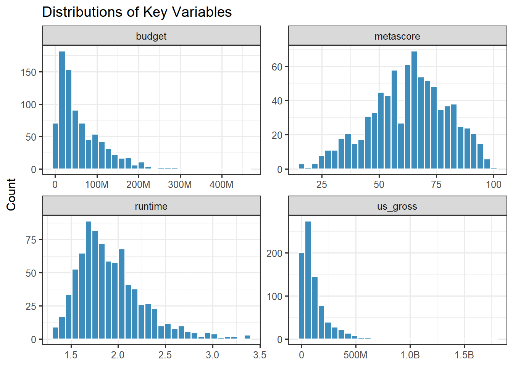
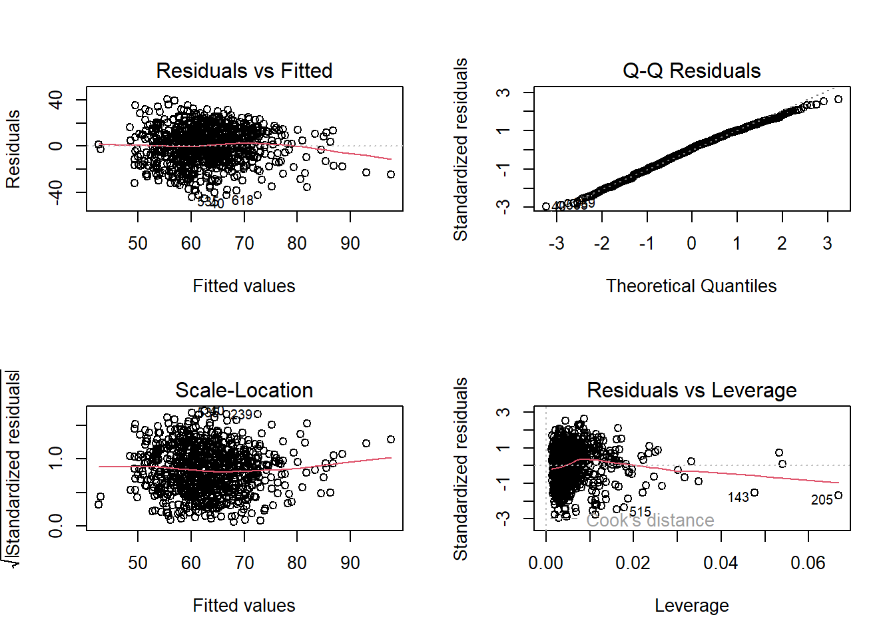
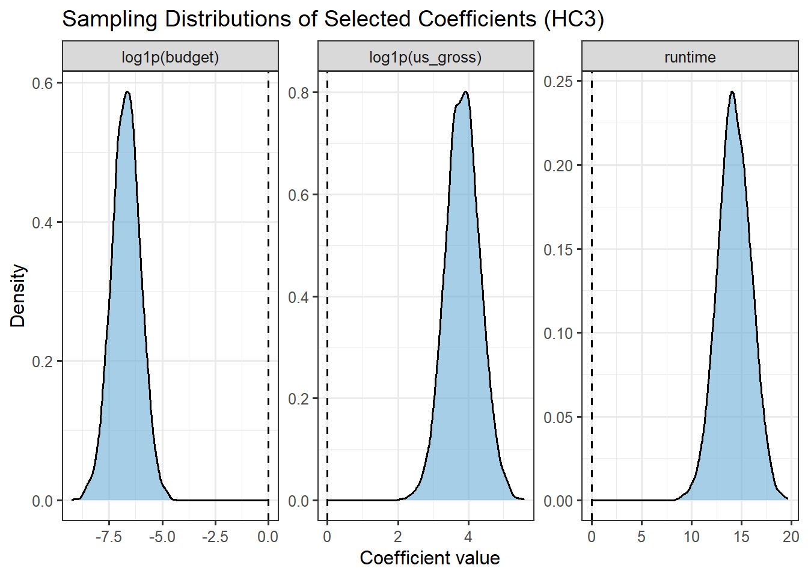
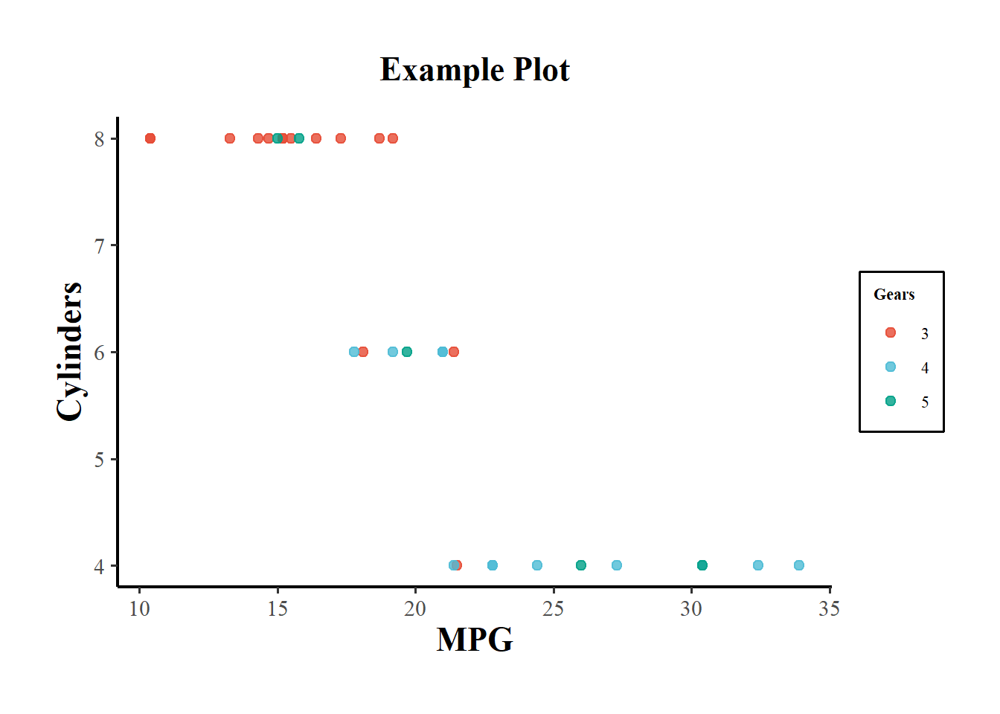
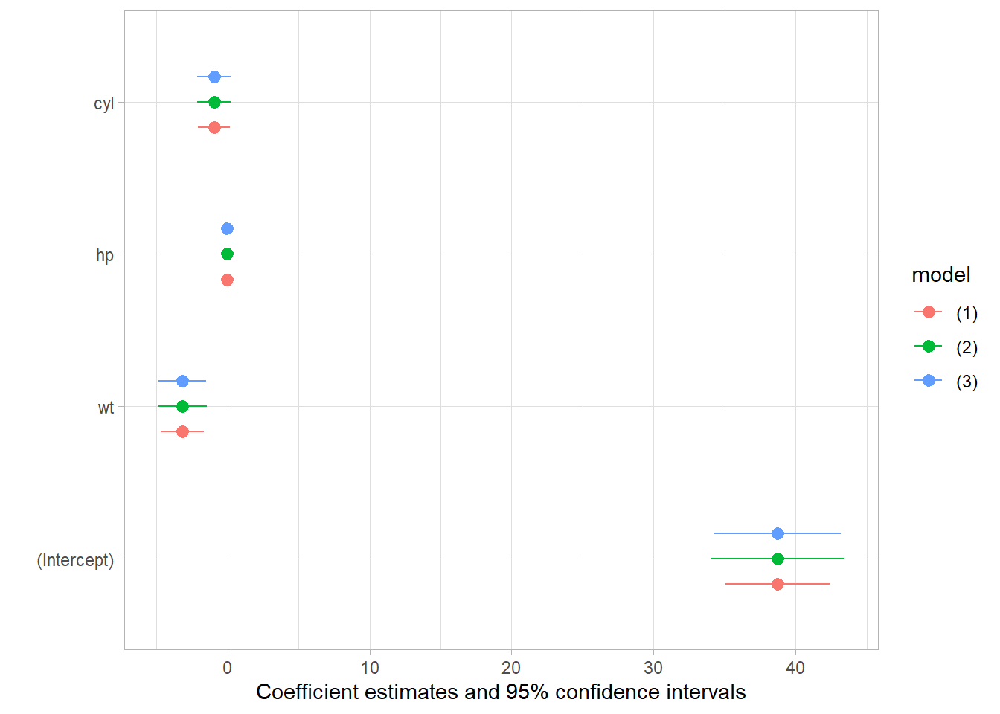

# Reporting Your Analysis {#sec-reporting}

::: {.chapter-abstract}
**Abstract.** A result that cannot be read is not a result. This chapter sets out a reproducible workflow for reporting quantitative analysis to academic, policy, and business audiences, organized around five phases: exploratory analysis, model selection and specification, fitting and diagnostic assessment, inference and prediction, and conclusions. It demonstrates the artifacts a professional manuscript is expected to contain, including descriptive tables, regression tables with cluster-robust standard errors, model comparison tables, coefficient plots, and the translation of a fitted object back into the equation it represents. Particular attention goes to reporting how an estimate moves across specifications, since a coefficient presented in isolation conceals the choices that produced it. The chapter shows how to export publication-ready tables in APA style, how to present coefficient uncertainty as a distribution rather than a row of stars, and how to keep every table and figure in a manuscript traceable to the code that generated it. Reproducible snippets that can be lifted directly into a reporting pipeline close the chapter.

**Keywords:** Reproducible reporting, Regression tables, Model comparison, Coefficient plots, APA style, Publication-ready output
:::

Chapter \@ref(sec-exploratory-data-analysis) is about what an analyst can learn
from the data. This chapter is about making that knowledge legible to someone
who was not there. The premise is that a result nobody can check is not a
result, so tables, figures, and specification reporting are treated here as part
of the analysis rather than as packaging applied to it afterwards.

## Recommended Structure

### Phase 1: Exploratory Data Analysis

Chapter \@ref(sec-exploratory-data-analysis) treats this phase in full, and
the argument there is that exploration is not preparation for the analysis but
part of it: it determines what the data can support, and it consumes evidence
while doing so. Two things from that chapter carry directly into how a study is
written up. The first is that the exploratory work should be scripted rather
than performed by hand, so that what was looked at is recoverable by a reader
who was not present. The second is that decisions taken during exploration,
above all the treatment of outliers and missing values, are inferential acts
and belong in the manuscript rather than in the analyst's memory. What follows
here is the reporting side of that: which artifacts a reader needs to see, and
in what form.

### Phase 2: Model Selection and Specification

**Articulating Model Assumptions**

Every statistical model rests on a foundation of assumptions, and making these explicit is essential for proper interpretation and assessment of your results. Begin by clearly stating the distributional assumptions your model makes about the outcome variable. Does your model assume normally distributed errors, or are you working within a generalized linear model framework that allows for binomial, Poisson, or other distributional families?

Detail the assumptions about the relationship between predictors and outcome. Most commonly, models assume linearity in parameters, meaning that the expected outcome changes by a constant amount for each unit change in a predictor (possibly after appropriate transformation or link function). If your model permits non-linear relationships through polynomial terms, splines, or other flexible forms, explain the functional form you've adopted and why.

Independence assumptions warrant careful consideration. Standard regression assumes that observations are independent of one another, but this is frequently violated in practice by clustering (students within schools, measurements within individuals), spatial dependence, or temporal autocorrelation. If such dependencies exist in your data structure, acknowledge them explicitly and describe how your model accounts for them, whether through mixed effects, robust standard errors, or specialized correlation structures.

Homoscedasticity, the assumption of constant error variance, should be stated and later verified. Many standard inferential procedures assume that the variance of your outcome does not depend on predictor values or fitted values, though weighted regression or generalized linear models can accommodate heteroscedastic errors when this assumption is untenable.

Additional assumptions relevant to specific methods should be documented. For causal inference, state clearly what identification assumptions are necessary for causal interpretation, such as ignorability, no unmeasured confounding, or valid instrumental variables. For time series models, describe stationarity assumptions. For machine learning approaches, discuss assumptions about the relationship between training and test data distributions.

**Justifying Your Modeling Approach**

After articulating assumptions, provide a compelling rationale for why your chosen model is the most appropriate tool for addressing your research question. Connect the model selection directly to your scientific objectives. If your goal is prediction, emphasize the model's predictive performance and its ability to generalize to new data. If your goal is inference about specific parameters, justify how the model structure allows for valid and efficient estimation of those parameters.

Consider the nature of your outcome variable in justifying your approach. Continuous outcomes measured on an interval or ratio scale typically call for linear regression or its extensions, while binary outcomes necessitate logistic regression or other classification methods. Count data often require Poisson or negative binomial regression, while time-to-event data demand survival analysis techniques. Ordinal outcomes merit specialized methods that respect the ordered nature of categories.

Discuss how your model handles the specific challenges present in your data. If you have high-dimensional data with more predictors than observations, explain your choice of regularization method such as ridge, lasso, or elastic net regression. If multicollinearity is a concern, describe how your approach mitigates its effects, whether through variable selection, principal component regression, or Bayesian methods with informative priors.

Address computational considerations when relevant. Some modeling approaches that are theoretically ideal may be computationally intractable for large datasets, while others scale efficiently. If you've made tradeoffs between statistical optimality and computational feasibility, acknowledge this transparently and describe any steps taken to validate that the chosen approach provides adequate performance.

Compare your chosen model to reasonable alternatives, explaining why you've selected one approach over others. This comparative discussion demonstrates that you've thoughtfully considered multiple options rather than defaulting to a familiar method. You might compare parametric versus non-parametric approaches, frequentist versus Bayesian frameworks, or simple versus complex model structures, weighing their relative advantages and limitations in your specific context.

**Considering Interactions, Collinearity, and Dependence**

Interaction effects represent situations where the effect of one predictor on the outcome depends on the value of another predictor. During model specification, consider whether substantive theory suggests important interactions, and explore whether your exploratory analysis revealed evidence of effect modification. Interaction terms can substantially improve model fit and provide crucial scientific insights, but they also increase model complexity and can make interpretation challenging.

When including interactions, think carefully about whether to also include the constituent main effects (you almost always should, to maintain the principle of marginality), and consider centering continuous variables before forming interaction terms to reduce collinearity and aid interpretation. Visualize predicted values across different combinations of interacting variables to help readers understand these complex relationships.

Multicollinearity, the presence of strong linear relationships among predictors, can create serious problems for parameter estimation and interpretation. Severely collinear predictors lead to unstable coefficient estimates with inflated standard errors, making it difficult to isolate the individual effect of any single predictor. Assess collinearity using variance inflation factors (VIF), with values exceeding 5 or 10 typically indicating problematic levels.

When high collinearity is detected, several remedial strategies exist. You might remove one of a highly correlated pair of predictors based on theoretical considerations or measurement quality. Alternatively, combine collinear predictors into composite scores or indices that capture their shared information. Regularization methods such as ridge regression explicitly address collinearity by shrinking coefficient estimates. In some cases, severe collinearity simply reflects reality and must be acknowledged as a limitation, particularly when you need to include certain predictors for theoretical completeness despite their intercorrelation.

Dependence structures in your data require special modeling approaches. For clustered data, where observations are nested within groups, mixed effects (multilevel or hierarchical) models partition variance into within-group and between-group components and account for the correlation among observations from the same cluster. Specify both fixed effects that represent average relationships and random effects that allow these relationships to vary across clusters.

For longitudinal data with repeated measurements on the same units, consider growth curve models, generalized estimating equations (GEE), or transition models depending on your research question. Each approach handles the correlation among repeated measures differently and allows for different types of inference, so select the framework that best matches your substantive goals.

Spatial or network dependence calls for specialized models that explicitly represent connections between observations. Spatial autoregressive models, geographically weighted regression, or network autocorrelation models may be appropriate depending on the structure of spatial or social relationships in your data.

### Phase 3: Model Fitting and Diagnostic Assessment

**Evaluating Overall Model Fit**

After estimating your model, systematically evaluate how well it fits the observed data. Begin with summary statistics that quantify the proportion of variance explained. For linear models, the coefficient of determination ($R^2$) indicates what fraction of outcome variance is captured by your predictors, while adjusted $R^2$ penalizes model complexity to discourage overfitting. Recognize that while $R^2$ provides a useful summary, it doesn't tell the whole story about model adequacy, and even low $R^2$ values can be scientifically important if they represent relationships that are difficult to predict.

For generalized linear models, report appropriate pseudo-$R^2$ measures such as McFadden's, Nagelkerke's, or Tjur's $R^2$, keeping in mind that these lack the direct interpretation of classical $R^2$. Log-likelihood values and deviance statistics provide information about how well the model's probability distribution matches the data, with comparisons to null or saturated models offering context for interpretation.

Information criteria including Akaike Information Criterion (AIC) and Bayesian Information Criterion (BIC) balance goodness of fit against model complexity, rewarding fit while penalizing the inclusion of additional parameters. These are particularly valuable for comparing non-nested models, though differences of less than 2-3 units are generally considered negligible. BIC penalizes complexity more heavily than AIC and tends to favor simpler models, especially with large sample sizes.

For models intended for prediction, assess predictive performance using metrics appropriate to your outcome type. For continuous outcomes, examine mean squared error, root mean squared error, or mean absolute error. For binary outcomes, consider accuracy, sensitivity, specificity, positive and negative predictive values, area under the ROC curve (AUC), and calibration metrics. Critically, evaluate predictive performance on held-out data not used for model training to obtain honest estimates of generalization performance.

Conduct formal goodness-of-fit tests where appropriate. The Hosmer-Lemeshow test for logistic regression, the deviance test for generalized linear models, or omnibus tests for model specification each provide statistical assessments of model adequacy, though remember that with large sample sizes, these tests may reject even models that fit adequately for practical purposes.

**Verifying Model Assumptions Through Residual Analysis**

Residual analysis forms the cornerstone of model diagnostics, as residuals (i.e., the differences between observed and fitted values) should exhibit certain properties if model assumptions hold. If your model is correctly specified and assumptions are satisfied, residuals should appear as random noise without systematic patterns.

Begin with residual plots that display residuals against fitted values. In a well-fitting model, this plot should show a random cloud of points with no discernible pattern, constant spread across the range of fitted values, and no systematic curvature. A funnel shape, where spread increases or decreases with fitted values, suggests heteroscedasticity. Curved patterns indicate that the assumed functional form may be incorrect and that transformations or additional predictors might improve the model.

For generalized linear models, use appropriate residuals such as deviance, Pearson, or quantile residuals rather than raw residuals, as these better approximate the expected properties under the model assumptions. Deviance residuals are particularly useful for assessing overall model fit, while Pearson residuals help evaluate the variance assumption.

Construct residual plots against each predictor variable to identify whether any individual predictor's relationship with the outcome is misspecified. Non-random patterns in these plots suggest that the predictor may require transformation, that its effect may be non-linear, or that it may interact with other variables.

Q-Q (quantile-quantile) plots compare the distribution of residuals to the theoretical distribution assumed by your model, typically the normal distribution for linear regression. Points should fall approximately along a straight diagonal line if the distributional assumption is satisfied. Systematic departures from linearity, particularly in the tails, indicate non-normality. Light-tailed distributions (fewer extreme values than expected under normality) produce S-shaped patterns, while heavy-tailed distributions (more extreme values) create inversely S-shaped patterns.

For time series or spatially structured data, examine residual autocorrelation through autocorrelation function (ACF) plots or spatial correlograms. Significant autocorrelation in residuals indicates that your model has failed to account for temporal or spatial dependence, suggesting the need for more sophisticated modeling approaches that explicitly model correlation structures.

Identify influential observations using diagnostic measures such as Cook's distance, DFBETAS, DFFITS, and leverage values. Influential points are those whose inclusion or exclusion would substantially alter model estimates or predictions. High leverage points have unusual predictor values that give them the potential for influence, while high influence points actually do substantially affect the fitted model. Investigate influential observations carefully, determining whether they represent errors, exceptional cases worthy of separate analysis, or legitimate data that should be retained.

Assess the variance inflation in parameter estimates due to collinearity by examining condition indices or variance decomposition proportions in addition to variance inflation factors. These diagnostics help you understand which specific parameters are most affected by collinearity and whether the instability is severe enough to warrant remedial action.

Test for heteroscedasticity formally using the Breusch-Pagan test, White test, or other appropriate diagnostics depending on your model type. If heteroscedasticity is detected, consider whether variance-stabilizing transformations, weighted least squares, or robust standard error estimators are appropriate remedies.

For mixed effects models, examine residuals at each level of the hierarchy. Inspect level-1 (within-group) residuals for the usual regression diagnostics, and additionally examine level-2 (group-level) residuals and random effects to assess whether higher-level assumptions are satisfied and to identify outlying clusters.

When assumption violations are detected, consider their practical severity carefully. Minor violations may have negligible impact on inference, particularly with large samples where central limit theorem properties provide robustness. Severe violations require remedy through data transformation, alternative modeling approaches, robust methods, or explicit acknowledgment as a limitation.

### Phase 4: Inference and Prediction

**Drawing Valid Statistical Inferences**

With a well-fitting model in hand, turn your attention to statistical inference about parameters of interest and the relationships they represent. Begin by reporting point estimates for all relevant parameters, including regression coefficients, odds ratios, hazard ratios, or other effect measures appropriate to your model type. Present these with appropriate measures of uncertainty, typically confidence intervals and p-values from hypothesis tests.

Interpret each parameter estimate in the context of your research question and in language accessible to your intended audience. For linear regression coefficients, explain the expected change in the outcome associated with a one-unit change in the predictor, holding other variables constant. For logistic regression, interpret odds ratios or convert to more intuitive probability scales for specific covariate values. For survival models, explain hazard ratios in terms of relative risk over time.

Attend carefully to the distinction between statistical significance and practical significance. Statistically significant effects may be too small to matter in practice, particularly with large samples, while non-significant effects may still be substantively important, especially when confidence intervals are wide due to limited power. Report and discuss both the magnitude and precision of estimates rather than focusing exclusively on whether p-values fall below arbitrary thresholds.

Consider the multiple testing problem if you're conducting numerous hypothesis tests. When testing many hypotheses simultaneously, some will appear significant purely by chance. Address this through appropriate multiple testing corrections such as Bonferroni, Holm, or false discovery rate (FDR) methods, or through a hierarchical testing strategy that prioritizes certain comparisons. Alternatively, distinguish clearly between confirmatory tests of pre-specified hypotheses and exploratory analyses that generate hypotheses for future research.

For predictive models, generate predictions for new observations or for specific covariate profiles of interest. Provide prediction intervals that appropriately capture uncertainty, recognizing that prediction uncertainty includes both estimation uncertainty about parameters and inherent residual variation in individual observations. Visualize predictions across the range of key predictors to help readers understand model implications.

**Exploring Alternative Approaches to Support Inference**

Strengthen your inferences by demonstrating robustness through alternative analytical approaches. A finding that persists across multiple reasonable modeling strategies is more credible than one that depends critically on specific modeling choices. This triangulation of evidence provides readers with greater confidence in your conclusions.

Conduct sensitivity analyses that explore how results change under different assumptions. Fit variants of your model that include or exclude potential confounders, use different functional forms for continuous predictors, apply different transformations to the outcome, or employ alternative link functions. If conclusions remain substantively similar across these variations, you can be more confident in their validity. If results are sensitive to specific modeling choices, acknowledge this and discuss which specification is most defensible based on theory and empirical evidence.

For causal inference questions, implement multiple analytical strategies if possible. Combine regression adjustment with propensity score methods, instrumental variables, difference-in-differences, or regression discontinuity designs depending on your data structure and research design. Agreement across methods that rely on different identifying assumptions substantially strengthens causal claims.

Employ resampling methods such as bootstrap or permutation tests to validate your inferential conclusions, particularly when sample sizes are modest or distributional assumptions are questionable. The bootstrap provides a way to estimate sampling distributions and standard errors without relying on parametric assumptions, while permutation tests offer exact significance tests for certain hypotheses.

Conduct subgroup analyses to examine whether relationships are consistent across different populations or contexts within your data. While these are exploratory and should be interpreted cautiously due to reduced power and multiple testing concerns, they can reveal important heterogeneity in effects and generate hypotheses about effect moderation that deserve investigation in future studies.

Implement cross-validation or other hold-out validation procedures for predictive models to honestly assess generalization performance. K-fold cross-validation, leave-one-out cross-validation, or train-test splits allow you to evaluate how well your model performs on data it hasn't seen during training. This is essential for claims about predictive utility and for comparing the predictive performance of different modeling approaches.

If you have access to multiple datasets addressing similar questions, consider replication analyses that fit your model to independent data. Successful replication provides the strongest possible evidence for the robustness and generalizability of your findings, while failures to replicate may indicate that initial results were sample-specific or resulted from chance variation.

For Bayesian analyses, conduct prior sensitivity analyses that examine how posterior inferences change under different prior specifications. If conclusions are similar under a range of reasonable priors, inference is robust to prior specification. If posteriors are highly sensitive to prior choice, either collect more data to allow the likelihood to dominate or acknowledge that definitive conclusions require stronger prior information.

### Phase 5: Conclusions and Recommendations

**Synthesizing Findings into Actionable Recommendations**

In concluding your analysis, synthesize your findings into clear, actionable recommendations that directly address the original research questions or practical problems that motivated the investigation. Avoid simply restating results. Interpret their meaning and implications for theory, policy, or practice instead.

Connect your statistical findings back to the substantive domain, explaining what your results mean for real-world phenomena. If you've found that a particular intervention has a significant positive effect, discuss what decision-makers should do with this information. If you've built a predictive model, explain how it should be deployed and what level of performance users can expect in practice.

Prioritize your recommendations by importance and strength of evidence. Some findings will be central to your research questions and supported by robust evidence across multiple analyses, while others may be more peripheral or tentative. Help readers understand which conclusions are most secure and which require additional confirmation before being acted upon.

Acknowledge uncertainty in your recommendations. Statistical analysis rarely provides absolute certainty, and honest acknowledgment of uncertainty better serves decision-makers than false precision. Describe the range of plausible effects indicated by confidence intervals and discuss how remaining uncertainty might affect decisions.

If your analysis revealed unexpected findings, discuss their potential significance and implications for existing theory or practice. Surprising results often represent the most important scientific contributions, but they also require more scrutiny and replication before being accepted with high confidence.

Consider differential implications for different stakeholders or contexts. A finding that suggests one course of action for one group might have different implications for another, and careful analysis should recognize this heterogeneity in drawing conclusions.

**Acknowledging Limitations with Specificity and Candor**

Every analysis has limitations, and comprehensive acknowledgment of these limitations actually strengthens rather than weakens your work by demonstrating careful scientific reasoning and helping readers appropriately calibrate their confidence in your conclusions. Move beyond generic limitations to provide specific, honest assessment of factors that may limit the validity or generalizability of your findings.

Discuss limitations related to your data source and sampling. Is your sample representative of the population to which you wish to generalize, or might selection bias limit external validity? Are there important subgroups underrepresented or absent from your data? Does non-response or attrition introduce potential bias? Are key variables measured with error or missing for substantial proportions of observations?

Address methodological limitations in your analytical approach. Which assumptions of your chosen model are most questionable in your particular application? Are there known alternatives that might have advantages you couldn't exploit due to data constraints or computational limitations? Does the observational nature of your data limit causal inference, even if you've attempted to address confounding through statistical adjustment?

Consider limitations in measurement and operationalization. Do your variables capture the theoretical constructs of interest with high fidelity, or are they imperfect proxies? Are there important dimensions of concepts that your measures don't capture? Would different but equally defensible operationalizations lead to different conclusions?

Acknowledge temporal limitations. For cross-sectional data, note that you observe relationships at a single time point and cannot make claims about causal ordering or temporal dynamics. For longitudinal data, discuss whether your observation period is long enough to capture relevant changes and whether patterns might differ over longer time horizons.

Discuss limitations related to model complexity and specification. Have you potentially omitted important confounders or moderators due to data unavailability? Does your model impose functional form assumptions that, while reasonable, may not perfectly capture reality? Have you prioritized interpretability over predictive performance, or vice versa, and how might this choice limit certain uses of your findings?

For predictive models, clearly delineate the conditions under which predictions should be trusted and situations where the model may perform poorly. Discuss the training data's representativeness and how concept drift or distribution shift might affect performance when the model is deployed in different contexts or time periods.

Address limitations in statistical power if applicable. Underpowered studies may fail to detect truly important effects, and confidence intervals may be too wide to provide useful guidance. Non-significant findings in underpowered studies should be interpreted as inconclusive rather than as evidence of null effects.

**Charting a Path Forward: Future Research Directions**

Conclude by outlining specific steps that could address the limitations you've identified and advance understanding beyond what your current analysis achieved. This forward-looking discussion demonstrates scientific maturity and provides a roadmap for continuing research on important questions.

For data-related limitations, describe what improved data collection efforts would look like. Should future studies employ different sampling strategies to improve representativeness? Would longitudinal designs that track individuals over time provide stronger evidence than cross-sectional data? Are there key variables that should be measured but weren't available in your data? Would larger sample sizes enable detection of more subtle effects or more complex modeling?

Recommend methodological innovations or alternative analytical approaches that might overcome current limitations. Are there emerging statistical methods that would better address the particular challenges your data present? Would experimental or quasi-experimental designs provide stronger causal evidence? Could different modeling frameworks accommodate complexities that your current approach handles imperfectly?

Suggest directions for extending your findings. What related research questions naturally follow from your results? Are there important moderators or boundary conditions that should be explored? Would replication in different populations or contexts test the generalizability of your findings? Are there theoretical mechanisms linking your variables that require further investigation?

For applied work, discuss how implementation research could assess the effectiveness of your recommendations in practice. Statistical findings that seem promising in analysis may encounter challenges when deployed in real-world contexts, and careful evaluation of implementation is crucial for evidence-based practice.

Consider interdisciplinary connections that might enrich future investigation of your research questions. Would combining your quantitative approach with qualitative methods provide richer understanding? Could insights from other disciplines inform better model specification or theoretical development?

If your work identified measurement limitations, suggest how instrument development or validation studies could improve future research. Better measurement is often the key to scientific progress, and acknowledging measurement challenges while proposing solutions contributes meaningfully to your field.

Discuss how emerging data sources or technologies might enable future research that wasn't possible for your current analysis. Could sensor data, administrative records, natural language processing of text data, or other innovations provide new windows into your research questions?

Finally, contextualize your work within the broader scientific enterprise. Position your analysis as one contribution within an accumulating body of evidence, acknowledging what remains to be learned and how the field should collectively move forward to advance understanding.

This expanded structure provides a comprehensive framework for conducting and presenting rigorous statistical analysis, emphasizing transparency, methodological awareness, and careful reasoning at every stage of the research process.

## One Summary Table (Packages)

**Summary Statistics Table**

-   [qwraps2](https://cran.r-project.org/web/packages/qwraps2/vignettes/summary-statistics.html)

-   [vtable](https://cran.r-project.org/web/packages/vtable/vignettes/sumtable.html)

-   [gtsummary](http://www.danieldsjoberg.com/gtsummary/)

-   [apaTables](https://cran.r-project.org/web/packages/apaTables/apaTables.pdf)

-   [stargazer](https://cran.r-project.org/web/packages/stargazer/vignettes/stargazer.pdf)

**Regression Table**

-   [gtsummary](http://www.danieldsjoberg.com/gtsummary/)

-   [sjPlot, sjmisc, sjlabelled](https://cran.r-project.org/web/packages/sjPlot/vignettes/tab_model_estimates.html)

-   [stargazer](https://cran.r-project.org/web/packages/stargazer/vignettes/stargazer.pdf): recommended ([Example](https://www.jakeruss.com/cheatsheets/stargazer/))

-   [modelsummary](https://github.com/vincentarelbundock/modelsummary#a-simple-example)


``` r
# Core packages we will use throughout the chapter
library(jtools)
library(broom)
library(dplyr)
library(ggplot2)
library(lmtest)
library(sandwich)
set.seed(123)
```

## The Worked Example

The rest of this chapter reports one analysis end to end, so that every artifact
can be shown in the form a reader would meet it. The `jtools::movies` dataset
offers a realistic setting with continuous and discrete variables relevant to
business and creative outcomes.

The exploratory work that precedes this point is the subject of Chapter
\@ref(sec-exploratory-data-analysis) and is not repeated here. What belongs in
the write-up is not the exploration itself but its residue: the summary that
tells a reader what was analyzed, and a record of the decisions taken about
outliers and missing values, which the previous chapter argues are inferential
acts rather than housekeeping.


``` r
data(movies, package = "jtools")

# Minimal wrangling for illustration
movies_small <- movies %>%
  select(metascore, budget, us_gross, year, runtime) %>%
  filter(complete.cases(.))

summary(movies_small)
#>    metascore          budget             us_gross        
#>  Min.   : 16.00   Min.   :    11622   Min.   :4.261e+04  
#>  1st Qu.: 52.00   1st Qu.: 19543169   1st Qu.:3.168e+07  
#>  Median : 64.00   Median : 40452872   Median :7.318e+07  
#>  Mean   : 63.01   Mean   : 60831325   Mean   :1.215e+08  
#>  3rd Qu.: 75.00   3rd Qu.: 89567622   3rd Qu.:1.530e+08  
#>  Max.   :100.00   Max.   :461435929   Max.   :1.772e+09  
#>       year         runtime     
#>  Min.   :1971   Min.   :1.333  
#>  1st Qu.:1998   1st Qu.:1.667  
#>  Median :2004   Median :1.850  
#>  Mean   :2002   Mean   :1.923  
#>  3rd Qu.:2009   3rd Qu.:2.100  
#>  Max.   :2013   Max.   :3.367
```

Figure \@ref(fig:report-eda-distributions) shows the marginal distributions of the four key variables in the movies sample. Figure \@ref(fig:report-pairs-matrix) then shows how these variables relate in pairs, with budget and US gross on a log scale.


``` r
# Distribution plots (log scale for highly skewed financials)
library(tidyr)

movies_long <- movies_small %>%
  pivot_longer(cols = c(metascore, budget, us_gross, runtime),
               names_to = "variable", values_to = "value")

var_labels <- c(budget = "Budget", metascore = "Metascore",
                runtime = "Runtime (hours)", us_gross = "US gross")

ggplot(movies_long, aes(value)) +
  facet_wrap(~ variable, scales = "free",
             labeller = as_labeller(var_labels)) +
  geom_histogram(bins = 30, fill = "#3c8dbc", color = "white") +
  scale_x_continuous(
    labels = scales::label_number(scale_cut = scales::cut_short_scale())
  ) +
  labs(title = "Distributions of Key Variables",
       x = NULL, y = "Count") +
  theme_bw(base_size = 12)
```

<div class="figure" style="text-align: center">

<p class="caption">(\#fig:report-eda-distributions)Marginal distributions of metascore, budget, US gross, and runtime in the movies sample.</p>
</div>


``` r
# Pairwise relationships: simple scatter matrix. Angled x tick labels keep
# the year ticks from running together.
if (requireNamespace("GGally", quietly = TRUE)) {
  GGally::ggpairs(
    movies_small %>% mutate(across(c(budget, us_gross), log1p)),
    columns = c("metascore", "budget", "us_gross", "runtime", "year"),
    columnLabels = c("Metascore", "Log budget", "Log US gross",
                     "Runtime (hours)", "Year"),
    upper = list(continuous = GGally::wrap("cor", size = 3, stars = FALSE)),
    lower = list(continuous = GGally::wrap("points", alpha = .5, size = .7)),
    diag = list(continuous = GGally::wrap("barDiag", bins = 20))
  ) +
    theme_bw(base_size = 10) +
    theme(axis.text.x = element_text(angle = 45, hjust = 1))
}
```

<div class="figure" style="text-align: center">

<p class="caption">(\#fig:report-pairs-matrix)Pairwise scatter plots, histograms, and correlations for metascore, log budget, log US gross, runtime, and year in the movies sample.</p>
</div>


``` r
# Quick correlation table (with log transforms for skewed $ variables)
cor_mat <- movies_small %>%
  mutate(across(c(budget, us_gross), log1p)) %>%
  select(metascore, budget, us_gross, runtime, year) %>%
  cor(use = "pairwise.complete.obs")

round(cor_mat, 3)
#>           metascore budget us_gross runtime   year
#> metascore     1.000 -0.168    0.105   0.197 -0.126
#> budget       -0.168  1.000    0.596   0.378  0.017
#> us_gross      0.105  0.596    1.000   0.245 -0.309
#> runtime       0.197  0.378    0.245   1.000 -0.057
#> year         -0.126  0.017   -0.309  -0.057  1.000
```


``` r
# Outlier & influence screening (pre-model)
base_fit <- lm(metascore ~ log1p(budget) + log1p(us_gross) + runtime + year, data = movies_small)

infl <- influence.measures(base_fit)
summary(infl)
#> Potentially influential observations of
#> 	 lm(formula = metascore ~ log1p(budget) + log1p(us_gross) + runtime +      year, data = movies_small) :
#> 
#>     dfb.1_ dfb.l1() dfb.l1(_ dfb.rntm dfb.year dffit   cov.r   cook.d
#> 20  -0.05  -0.06     0.06    -0.02     0.05    -0.12    0.96_*  0.00 
#> 40   0.08   0.06    -0.04     0.05    -0.09    -0.16    0.96_*  0.01 
#> 44   0.05  -0.08     0.06     0.01    -0.05     0.12    1.03_*  0.00 
#> 62   0.09   0.13    -0.05     0.07    -0.10    -0.22    0.97_*  0.01 
#> 95   0.02   0.03     0.01     0.10    -0.02    -0.16    0.97_*  0.01 
#> 102  0.00   0.00     0.00     0.00     0.00    -0.01    1.02_*  0.00 
#> 106 -0.01  -0.01     0.00     0.01     0.01     0.02    1.02_*  0.00 
#> 110 -0.01   0.00     0.01    -0.03     0.01    -0.04    1.02_*  0.00 
#> 112  0.00   0.04     0.00    -0.02     0.00    -0.05    1.02_*  0.00 
#> 129  0.00   0.00     0.00     0.00     0.00     0.00    1.02_*  0.00 
#> 133  0.03   0.03    -0.05    -0.02    -0.03     0.06    1.02_*  0.00 
#> 138  0.00   0.18    -0.07    -0.06    -0.01    -0.19    1.03_*  0.01 
#> 143 -0.02   0.31    -0.10    -0.06     0.00    -0.34_*  1.04_*  0.02 
#> 172  0.25   0.05    -0.14    -0.06    -0.24     0.28_*  1.00    0.02 
#> 205 -0.02   0.40    -0.13    -0.06     0.00    -0.44_*  1.06_*  0.04 
#> 230  0.01   0.01    -0.01     0.00    -0.01     0.01    1.02_*  0.00 
#> 237 -0.21  -0.06     0.01     0.12     0.21    -0.26_*  0.98_*  0.01 
#> 239 -0.18   0.14    -0.07     0.05     0.17    -0.30_*  0.97_*  0.02 
#> 271 -0.14   0.04     0.11    -0.14     0.14     0.25_*  0.97_*  0.01 
#> 296 -0.01  -0.02     0.06     0.00     0.01    -0.07    1.02_*  0.00 
#> 298 -0.20  -0.11     0.18     0.00     0.20    -0.24_*  0.99    0.01 
#> 329  0.11   0.24    -0.16    -0.03    -0.12    -0.26_*  1.00    0.01 
#> 330  0.16   0.22    -0.18    -0.02    -0.16    -0.26_*  0.99    0.01 
#> 350 -0.01   0.00     0.00     0.06     0.01     0.07    1.02_*  0.00 
#> 383  0.00   0.00     0.00     0.01     0.00     0.01    1.02_*  0.00 
#> 385 -0.02   0.01     0.01    -0.09     0.02    -0.10    1.03_*  0.00 
#> 387  0.04   0.06    -0.16     0.06    -0.03     0.17    1.06_*  0.01 
#> 391  0.00  -0.02     0.00     0.00     0.01     0.02    1.02_*  0.00 
#> 408 -0.01  -0.02     0.02     0.01     0.01    -0.02    1.02_*  0.00 
#> 413  0.00   0.00    -0.02     0.01     0.00     0.02    1.02_*  0.00 
#> 454  0.00   0.15    -0.04    -0.01    -0.01    -0.17    1.04_*  0.01 
#> 484 -0.06   0.08     0.04    -0.06     0.06     0.17    0.97_*  0.01 
#> 503 -0.07   0.12    -0.09    -0.03     0.06    -0.17    1.02_*  0.01 
#> 510  0.00   0.00     0.00     0.00     0.00     0.00    1.02_*  0.00 
#> 515  0.09   0.30    -0.20    -0.04    -0.10    -0.32_*  0.99    0.02 
#> 516  0.01  -0.03     0.01     0.07    -0.01     0.08    1.03_*  0.00 
#> 535 -0.13  -0.10     0.14    -0.04     0.13    -0.20    0.96_*  0.01 
#> 551 -0.22  -0.02     0.10     0.04     0.22    -0.24_*  0.99    0.01 
#> 554 -0.03  -0.04     0.11    -0.04     0.03    -0.12    1.04_*  0.00 
#> 586 -0.01   0.00     0.04     0.00     0.00    -0.06    1.02_*  0.00 
#> 615  0.01   0.04    -0.03     0.00    -0.01    -0.04    1.04_*  0.00 
#> 617  0.01   0.01    -0.02     0.00    -0.01     0.02    1.06_*  0.00 
#> 618  0.05   0.09     0.04    -0.07    -0.06    -0.19    0.96_*  0.01 
#> 625  0.04   0.09    -0.07    -0.02    -0.05    -0.13    0.97_*  0.00 
#> 639  0.03  -0.01     0.00     0.04    -0.03     0.05    1.03_*  0.00 
#> 646  0.05  -0.01     0.02     0.00    -0.06     0.08    1.02_*  0.00 
#> 655  0.02   0.01     0.00     0.04    -0.02    -0.10    0.98_*  0.00 
#> 661  0.07  -0.04     0.03     0.09    -0.08     0.14    1.03_*  0.00 
#> 662  0.02  -0.01     0.00     0.04    -0.02     0.05    1.04_*  0.00 
#> 673  0.02   0.03    -0.03     0.00    -0.02     0.04    1.02_*  0.00 
#> 683  0.07   0.14    -0.10    -0.14    -0.08     0.20    0.98_*  0.01 
#> 692  0.02  -0.01    -0.01     0.02    -0.01     0.03    1.02_*  0.00 
#> 698 -0.02  -0.03     0.03     0.10     0.02     0.11    1.03_*  0.00 
#> 703 -0.04  -0.07     0.10    -0.13     0.04    -0.20    0.98_*  0.01 
#> 721 -0.10  -0.09     0.17    -0.24     0.10    -0.32_*  0.99    0.02 
#> 730 -0.10   0.14    -0.13     0.02     0.10    -0.23    1.01    0.01 
#> 731  0.09   0.05    -0.04     0.08    -0.09    -0.16    0.97_*  0.01 
#> 744  0.01   0.00     0.01     0.00    -0.01     0.02    1.02_*  0.00 
#> 759  0.00   0.00     0.00     0.01     0.00     0.01    1.02_*  0.00 
#> 771  0.00   0.00    -0.01    -0.03     0.00    -0.03    1.03_*  0.00 
#> 778  0.03   0.01     0.09    -0.15    -0.03     0.20    0.98_*  0.01 
#> 779 -0.10   0.06     0.09    -0.10     0.09     0.21    0.98_*  0.01 
#> 788  0.04   0.05    -0.15    -0.02    -0.03     0.17    1.02_*  0.01 
#> 829  0.03  -0.01     0.01     0.00    -0.03     0.04    1.02_*  0.00 
#>     hat    
#> 20   0.00  
#> 40   0.00  
#> 44   0.03_*
#> 62   0.01  
#> 95   0.00  
#> 102  0.02_*
#> 106  0.02  
#> 110  0.01  
#> 112  0.02_*
#> 129  0.01  
#> 133  0.01  
#> 138  0.03_*
#> 143  0.05_*
#> 172  0.02  
#> 205  0.07_*
#> 230  0.01  
#> 237  0.01  
#> 239  0.01  
#> 271  0.01  
#> 296  0.02_*
#> 298  0.01  
#> 329  0.02_*
#> 330  0.01  
#> 350  0.02  
#> 383  0.02_*
#> 385  0.02_*
#> 387  0.05_*
#> 391  0.01  
#> 408  0.01  
#> 413  0.01  
#> 454  0.03_*
#> 484  0.00  
#> 503  0.02_*
#> 510  0.02  
#> 515  0.02  
#> 516  0.02_*
#> 535  0.00  
#> 551  0.01  
#> 554  0.03_*
#> 586  0.02_*
#> 615  0.03_*
#> 617  0.05_*
#> 618  0.00  
#> 625  0.00  
#> 639  0.02_*
#> 646  0.02  
#> 655  0.00  
#> 661  0.03_*
#> 662  0.03_*
#> 673  0.02  
#> 683  0.01  
#> 692  0.02  
#> 698  0.02_*
#> 703  0.01  
#> 721  0.02  
#> 730  0.02_*
#> 731  0.00  
#> 744  0.02  
#> 759  0.02  
#> 771  0.02_*
#> 778  0.01  
#> 779  0.01  
#> 788  0.02_*
#> 829  0.02

# Flag observations with large Cook's distance or high leverage
diag_df <- tibble(
  .cooksd  = cooks.distance(base_fit),
  .hat     = hatvalues(base_fit),
  .resid   = rstandard(base_fit)
) %>% mutate(id = row_number())

head(diag_df[order(-diag_df$.cooksd),], 10)
#> # A tibble: 10 × 4
#>    .cooksd    .hat .resid    id
#>      <dbl>   <dbl>  <dbl> <int>
#>  1  0.0393 0.0668   -1.66   205
#>  2  0.0233 0.0476   -1.53   143
#>  3  0.0199 0.0178   -2.34   515
#>  4  0.0199 0.0161   -2.46   721
#>  5  0.0176 0.0113   -2.77   239
#>  6  0.0152 0.0165    2.13   172
#>  7  0.0139 0.0107   -2.53   237
#>  8  0.0134 0.0126   -2.29   330
#>  9  0.0134 0.0187   -1.87   329
#> 10  0.0122 0.00869   2.64   271
```

## Model

We illustrate a multiple linear regression model appropriate for continuous outcomes:

$$
y_i = \beta_0+ \beta_1 \log(\mathrm{budget}_i + 1)+ \beta_2 \log(\mathrm{us\_gross}_i + 1)+ \beta_3 \mathrm{runtime}_i+ \beta_4 \mathrm{year}_i+ \varepsilon_i .
$$

### Assumptions

The four assumptions below are not equally consequential, and stating them as a
flat list obscures that. Only the first is about identification. The other
three are about inference, and each has a standard repair given in parentheses,
which is why a violation of one of them is a nuisance rather than a threat to
the result.

-   Linearity in parameters and approximately linear relationships after transformation
-   Independence of errors (or appropriately modeled dependence/clustered SEs)
-   Homoskedasticity of errors (or robust SEs)
-   Approximately normal errors for t tests/intervals (large-sample robustness often sufficient)

Getting the functional form wrong biases the coefficient itself, and no
standard error correction can recover it. Getting the error structure wrong
leaves the coefficient alone and misstates its precision, which the estimators
in Chapter \@ref(sec-clustered-inference) are designed to fix. Reporting
practice should follow that asymmetry: defend the functional form in the text,
and handle the remaining three in the specification of the standard errors.

### Why this model?

-   `metascore` is continuous, so OLS is a natural baseline.
-   Financial variables are **skewed**, so a log transform helps stabilize variance and linearize relationships.
-   `year` and `runtime` capture secular trends and content length.

Each choice above is a defensible default rather than a discovery, which is
exactly what a baseline specification should be. Stating them explicitly in the
manuscript serves a purpose beyond documentation: it fixes the reference point
against which every later specification is compared, so that a reader can tell
which results follow from the data and which follow from a modelling decision
made before the data were consulted.

### Considerations

-   Interactions: e.g., does budget effectiveness differ by year?
-   Collinearity: budget and gross can be correlated, so check VIF.
-   Dependence: panel or clustered structures (franchise, studio) may require cluster-robust SEs.

These are the three directions in which the baseline is most likely to be
wrong, and they call for different responses. An interaction is a substantive
hypothesis and belongs in the paper only if theory or a prior result motivates
it, since fitting interactions until one is significant is the mechanism
described in Section \@ref(sec-publication-bias-phacking). Collinearity is a
precision problem rather than a bias problem, so a high variance inflation
factor is a reason to interpret individual coefficients cautiously, not a
reason to drop a variable that belongs in the model. Dependence is the one item
of the three that can change a conclusion outright, because ignoring it can
shrink a standard error by a factor of several. Figure \@ref(fig:report-budget-year-interaction) takes up the first of these, plotting the budget by year interaction in the movies data.


``` r
fit <- lm(metascore ~ log1p(budget) + log1p(us_gross) + runtime + year, data = movies_small)

# Core jtools summary (unstandardized)
summ(fit)
```

<table class="table table-striped table-hover table-condensed table-responsive" style="width: auto !important; margin-left: auto; margin-right: auto;">
<tbody>
  <tr>
   <td style="text-align:left;font-weight: bold;"> Observations </td>
   <td style="text-align:right;"> 831 </td>
  </tr>
  <tr>
   <td style="text-align:left;font-weight: bold;"> Dependent variable </td>
   <td style="text-align:right;"> metascore </td>
  </tr>
  <tr>
   <td style="text-align:left;font-weight: bold;"> Type </td>
   <td style="text-align:right;"> OLS linear regression </td>
  </tr>
</tbody>
</table> <table class="table table-striped table-hover table-condensed table-responsive" style="width: auto !important; margin-left: auto; margin-right: auto;">
<tbody>
  <tr>
   <td style="text-align:left;font-weight: bold;"> F(4,826) </td>
   <td style="text-align:right;"> 41.99 </td>
  </tr>
  <tr>
   <td style="text-align:left;font-weight: bold;"> R² </td>
   <td style="text-align:right;"> 0.17 </td>
  </tr>
  <tr>
   <td style="text-align:left;font-weight: bold;"> Adj. R² </td>
   <td style="text-align:right;"> 0.16 </td>
  </tr>
</tbody>
</table> <table class="table table-striped table-hover table-condensed table-responsive" style="width: auto !important; margin-left: auto; margin-right: auto;border-bottom: 0;">
 <thead>
  <tr>
   <th style="text-align:left;">   </th>
   <th style="text-align:right;"> Est. </th>
   <th style="text-align:right;"> S.E. </th>
   <th style="text-align:right;"> t val. </th>
   <th style="text-align:right;"> p </th>
  </tr>
 </thead>
<tbody>
  <tr>
   <td style="text-align:left;font-weight: bold;"> (Intercept) </td>
   <td style="text-align:right;"> 108.91 </td>
   <td style="text-align:right;"> 131.81 </td>
   <td style="text-align:right;"> 0.83 </td>
   <td style="text-align:right;"> 0.41 </td>
  </tr>
  <tr>
   <td style="text-align:left;font-weight: bold;"> log1p(budget) </td>
   <td style="text-align:right;"> -6.67 </td>
   <td style="text-align:right;"> 0.62 </td>
   <td style="text-align:right;"> -10.75 </td>
   <td style="text-align:right;"> 0.00 </td>
  </tr>
  <tr>
   <td style="text-align:left;font-weight: bold;"> log1p(us_gross) </td>
   <td style="text-align:right;"> 3.80 </td>
   <td style="text-align:right;"> 0.54 </td>
   <td style="text-align:right;"> 7.08 </td>
   <td style="text-align:right;"> 0.00 </td>
  </tr>
  <tr>
   <td style="text-align:left;font-weight: bold;"> runtime </td>
   <td style="text-align:right;"> 14.27 </td>
   <td style="text-align:right;"> 1.65 </td>
   <td style="text-align:right;"> 8.65 </td>
   <td style="text-align:right;"> 0.00 </td>
  </tr>
  <tr>
   <td style="text-align:left;font-weight: bold;"> year </td>
   <td style="text-align:right;"> -0.01 </td>
   <td style="text-align:right;"> 0.07 </td>
   <td style="text-align:right;"> -0.19 </td>
   <td style="text-align:right;"> 0.85 </td>
  </tr>
</tbody>
<tfoot><tr><td style="padding: 0; " colspan="100%">
<sup></sup> Standard errors: OLS</td></tr></tfoot>
</table>


``` r
# Enhanced jtools summary: standardized coefs, VIFs, semi-partial correlations, CIs
summ(
  fit,
  scale = TRUE,      # standardized betas
  vifs = TRUE,       # collinearity diagnostics
  part.corr = TRUE,  # semi-partial (part) correlations
  confint = TRUE,
  pvals = TRUE
)
```

<table class="table table-striped table-hover table-condensed table-responsive" style="width: auto !important; margin-left: auto; margin-right: auto;">
<tbody>
  <tr>
   <td style="text-align:left;font-weight: bold;"> Observations </td>
   <td style="text-align:right;"> 831 </td>
  </tr>
  <tr>
   <td style="text-align:left;font-weight: bold;"> Dependent variable </td>
   <td style="text-align:right;"> metascore </td>
  </tr>
  <tr>
   <td style="text-align:left;font-weight: bold;"> Type </td>
   <td style="text-align:right;"> OLS linear regression </td>
  </tr>
</tbody>
</table> <table class="table table-striped table-hover table-condensed table-responsive" style="width: auto !important; margin-left: auto; margin-right: auto;">
<tbody>
  <tr>
   <td style="text-align:left;font-weight: bold;"> F(4,826) </td>
   <td style="text-align:right;"> 41.99 </td>
  </tr>
  <tr>
   <td style="text-align:left;font-weight: bold;"> R² </td>
   <td style="text-align:right;"> 0.17 </td>
  </tr>
  <tr>
   <td style="text-align:left;font-weight: bold;"> Adj. R² </td>
   <td style="text-align:right;"> 0.16 </td>
  </tr>
</tbody>
</table> <table class="table table-striped table-hover table-condensed table-responsive" style="width: auto !important; margin-left: auto; margin-right: auto;border-bottom: 0;">
 <thead>
  <tr>
   <th style="text-align:left;">   </th>
   <th style="text-align:right;"> Est. </th>
   <th style="text-align:right;"> 2.5% </th>
   <th style="text-align:right;"> 97.5% </th>
   <th style="text-align:right;"> t val. </th>
   <th style="text-align:right;"> p </th>
   <th style="text-align:right;"> VIF </th>
   <th style="text-align:right;"> partial.r </th>
   <th style="text-align:right;"> part.r </th>
  </tr>
 </thead>
<tbody>
  <tr>
   <td style="text-align:left;font-weight: bold;"> (Intercept) </td>
   <td style="text-align:right;"> 63.01 </td>
   <td style="text-align:right;"> 61.96 </td>
   <td style="text-align:right;"> 64.06 </td>
   <td style="text-align:right;"> 117.57 </td>
   <td style="text-align:right;"> 0.00 </td>
   <td style="text-align:right;"> NA </td>
   <td style="text-align:right;"> NA </td>
   <td style="text-align:right;"> NA </td>
  </tr>
  <tr>
   <td style="text-align:left;font-weight: bold;"> `log1p(budget)` </td>
   <td style="text-align:right;"> -7.81 </td>
   <td style="text-align:right;"> -9.24 </td>
   <td style="text-align:right;"> -6.38 </td>
   <td style="text-align:right;"> -10.75 </td>
   <td style="text-align:right;"> 0.00 </td>
   <td style="text-align:right;"> 1.84 </td>
   <td style="text-align:right;"> -0.35 </td>
   <td style="text-align:right;"> -0.34 </td>
  </tr>
  <tr>
   <td style="text-align:left;font-weight: bold;"> `log1p(us_gross)` </td>
   <td style="text-align:right;"> 5.15 </td>
   <td style="text-align:right;"> 3.73 </td>
   <td style="text-align:right;"> 6.58 </td>
   <td style="text-align:right;"> 7.08 </td>
   <td style="text-align:right;"> 0.00 </td>
   <td style="text-align:right;"> 1.84 </td>
   <td style="text-align:right;"> 0.24 </td>
   <td style="text-align:right;"> 0.22 </td>
  </tr>
  <tr>
   <td style="text-align:left;font-weight: bold;"> runtime </td>
   <td style="text-align:right;"> 5.02 </td>
   <td style="text-align:right;"> 3.88 </td>
   <td style="text-align:right;"> 6.16 </td>
   <td style="text-align:right;"> 8.65 </td>
   <td style="text-align:right;"> 0.00 </td>
   <td style="text-align:right;"> 1.17 </td>
   <td style="text-align:right;"> 0.29 </td>
   <td style="text-align:right;"> 0.27 </td>
  </tr>
  <tr>
   <td style="text-align:left;font-weight: bold;"> year </td>
   <td style="text-align:right;"> -0.11 </td>
   <td style="text-align:right;"> -1.26 </td>
   <td style="text-align:right;"> 1.04 </td>
   <td style="text-align:right;"> -0.19 </td>
   <td style="text-align:right;"> 0.85 </td>
   <td style="text-align:right;"> 1.19 </td>
   <td style="text-align:right;"> -0.01 </td>
   <td style="text-align:right;"> -0.01 </td>
  </tr>
</tbody>
<tfoot><tr><td style="padding: 0; " colspan="100%">
<sup></sup> Standard errors: OLS. Continuous predictors are mean-centered and scaled by 1 s.d. The outcome variable remains in its original units.</td></tr></tfoot>
</table>


``` r
# Interactions: visualize and test
fit_int <- lm(metascore ~ log1p(budget)*year + log1p(us_gross) + runtime, data = movies_small)

# Create the transformed variable in your dataset
movies_small$log_budget <- log1p(movies_small$budget)

# Fit the model with the new variable
fit_int <- lm(metascore ~ log_budget*year + log1p(us_gross) + runtime, 
              data = movies_small)

# Now visualize
interactions::interact_plot(fit_int,
                           pred = year,
                           modx = log_budget,
                           interval = TRUE,
                           plot.points = TRUE,
                           x.label = "Year",
                           y.label = "Metascore",
                           legend.main = "Log budget") +
  theme_bw(base_size = 12)
```

<div class="figure" style="text-align: center">

<p class="caption">(\#fig:report-budget-year-interaction)Predicted metascore against release year at three levels of log budget, from the model with a budget by year interaction, with confidence bands.</p>
</div>


``` r
# Collinearity (car::vif)
car::vif(fit)
#>   log1p(budget) log1p(us_gross)         runtime            year 
#>        1.835578        1.841513        1.172572        1.192862
```

### Model Fit

We report $R^2$, adjusted $R^2$, residual standard error (RSE), and information criteria (AIC/BIC). For nested models, we can use ANOVA. Otherwise, compare AIC/BIC, cross-validated error, or out-of-sample performance.

We then examine residuals for normality, heteroskedasticity, and influential points. If assumptions are questionable, prefer **heteroskedasticity-robust** or **cluster-robust** standard errors.


``` r
broom::glance(fit) %>%
  select(r.squared, adj.r.squared, sigma, AIC, BIC, df, nobs)
#> # A tibble: 1 × 7
#>   r.squared adj.r.squared sigma   AIC   BIC    df  nobs
#>       <dbl>         <dbl> <dbl> <dbl> <dbl> <dbl> <int>
#> 1     0.169         0.165  15.4 6915. 6943.     4   831
```

Figure \@ref(fig:report-residual-diagnostics) shows the standard four-panel residual diagnostic plots for the fitted OLS model. Figure \@ref(fig:report-partial-residuals) adds a component plus residual plot for each predictor, which shows whether each one enters the model linearly.


``` r
# Base residual diagnostics (four-panel plots). The default device is too
# small for a two-by-two panel, and id.n = 0 drops the case-number labels,
# which overprint one another in a sample this size.
par(mfrow = c(2, 2))
plot(fit, id.n = 0)
```

<div class="figure" style="text-align: center">

<p class="caption">(\#fig:report-residual-diagnostics)Four-panel residual diagnostics for the OLS model: residuals vs. fitted, normal Q-Q, scale-location, and residuals vs. leverage.</p>
</div>

``` r
par(mfrow = c(1, 1))
```


``` r
# Formal tests (use judiciously, they are sensitive to n)
if (requireNamespace("car", quietly = TRUE)) {
  car::ncvTest(fit)                     # non-constant variance test
  car::durbinWatsonTest(fit)            # autocorrelation test (time ordering needed)
}
#>  lag Autocorrelation D-W Statistic p-value
#>    1      0.03649805      1.923838   0.268
#>  Alternative hypothesis: rho != 0
lmtest::bptest(fit)                      # Breusch-Pagan heteroskedasticity test
#> 
#> 	studentized Breusch-Pagan test
#> 
#> data:  fit
#> BP = 18.909, df = 4, p-value = 0.0008191
```


``` r
# Partial residual plots. crPlots() labels each axis with the model term,
# so each term is drawn with crPlot() and given a readable label.
if (requireNamespace("car", quietly = TRUE)) {
  cr_labels <- c("log1p(budget)" = "Log budget",
                 "log1p(us_gross)" = "Log US gross",
                 "runtime" = "Runtime (hours)", "year" = "Year")
  par(mfrow = c(2, 2))
  for (term in names(cr_labels)) {
    car::crPlot(fit, term, xlab = cr_labels[[term]],
                ylab = "Component + residual")
  }
  par(mfrow = c(1, 1))
}
```

<div class="figure" style="text-align: center">

<p class="caption">(\#fig:report-partial-residuals)Component plus residual plots for each predictor in the OLS model, a check on whether each term enters linearly.</p>
</div>

### Cluster-Robust Standard Errors

When heteroskedasticity or clustering is present, use **sandwich** estimators:

-   HC0/HC1/HC2/HC3: robust to heteroskedasticity

-   Cluster-robust (by firm, school, market, etc.) when errors correlate within clusters

Below: examples using `jtools::summ()` and `lmtest::coeftest()` with `sandwich`.


``` r
# Heteroskedasticity-robust SEs for fit
lmtest::coeftest(fit, vcov. = sandwich::vcovHC(fit, type = "HC3"))
#> 
#> t test of coefficients:
#> 
#>                   Estimate Std. Error t value  Pr(>|t|)    
#> (Intercept)     108.910293 145.640262  0.7478    0.4548    
#> log1p(budget)    -6.669123   0.708027 -9.4193 < 2.2e-16 ***
#> log1p(us_gross)   3.803854   0.552399  6.8861 1.136e-11 ***
#> runtime          14.268967   1.641196  8.6942 < 2.2e-16 ***
#> year             -0.012659   0.072085 -0.1756    0.8606    
#> ---
#> Signif. codes:  0 '***' 0.001 '**' 0.01 '*' 0.05 '.' 0.1 ' ' 1

# jtools in one line
summ(fit, robust = "HC3", confint = TRUE)
```

<table class="table table-striped table-hover table-condensed table-responsive" style="width: auto !important; margin-left: auto; margin-right: auto;">
<tbody>
  <tr>
   <td style="text-align:left;font-weight: bold;"> Observations </td>
   <td style="text-align:right;"> 831 </td>
  </tr>
  <tr>
   <td style="text-align:left;font-weight: bold;"> Dependent variable </td>
   <td style="text-align:right;"> metascore </td>
  </tr>
  <tr>
   <td style="text-align:left;font-weight: bold;"> Type </td>
   <td style="text-align:right;"> OLS linear regression </td>
  </tr>
</tbody>
</table> <table class="table table-striped table-hover table-condensed table-responsive" style="width: auto !important; margin-left: auto; margin-right: auto;">
<tbody>
  <tr>
   <td style="text-align:left;font-weight: bold;"> F(4,826) </td>
   <td style="text-align:right;"> 41.99 </td>
  </tr>
  <tr>
   <td style="text-align:left;font-weight: bold;"> R² </td>
   <td style="text-align:right;"> 0.17 </td>
  </tr>
  <tr>
   <td style="text-align:left;font-weight: bold;"> Adj. R² </td>
   <td style="text-align:right;"> 0.16 </td>
  </tr>
</tbody>
</table> <table class="table table-striped table-hover table-condensed table-responsive" style="width: auto !important; margin-left: auto; margin-right: auto;border-bottom: 0;">
 <thead>
  <tr>
   <th style="text-align:left;">   </th>
   <th style="text-align:right;"> Est. </th>
   <th style="text-align:right;"> 2.5% </th>
   <th style="text-align:right;"> 97.5% </th>
   <th style="text-align:right;"> t val. </th>
   <th style="text-align:right;"> p </th>
  </tr>
 </thead>
<tbody>
  <tr>
   <td style="text-align:left;font-weight: bold;"> (Intercept) </td>
   <td style="text-align:right;"> 108.91 </td>
   <td style="text-align:right;"> -176.96 </td>
   <td style="text-align:right;"> 394.78 </td>
   <td style="text-align:right;"> 0.75 </td>
   <td style="text-align:right;"> 0.45 </td>
  </tr>
  <tr>
   <td style="text-align:left;font-weight: bold;"> log1p(budget) </td>
   <td style="text-align:right;"> -6.67 </td>
   <td style="text-align:right;"> -8.06 </td>
   <td style="text-align:right;"> -5.28 </td>
   <td style="text-align:right;"> -9.42 </td>
   <td style="text-align:right;"> 0.00 </td>
  </tr>
  <tr>
   <td style="text-align:left;font-weight: bold;"> log1p(us_gross) </td>
   <td style="text-align:right;"> 3.80 </td>
   <td style="text-align:right;"> 2.72 </td>
   <td style="text-align:right;"> 4.89 </td>
   <td style="text-align:right;"> 6.89 </td>
   <td style="text-align:right;"> 0.00 </td>
  </tr>
  <tr>
   <td style="text-align:left;font-weight: bold;"> runtime </td>
   <td style="text-align:right;"> 14.27 </td>
   <td style="text-align:right;"> 11.05 </td>
   <td style="text-align:right;"> 17.49 </td>
   <td style="text-align:right;"> 8.69 </td>
   <td style="text-align:right;"> 0.00 </td>
  </tr>
  <tr>
   <td style="text-align:left;font-weight: bold;"> year </td>
   <td style="text-align:right;"> -0.01 </td>
   <td style="text-align:right;"> -0.15 </td>
   <td style="text-align:right;"> 0.13 </td>
   <td style="text-align:right;"> -0.18 </td>
   <td style="text-align:right;"> 0.86 </td>
  </tr>
</tbody>
<tfoot><tr><td style="padding: 0; " colspan="100%">
<sup></sup> Standard errors: Robust, type = HC3</td></tr></tfoot>
</table>


``` r
# Cluster-robust SEs using example data from 'sandwich'
data("PetersenCL", package = "sandwich")
fit2 <- lm(y ~ x, data = PetersenCL)

# Cluster on 'firm'
summ(fit2, robust = "HC3", cluster = "firm")
```

<table class="table table-striped table-hover table-condensed table-responsive" style="width: auto !important; margin-left: auto; margin-right: auto;">
<tbody>
  <tr>
   <td style="text-align:left;font-weight: bold;"> Observations </td>
   <td style="text-align:right;"> 5000 </td>
  </tr>
  <tr>
   <td style="text-align:left;font-weight: bold;"> Dependent variable </td>
   <td style="text-align:right;"> y </td>
  </tr>
  <tr>
   <td style="text-align:left;font-weight: bold;"> Type </td>
   <td style="text-align:right;"> OLS linear regression </td>
  </tr>
</tbody>
</table> <table class="table table-striped table-hover table-condensed table-responsive" style="width: auto !important; margin-left: auto; margin-right: auto;">
<tbody>
  <tr>
   <td style="text-align:left;font-weight: bold;"> F(1,4998) </td>
   <td style="text-align:right;"> 1310.74 </td>
  </tr>
  <tr>
   <td style="text-align:left;font-weight: bold;"> R² </td>
   <td style="text-align:right;"> 0.21 </td>
  </tr>
  <tr>
   <td style="text-align:left;font-weight: bold;"> Adj. R² </td>
   <td style="text-align:right;"> 0.21 </td>
  </tr>
</tbody>
</table> <table class="table table-striped table-hover table-condensed table-responsive" style="width: auto !important; margin-left: auto; margin-right: auto;border-bottom: 0;">
 <thead>
  <tr>
   <th style="text-align:left;">   </th>
   <th style="text-align:right;"> Est. </th>
   <th style="text-align:right;"> S.E. </th>
   <th style="text-align:right;"> t val. </th>
   <th style="text-align:right;"> p </th>
  </tr>
 </thead>
<tbody>
  <tr>
   <td style="text-align:left;font-weight: bold;"> (Intercept) </td>
   <td style="text-align:right;"> 0.03 </td>
   <td style="text-align:right;"> 0.07 </td>
   <td style="text-align:right;"> 0.44 </td>
   <td style="text-align:right;"> 0.66 </td>
  </tr>
  <tr>
   <td style="text-align:left;font-weight: bold;"> x </td>
   <td style="text-align:right;"> 1.03 </td>
   <td style="text-align:right;"> 0.05 </td>
   <td style="text-align:right;"> 20.36 </td>
   <td style="text-align:right;"> 0.00 </td>
  </tr>
</tbody>
<tfoot><tr><td style="padding: 0; " colspan="100%">
<sup></sup> Standard errors: Cluster-robust, type = HC3</td></tr></tfoot>
</table>

See Table \@ref(tab:report-sandwich-variants) for a quick reference:

| Type       | Applicable  | Usage             | Notes/References                           |
|:-----------|:------------|:------------------|:-------------------------------------------|
| const      | iid         | Homoskedastic     | Assumes constant variance                  |
| HC/HC0     | vcovHC      | Heteroskedastic   | White's estimator [@white1980heteroskedasticity] |
| HC1        | vcovHC      | Heteroskedastic   | DoF correction [@mackinnon1985some]        |
| HC2        | vcovHC      | Heteroskedastic   | Hat-matrix adjustment                      |
| HC3        | vcovHC      | Heteroskedastic   | Preferred for small $n$, hat-matrix adjustment |
| HC4/4m/5   | vcovHC      | Heteroskedastic   | Leverage-adaptive                          |

Table: (\#tab:report-sandwich-variants) Sandwich variants.

<!--# See vignette: https://cran.r-project.org/web/packages/sandwich/vignettes/sandwich-CL.pdf  -->

``` r
# Another quick demo on built-in data. package= is needed because
# caret also exports a `cars` dataset with different columns.
data(cars, package = "datasets")
model <- lm(speed ~ dist, data = cars)
summary(model)
#> 
#> Call:
#> lm(formula = speed ~ dist, data = cars)
#> 
#> Residuals:
#>     Min      1Q  Median      3Q     Max 
#> -7.5293 -2.1550  0.3615  2.4377  6.4179 
#> 
#> Coefficients:
#>             Estimate Std. Error t value Pr(>|t|)    
#> (Intercept)  8.28391    0.87438   9.474 1.44e-12 ***
#> dist         0.16557    0.01749   9.464 1.49e-12 ***
#> ---
#> Signif. codes:  0 '***' 0.001 '**' 0.01 '*' 0.05 '.' 0.1 ' ' 1
#> 
#> Residual standard error: 3.156 on 48 degrees of freedom
#> Multiple R-squared:  0.6511,	Adjusted R-squared:  0.6438 
#> F-statistic: 89.57 on 1 and 48 DF,  p-value: 1.49e-12
lmtest::coeftest(model, vcov. = sandwich::vcovHC(model, type = "HC1"))
#> 
#> t test of coefficients:
#> 
#>             Estimate Std. Error t value  Pr(>|t|)    
#> (Intercept) 8.283906   0.891860  9.2883 2.682e-12 ***
#> dist        0.165568   0.019402  8.5335 3.482e-11 ***
#> ---
#> Signif. codes:  0 '***' 0.001 '**' 0.01 '*' 0.05 '.' 0.1 ' ' 1
```

### Model to Equation

Use `equatiomatic` to extract LaTeX-ready equations. If unavailable, we provide a fallback to print the fitted equation with estimated coefficients.


``` r
# install.packages("equatiomatic") # not available for some R versions (e.g., R 4.2)
fit_eq <- lm(metascore ~ log1p(budget) + log1p(us_gross) + runtime + year, data = movies_small)

# Show the theoretical model
equatiomatic::extract_eq(fit_eq)

# Display the actual coefficients
equatiomatic::extract_eq(fit_eq, use_coefs = TRUE)
```


``` r
# Fallback: build a simple equation string with estimated coefs
print_lm_equation <- function(mod) {
  co <- coef(mod)
  terms <- names(co)
  terms_fmt <- ifelse(terms == "(Intercept)",
                      sprintf("%.3f", co[terms]),
                      paste0(sprintf("%.3f", co[terms]), " \\cdot ", terms))
  rhs <- paste(terms_fmt, collapse = " + ")
  asis <- paste0("$\\hat{y} = ", rhs, "$")
  cat(asis, "\n")
}
print_lm_equation(fit)
#> $\hat{y} = 108.910 + -6.669 \cdot log1p(budget) + 3.804 \cdot log1p(us_gross) + 14.269 \cdot runtime + -0.013 \cdot year$
```

## Model Comparison

Compare nested models via ANOVA (F-test), and non-nested via AIC/BIC, cross-validation, or predictive performance metrics. `jtools::export_summs()` offers attractive comparison tables.

Table \@ref(tab:report-nested-comparison) puts the three nested specifications
in one place, which is the form a reader needs in order to see how the estimate
moves as controls are added.


``` r
fit_a <- lm(metascore ~ log1p(budget), data = movies_small)
fit_b <- lm(metascore ~ log1p(budget) + log1p(us_gross), data = movies_small)
fit_c <- lm(metascore ~ log1p(budget) + log1p(us_gross) + runtime, data = movies_small)

coef_names <- c("Budget" = "log1p(budget)",
                "US Gross" = "log1p(us_gross)",
                "Runtime (Hours)" = "runtime",
                "Constant" = "(Intercept)")

tbl <- jtools::export_summs(fit_a, fit_b, fit_c, robust = "HC3", coefs = coef_names)

cap_tbl(tbl, "Three nested specifications for the metascore regression, with HC3 standard errors.", "report-nested-comparison")
```


```{=html}
<table class="huxtable" data-quarto-disable-processing="true"  style="margin-left: auto; margin-right: auto;" id="tab:report-nested-comparison">
<caption style="caption-side: top; text-align: left;">(#tab:report-nested-comparison) Three nested specifications for the metascore regression, with HC3 standard errors.</caption><col><col><col><col><thead>
<tr>
<th class="huxtable-cell huxtable-header" style="text-align: center;  border-style: solid solid solid solid; border-width: 0.8pt 0pt 0pt 0pt;      font-weight: normal;"></th><th class="huxtable-cell huxtable-header" style="text-align: center;  border-style: solid solid solid solid; border-width: 0.8pt 0pt 0.4pt 0pt;      font-weight: normal;">Model 1</th><th class="huxtable-cell huxtable-header" style="text-align: center;  border-style: solid solid solid solid; border-width: 0.8pt 0pt 0.4pt 0pt;      font-weight: normal;">Model 2</th><th class="huxtable-cell huxtable-header" style="text-align: center;  border-style: solid solid solid solid; border-width: 0.8pt 0pt 0.4pt 0pt;      font-weight: normal;">Model 3</th></tr>
</thead>
<tbody>
<tr>
<th class="huxtable-cell huxtable-header" style="border-style: solid solid solid solid; border-width: 0pt 0pt 0pt 0pt;      font-weight: normal;">Budget</th><td class="huxtable-cell" style="text-align: right;  border-style: solid solid solid solid; border-width: 0.4pt 0pt 0pt 0pt;">-2.43 ***</td><td class="huxtable-cell" style="text-align: right;  border-style: solid solid solid solid; border-width: 0.4pt 0pt 0pt 0pt;">-5.16 ***</td><td class="huxtable-cell" style="text-align: right;  border-style: solid solid solid solid; border-width: 0.4pt 0pt 0pt 0pt;">-6.70 ***</td></tr>
<tr>
<th class="huxtable-cell huxtable-header" style="border-style: solid solid solid solid; border-width: 0pt 0pt 0pt 0pt;      font-weight: normal;"></th><td class="huxtable-cell" style="text-align: right;  border-style: solid solid solid solid; border-width: 0pt 0pt 0pt 0pt;">(0.44)&nbsp;&nbsp;&nbsp;</td><td class="huxtable-cell" style="text-align: right;  border-style: solid solid solid solid; border-width: 0pt 0pt 0pt 0pt;">(0.62)&nbsp;&nbsp;&nbsp;</td><td class="huxtable-cell" style="text-align: right;  border-style: solid solid solid solid; border-width: 0pt 0pt 0pt 0pt;">(0.67)&nbsp;&nbsp;&nbsp;</td></tr>
<tr>
<th class="huxtable-cell huxtable-header" style="border-style: solid solid solid solid; border-width: 0pt 0pt 0pt 0pt;      font-weight: normal;">US Gross</th><td class="huxtable-cell" style="text-align: right;  border-style: solid solid solid solid; border-width: 0pt 0pt 0pt 0pt;">&nbsp;&nbsp;&nbsp;&nbsp;&nbsp;&nbsp;&nbsp;</td><td class="huxtable-cell" style="text-align: right;  border-style: solid solid solid solid; border-width: 0pt 0pt 0pt 0pt;">3.96 ***</td><td class="huxtable-cell" style="text-align: right;  border-style: solid solid solid solid; border-width: 0pt 0pt 0pt 0pt;">3.85 ***</td></tr>
<tr>
<th class="huxtable-cell huxtable-header" style="border-style: solid solid solid solid; border-width: 0pt 0pt 0pt 0pt;      font-weight: normal;"></th><td class="huxtable-cell" style="text-align: right;  border-style: solid solid solid solid; border-width: 0pt 0pt 0pt 0pt;">&nbsp;&nbsp;&nbsp;&nbsp;&nbsp;&nbsp;&nbsp;</td><td class="huxtable-cell" style="text-align: right;  border-style: solid solid solid solid; border-width: 0pt 0pt 0pt 0pt;">(0.51)&nbsp;&nbsp;&nbsp;</td><td class="huxtable-cell" style="text-align: right;  border-style: solid solid solid solid; border-width: 0pt 0pt 0pt 0pt;">(0.48)&nbsp;&nbsp;&nbsp;</td></tr>
<tr>
<th class="huxtable-cell huxtable-header" style="border-style: solid solid solid solid; border-width: 0pt 0pt 0pt 0pt;      font-weight: normal;">Runtime (Hours)</th><td class="huxtable-cell" style="text-align: right;  border-style: solid solid solid solid; border-width: 0pt 0pt 0pt 0pt;">&nbsp;&nbsp;&nbsp;&nbsp;&nbsp;&nbsp;&nbsp;</td><td class="huxtable-cell" style="text-align: right;  border-style: solid solid solid solid; border-width: 0pt 0pt 0pt 0pt;">&nbsp;&nbsp;&nbsp;&nbsp;&nbsp;&nbsp;&nbsp;</td><td class="huxtable-cell" style="text-align: right;  border-style: solid solid solid solid; border-width: 0pt 0pt 0pt 0pt;">14.29 ***</td></tr>
<tr>
<th class="huxtable-cell huxtable-header" style="border-style: solid solid solid solid; border-width: 0pt 0pt 0pt 0pt;      font-weight: normal;"></th><td class="huxtable-cell" style="text-align: right;  border-style: solid solid solid solid; border-width: 0pt 0pt 0pt 0pt;">&nbsp;&nbsp;&nbsp;&nbsp;&nbsp;&nbsp;&nbsp;</td><td class="huxtable-cell" style="text-align: right;  border-style: solid solid solid solid; border-width: 0pt 0pt 0pt 0pt;">&nbsp;&nbsp;&nbsp;&nbsp;&nbsp;&nbsp;&nbsp;</td><td class="huxtable-cell" style="text-align: right;  border-style: solid solid solid solid; border-width: 0pt 0pt 0pt 0pt;">(1.63)&nbsp;&nbsp;&nbsp;</td></tr>
<tr>
<th class="huxtable-cell huxtable-header" style="border-style: solid solid solid solid; border-width: 0pt 0pt 0pt 0pt;      font-weight: normal;">Constant</th><td class="huxtable-cell" style="text-align: right;  border-style: solid solid solid solid; border-width: 0pt 0pt 0pt 0pt;">105.29 ***</td><td class="huxtable-cell" style="text-align: right;  border-style: solid solid solid solid; border-width: 0pt 0pt 0pt 0pt;">81.84 ***</td><td class="huxtable-cell" style="text-align: right;  border-style: solid solid solid solid; border-width: 0pt 0pt 0pt 0pt;">83.35 ***</td></tr>
<tr>
<th class="huxtable-cell huxtable-header" style="border-style: solid solid solid solid; border-width: 0pt 0pt 0pt 0pt;      font-weight: normal;"></th><td class="huxtable-cell" style="text-align: right;  border-style: solid solid solid solid; border-width: 0pt 0pt 0.4pt 0pt;">(7.65)&nbsp;&nbsp;&nbsp;</td><td class="huxtable-cell" style="text-align: right;  border-style: solid solid solid solid; border-width: 0pt 0pt 0.4pt 0pt;">(8.66)&nbsp;&nbsp;&nbsp;</td><td class="huxtable-cell" style="text-align: right;  border-style: solid solid solid solid; border-width: 0pt 0pt 0.4pt 0pt;">(8.82)&nbsp;&nbsp;&nbsp;</td></tr>
<tr>
<th class="huxtable-cell huxtable-header" style="border-style: solid solid solid solid; border-width: 0pt 0pt 0pt 0pt;      font-weight: normal;">N</th><td class="huxtable-cell" style="text-align: right;  border-style: solid solid solid solid; border-width: 0.4pt 0pt 0pt 0pt;">831&nbsp;&nbsp;&nbsp;&nbsp;&nbsp;&nbsp;&nbsp;</td><td class="huxtable-cell" style="text-align: right;  border-style: solid solid solid solid; border-width: 0.4pt 0pt 0pt 0pt;">831&nbsp;&nbsp;&nbsp;&nbsp;&nbsp;&nbsp;&nbsp;</td><td class="huxtable-cell" style="text-align: right;  border-style: solid solid solid solid; border-width: 0.4pt 0pt 0pt 0pt;">831&nbsp;&nbsp;&nbsp;&nbsp;&nbsp;&nbsp;&nbsp;</td></tr>
<tr>
<th class="huxtable-cell huxtable-header" style="border-style: solid solid solid solid; border-width: 0pt 0pt 0.8pt 0pt;      font-weight: normal;">R2</th><td class="huxtable-cell" style="text-align: right;  border-style: solid solid solid solid; border-width: 0pt 0pt 0.8pt 0pt;">0.03&nbsp;&nbsp;&nbsp;&nbsp;</td><td class="huxtable-cell" style="text-align: right;  border-style: solid solid solid solid; border-width: 0pt 0pt 0.8pt 0pt;">0.09&nbsp;&nbsp;&nbsp;&nbsp;</td><td class="huxtable-cell" style="text-align: right;  border-style: solid solid solid solid; border-width: 0pt 0pt 0.8pt 0pt;">0.17&nbsp;&nbsp;&nbsp;&nbsp;</td></tr>
<tr>
<th class="huxtable-cell huxtable-header" colspan="4" style="border-style: solid solid solid solid; border-width: 0.8pt 0pt 0pt 0pt;      font-weight: normal;">* p &lt; 0.05, ** p &lt; 0.01, *** p &lt; 0.001</th></tr>
</tbody>
</table>

```


``` r
# AIC/BIC comparison
broom::glance(fit_a) %>% select(AIC, BIC, adj.r.squared) %>% mutate(model = "fit_a")
#> # A tibble: 1 × 4
#>     AIC   BIC adj.r.squared model
#>   <dbl> <dbl>         <dbl> <chr>
#> 1 7039. 7053.        0.0271 fit_a
broom::glance(fit_b) %>% select(AIC, BIC, adj.r.squared) %>% mutate(model = "fit_b")
#> # A tibble: 1 × 4
#>     AIC   BIC adj.r.squared model
#>   <dbl> <dbl>         <dbl> <chr>
#> 1 6984. 7003.        0.0910 fit_b
broom::glance(fit_c) %>% select(AIC, BIC, adj.r.squared) %>% mutate(model = "fit_c")
#> # A tibble: 1 × 4
#>     AIC   BIC adj.r.squared model
#>   <dbl> <dbl>         <dbl> <chr>
#> 1 6913. 6937.         0.166 fit_c
```


``` r
# Nested model ANOVA (fit_a nested in fit_b nested in fit_c)
anova(fit_a, fit_b, fit_c)
#> Analysis of Variance Table
#> 
#> Model 1: metascore ~ log1p(budget)
#> Model 2: metascore ~ log1p(budget) + log1p(us_gross)
#> Model 3: metascore ~ log1p(budget) + log1p(us_gross) + runtime
#>   Res.Df    RSS Df Sum of Sq      F    Pr(>F)    
#> 1    829 230545                                  
#> 2    828 215136  1     15409 64.634  3.11e-15 ***
#> 3    827 197160  1     17976 75.401 < 2.2e-16 ***
#> ---
#> Signif. codes:  0 '***' 0.001 '**' 0.01 '*' 0.05 '.' 0.1 ' ' 1
```

## Changes in an Estimate

Visualize how coefficient estimates shift when adding controls. This is especially useful to show robustness to omitted variable bias concerns.

Figure \@ref(fig:report-coef-shift) shows the three specifications side by side.


``` r
coef_names_plot <- coef_names[1:3] # Dropping intercept for plots
plot_summs(fit_a, fit_b, fit_c, robust = "HC3", coefs = coef_names_plot)
```

<div class="figure" style="text-align: center">

<p class="caption">(\#fig:report-coef-shift)Coefficient estimates across three nested specifications with HC3 standard errors. A coefficient that holds its position as controls are added is the visual form of the robustness argument. Budget does not hold its position: its estimate more than doubles once US gross enters.</p>
</div>


``` r
plot_summs(
  fit_c,
  robust = "HC3",
  coefs = coef_names_plot,
  plot.distributions = TRUE
)
```

<div class="figure" style="text-align: center">

<p class="caption">(\#fig:report-coef-distributions)The Model 3 coefficients drawn as sampling distributions within their 95 percent intervals, which shows the shape of the uncertainty between the two endpoints.</p>
</div>

Figure \@ref(fig:report-coef-distributions) draws the Model 3 estimates as
sampling distributions, cut off at the ends of their 95 percent intervals,
which conveys that a coefficient is a distribution and not a point with error
bars.

### Coefficient Uncertainty and Distribution

Visualize uncertainty with either frequentist or Bayesian approaches. With frequentist OLS, we can simulate coefficient draws from the asymptotic sampling distribution using the estimated variance-covariance matrix and then plot with `ggplot2`. Figure \@ref(fig:report-coef-sampling-densities) shows the simulated sampling densities for selected coefficients.


``` r
# Simulate coefficient draws (multivariate normal approx)
if (requireNamespace("MASS", quietly = TRUE)) {
  V <- vcovHC(fit_c, type = "HC3")
  b <- coef(fit_c)
  draws <- MASS::mvrnorm(n = 5000, mu = b, Sigma = V)
  draws_df <- as.data.frame(draws) %>% 
    select(`log1p(budget)`, `log1p(us_gross)`, runtime)

  draws_long <- tidyr::pivot_longer(draws_df, everything(),
                                    names_to = "term", values_to = "beta") %>%
    mutate(term = recode(term, "log1p(budget)" = "Log budget",
                         "log1p(us_gross)" = "Log US gross",
                         runtime = "Runtime (hours)"))

  ggplot(draws_long, aes(beta)) +
    facet_wrap(~ term, scales = "free") +
    geom_density(fill = "#6baed6", alpha = 0.6) +
    geom_vline(xintercept = 0, linetype = 2) +
    labs(title = "Sampling Distributions of Selected Coefficients (HC3)",
         x = "Coefficient value", y = "Density") +
    theme_bw(base_size = 12)
}
```

<div class="figure" style="text-align: center">

<p class="caption">(\#fig:report-coef-sampling-densities)Simulated HC3-robust sampling densities for selected coefficients, drawn from a multivariate normal approximation to the asymptotic distribution.</p>
</div>

## Descriptive Tables

Produce journal-quality descriptives and regression tables. Below are multiple options to match target outlet styles (APA, AER, WSJ, etc.)

Table \@ref(tab:report-gtsummary-descriptives) is the one-table overview `gtsummary` produces, carrying an overall column and a test of difference between the two score groups alongside the group summaries.


``` r
# Example with gtsummary: one-table overview
if (requireNamespace("gtsummary", quietly = TRUE)) {
  library(gtsummary)
  tbl <- movies_small %>%
    mutate(
      across(c(budget, us_gross), log1p),
      score_group = cut(metascore,
                       breaks = quantile(metascore, probs = c(0, .5, 1)),
                       include.lowest = TRUE,
                       labels = c("Low score", "High score"))
    ) %>%
    select(metascore, budget, us_gross, runtime, year, score_group) %>%
    tbl_summary(
      by = score_group,
      statistic = list(all_continuous() ~ "{mean} ({sd})"),
      digits = all_continuous() ~ 1
    ) %>%
    add_overall() %>%
    add_p() %>%
    bold_labels()

  # Both builds go through kableExtra, because that is what attaches the
  # bookdown table label and lets the text cross-reference this table by
  # number. gtsummary's own printer and as_gt() carry no label. Five columns
  # of "mean (sd)" are also wider than the LaTeX text block, so the print
  # build scales the table down to fit.
  out <- tbl %>%
    gtsummary::as_kable_extra(
      booktabs = TRUE,
      caption = paste(
        "Descriptive statistics for the movie sample, split at the median",
        "metascore, with an overall column and a test of difference between",
        "the two groups."
      )
    )
  if (knitr::is_latex_output()) {
    out %>% kableExtra::kable_styling(latex_options = "scale_down")
  } else {
    out
  }
}
```

<table style="NAborder-bottom: 0;">
<caption>(\#tab:report-gtsummary-descriptives)Descriptive statistics for the movie sample, split at the median metascore, with an overall column and a test of difference between the two groups.</caption>
 <thead>
  <tr>
   <th style="text-align:left;"> Characteristic </th>
   <th style="text-align:center;"> Overall  <br>N = 831 </th>
   <th style="text-align:center;"> Low score  <br>N = 431 </th>
   <th style="text-align:center;"> High score  <br>N = 400 </th>
   <th style="text-align:center;"> p-value </th>
  </tr>
 </thead>
<tbody>
  <tr>
   <td style="text-align:left;"> <span style=" font-weight: bold;    ">metascore</span> </td>
   <td style="text-align:center;"> 63.0 (16.9) </td>
   <td style="text-align:center;"> 50.0 (11.3) </td>
   <td style="text-align:center;"> 77.1 (8.7) </td>
   <td style="text-align:center;"> &lt;0.001 </td>
  </tr>
  <tr>
   <td style="text-align:left;"> <span style=" font-weight: bold;    ">budget</span> </td>
   <td style="text-align:center;"> 17.4 (1.2) </td>
   <td style="text-align:center;"> 17.7 (0.9) </td>
   <td style="text-align:center;"> 17.2 (1.3) </td>
   <td style="text-align:center;"> &lt;0.001 </td>
  </tr>
  <tr>
   <td style="text-align:left;"> <span style=" font-weight: bold;    ">us_gross</span> </td>
   <td style="text-align:center;"> 17.9 (1.4) </td>
   <td style="text-align:center;"> 17.9 (1.2) </td>
   <td style="text-align:center;"> 18.0 (1.5) </td>
   <td style="text-align:center;"> 0.3 </td>
  </tr>
  <tr>
   <td style="text-align:left;"> <span style=" font-weight: bold;    ">runtime</span> </td>
   <td style="text-align:center;"> 1.9 (0.4) </td>
   <td style="text-align:center;"> 1.9 (0.3) </td>
   <td style="text-align:center;"> 2.0 (0.4) </td>
   <td style="text-align:center;"> 0.004 </td>
  </tr>
  <tr>
   <td style="text-align:left;"> <span style=" font-weight: bold;    ">year</span> </td>
   <td style="text-align:center;"> 2,002.2 (9.0) </td>
   <td style="text-align:center;"> 2,003.0 (8.0) </td>
   <td style="text-align:center;"> 2,001.3 (9.9) </td>
   <td style="text-align:center;"> 0.056 </td>
  </tr>
</tbody>
<tfoot>
<tr><td style="padding: 0; " colspan="100%">
<sup>1</sup> Mean (SD)</td></tr>
<tr><td style="padding: 0; " colspan="100%">
<sup>2</sup> Wilcoxon rank sum test</td></tr>
</tfoot>
</table>


Table \@ref(tab:report-modelsummary-table) is the `modelsummary` equivalent, which reports one fit under three variance estimators side by side. The matching coefficient plot is Figure \@ref(fig:report-modelsummary-demo), further below.


``` r
# modelsummary example. Routing the output through kableExtra is what numbers
# the table. The coefficient plot for this same fit is drawn later, under
# Model Comparison, so it is not repeated here.
library(modelsummary)
lm_mod <- lm(mpg ~ wt + hp + cyl, mtcars)
msummary(
  lm_mod,
  vcov = c("iid", "robust", "HC4"),
  output = "kableExtra",
  title = paste(
    "OLS fit of miles per gallon on weight, horsepower, and cylinders,",
    "reported under classical, robust, and HC4 standard errors."
  )
)
```

<table class="table" style="width: auto !important; margin-left: auto; margin-right: auto;">
<caption>(\#tab:report-modelsummary-table)OLS fit of miles per gallon on weight, horsepower, and cylinders, reported under classical, robust, and HC4 standard errors.</caption>
 <thead>
  <tr>
   <th style="text-align:left;">   </th>
   <th style="text-align:center;"> &amp;nbsp;(1) </th>
   <th style="text-align:center;"> &amp;nbsp;&amp;nbsp;(2) </th>
   <th style="text-align:center;"> &amp;nbsp;&amp;nbsp;(3) </th>
  </tr>
 </thead>
<tbody>
  <tr>
   <td style="text-align:left;"> (Intercept) </td>
   <td style="text-align:center;"> 38.752 </td>
   <td style="text-align:center;"> 38.752 </td>
   <td style="text-align:center;"> 38.752 </td>
  </tr>
  <tr>
   <td style="text-align:left;">  </td>
   <td style="text-align:center;"> (1.787) </td>
   <td style="text-align:center;"> (2.286) </td>
   <td style="text-align:center;"> (2.177) </td>
  </tr>
  <tr>
   <td style="text-align:left;"> wt </td>
   <td style="text-align:center;"> −3.167 </td>
   <td style="text-align:center;"> −3.167 </td>
   <td style="text-align:center;"> −3.167 </td>
  </tr>
  <tr>
   <td style="text-align:left;">  </td>
   <td style="text-align:center;"> (0.741) </td>
   <td style="text-align:center;"> (0.833) </td>
   <td style="text-align:center;"> (0.819) </td>
  </tr>
  <tr>
   <td style="text-align:left;"> hp </td>
   <td style="text-align:center;"> −0.018 </td>
   <td style="text-align:center;"> −0.018 </td>
   <td style="text-align:center;"> −0.018 </td>
  </tr>
  <tr>
   <td style="text-align:left;">  </td>
   <td style="text-align:center;"> (0.012) </td>
   <td style="text-align:center;"> (0.010) </td>
   <td style="text-align:center;"> (0.013) </td>
  </tr>
  <tr>
   <td style="text-align:left;"> cyl </td>
   <td style="text-align:center;"> −0.942 </td>
   <td style="text-align:center;"> −0.942 </td>
   <td style="text-align:center;"> −0.942 </td>
  </tr>
  <tr>
   <td style="text-align:left;box-shadow: 0px 1.5px">  </td>
   <td style="text-align:center;box-shadow: 0px 1.5px"> (0.551) </td>
   <td style="text-align:center;box-shadow: 0px 1.5px"> (0.573) </td>
   <td style="text-align:center;box-shadow: 0px 1.5px"> (0.572) </td>
  </tr>
  <tr>
   <td style="text-align:left;"> Num.Obs. </td>
   <td style="text-align:center;"> 32 </td>
   <td style="text-align:center;"> 32 </td>
   <td style="text-align:center;"> 32 </td>
  </tr>
  <tr>
   <td style="text-align:left;"> R2 </td>
   <td style="text-align:center;"> 0.843 </td>
   <td style="text-align:center;"> 0.843 </td>
   <td style="text-align:center;"> 0.843 </td>
  </tr>
  <tr>
   <td style="text-align:left;"> R2 Adj. </td>
   <td style="text-align:center;"> 0.826 </td>
   <td style="text-align:center;"> 0.826 </td>
   <td style="text-align:center;"> 0.826 </td>
  </tr>
  <tr>
   <td style="text-align:left;"> AIC </td>
   <td style="text-align:center;"> 155.5 </td>
   <td style="text-align:center;"> 155.5 </td>
   <td style="text-align:center;"> 155.5 </td>
  </tr>
  <tr>
   <td style="text-align:left;"> BIC </td>
   <td style="text-align:center;"> 162.8 </td>
   <td style="text-align:center;"> 162.8 </td>
   <td style="text-align:center;"> 162.8 </td>
  </tr>
  <tr>
   <td style="text-align:left;"> Log.Lik. </td>
   <td style="text-align:center;"> −72.738 </td>
   <td style="text-align:center;"> −72.738 </td>
   <td style="text-align:center;"> −72.738 </td>
  </tr>
  <tr>
   <td style="text-align:left;"> F </td>
   <td style="text-align:center;"> 50.171 </td>
   <td style="text-align:center;"> 31.065 </td>
   <td style="text-align:center;"> 32.623 </td>
  </tr>
  <tr>
   <td style="text-align:left;"> RMSE </td>
   <td style="text-align:center;"> 2.35 </td>
   <td style="text-align:center;"> 2.35 </td>
   <td style="text-align:center;"> 2.35 </td>
  </tr>
  <tr>
   <td style="text-align:left;"> Std.Errors </td>
   <td style="text-align:center;"> IID </td>
   <td style="text-align:center;"> HC3 </td>
   <td style="text-align:center;"> HC4 </td>
  </tr>
</tbody>
</table>


The chunk below reports stargazer-formatted regression and correlation output for the `attitude` dataset: descriptive statistics in Table \@ref(tab:sg-attitude), the three fitted models in Table \@ref(tab:sg-results), and the correlation matrix in Table \@ref(tab:sg-corr). stargazer writes its own markup rather than going through `knitr::kable()`, so it carries no bookdown label of its own. Each `title` therefore opens with a bookdown table anchor, which is the documented way to number a table produced by another package.


``` r
# stargazer writes finished markup rather than returning an object, so the
# chunk needs results='asis'. Without it knitr prints the markup as console
# output and the reader gets pages of raw LaTeX instead of tables.
#
# header = FALSE drops stargazer's "Table created by ... Date and time"
# banner, which would otherwise stamp the build time into the manuscript and
# make two builds of the same source differ.
if (requireNamespace("stargazer", quietly = TRUE)) {
  library(stargazer)
  sg_type <- if (knitr::is_latex_output()) "latex" else "html"
  # stargazer's default significance note separates the cutoffs with
  # semicolons. Replace it so the printed page follows the volume's
  # punctuation.
  sg_note <- "* p < 0.1, ** p < 0.05, *** p < 0.01"

  # No `label =` argument: bookdown turns the anchor at the front of the title
  # into the LaTeX label itself, and passing both would define it twice.
  stargazer(attitude, type = sg_type, header = FALSE,
            title = "(\\#tab:sg-attitude) Descriptive statistics for the attitude data")

  linear.1 <- lm(rating ~ complaints + privileges + learning + raises + critical, data = attitude)
  linear.2 <- lm(rating ~ complaints + privileges + learning, data = attitude)

  attitude$high.rating <- (attitude$rating > 70)
  probit.model <- glm(high.rating ~ learning + critical + advance,
                      data = attitude,
                      family = binomial(link = "probit"))

  stargazer(linear.1, linear.2, probit.model, type = sg_type, header = FALSE,
            title = "(\\#tab:sg-results) Two OLS fits and a probit for the attitude data",
            # Three decimal-aligned columns overrun the text block at the
            # default size.
            font.size = "small", column.sep.width = "1pt",
            align = TRUE, notes = sg_note, notes.append = FALSE)

  correlation.matrix <- cor(attitude[, c("rating", "complaints", "privileges")])
  stargazer(correlation.matrix, type = sg_type, header = FALSE,
            title = "(\\#tab:sg-corr) Correlation matrix for rating, complaints, and privileges")
}
```


<table style="text-align:center">
<caption>(\#tab:sg-attitude) <strong>Descriptive statistics for the attitude data</strong></caption>
<tr><td colspan="6" style="border-bottom: 1px solid black"></td></tr><tr><td style="text-align:left">Statistic</td><td>N</td><td>Mean</td><td>St. Dev.</td><td>Min</td><td>Max</td></tr>
<tr><td colspan="6" style="border-bottom: 1px solid black"></td></tr><tr><td style="text-align:left">rating</td><td>30</td><td>64.633</td><td>12.173</td><td>40</td><td>85</td></tr>
<tr><td style="text-align:left">complaints</td><td>30</td><td>66.600</td><td>13.315</td><td>37</td><td>90</td></tr>
<tr><td style="text-align:left">privileges</td><td>30</td><td>53.133</td><td>12.235</td><td>30</td><td>83</td></tr>
<tr><td style="text-align:left">learning</td><td>30</td><td>56.367</td><td>11.737</td><td>34</td><td>75</td></tr>
<tr><td style="text-align:left">raises</td><td>30</td><td>64.633</td><td>10.397</td><td>43</td><td>88</td></tr>
<tr><td style="text-align:left">critical</td><td>30</td><td>74.767</td><td>9.895</td><td>49</td><td>92</td></tr>
<tr><td style="text-align:left">advance</td><td>30</td><td>42.933</td><td>10.289</td><td>25</td><td>72</td></tr>
<tr><td colspan="6" style="border-bottom: 1px solid black"></td></tr></table>

<table style="text-align:center">
<caption>(\#tab:sg-results) <strong>Two OLS fits and a probit for the attitude data</strong></caption>
<tr><td colspan="4" style="border-bottom: 1px solid black"></td></tr><tr><td style="text-align:left"></td><td colspan="3"><em>Dependent variable:</em></td></tr>
<tr><td></td><td colspan="3" style="border-bottom: 1px solid black"></td></tr>
<tr><td style="text-align:left"></td><td colspan="2">rating</td><td>high.rating</td></tr>
<tr><td style="text-align:left"></td><td colspan="2"><em>OLS</em></td><td><em>probit</em></td></tr>
<tr><td style="text-align:left"></td><td>(1)</td><td>(2)</td><td>(3)</td></tr>
<tr><td colspan="4" style="border-bottom: 1px solid black"></td></tr><tr><td style="text-align:left">complaints</td><td>0.692<sup>***</sup></td><td>0.682<sup>***</sup></td><td></td></tr>
<tr><td style="text-align:left"></td><td>(0.149)</td><td>(0.129)</td><td></td></tr>
<tr><td style="text-align:left"></td><td></td><td></td><td></td></tr>
<tr><td style="text-align:left">privileges</td><td>-0.104</td><td>-0.103</td><td></td></tr>
<tr><td style="text-align:left"></td><td>(0.135)</td><td>(0.129)</td><td></td></tr>
<tr><td style="text-align:left"></td><td></td><td></td><td></td></tr>
<tr><td style="text-align:left">learning</td><td>0.249</td><td>0.238<sup>*</sup></td><td>0.164<sup>***</sup></td></tr>
<tr><td style="text-align:left"></td><td>(0.160)</td><td>(0.139)</td><td>(0.053)</td></tr>
<tr><td style="text-align:left"></td><td></td><td></td><td></td></tr>
<tr><td style="text-align:left">raises</td><td>-0.033</td><td></td><td></td></tr>
<tr><td style="text-align:left"></td><td>(0.202)</td><td></td><td></td></tr>
<tr><td style="text-align:left"></td><td></td><td></td><td></td></tr>
<tr><td style="text-align:left">critical</td><td>0.015</td><td></td><td>-0.001</td></tr>
<tr><td style="text-align:left"></td><td>(0.147)</td><td></td><td>(0.044)</td></tr>
<tr><td style="text-align:left"></td><td></td><td></td><td></td></tr>
<tr><td style="text-align:left">advance</td><td></td><td></td><td>-0.062</td></tr>
<tr><td style="text-align:left"></td><td></td><td></td><td>(0.042)</td></tr>
<tr><td style="text-align:left"></td><td></td><td></td><td></td></tr>
<tr><td style="text-align:left">Constant</td><td>11.011</td><td>11.258</td><td>-7.476<sup>**</sup></td></tr>
<tr><td style="text-align:left"></td><td>(11.704)</td><td>(7.318)</td><td>(3.570)</td></tr>
<tr><td style="text-align:left"></td><td></td><td></td><td></td></tr>
<tr><td colspan="4" style="border-bottom: 1px solid black"></td></tr><tr><td style="text-align:left">Observations</td><td>30</td><td>30</td><td>30</td></tr>
<tr><td style="text-align:left">R<sup>2</sup></td><td>0.715</td><td>0.715</td><td></td></tr>
<tr><td style="text-align:left">Adjusted R<sup>2</sup></td><td>0.656</td><td>0.682</td><td></td></tr>
<tr><td style="text-align:left">Log Likelihood</td><td></td><td></td><td>-9.087</td></tr>
<tr><td style="text-align:left">Akaike Inf. Crit.</td><td></td><td></td><td>26.175</td></tr>
<tr><td style="text-align:left">Residual Std. Error</td><td>7.139 (df = 24)</td><td>6.863 (df = 26)</td><td></td></tr>
<tr><td style="text-align:left">F Statistic</td><td>12.063<sup>***</sup> (df = 5; 24)</td><td>21.743<sup>***</sup> (df = 3; 26)</td><td></td></tr>
<tr><td colspan="4" style="border-bottom: 1px solid black"></td></tr><tr><td style="text-align:left"><em>Note:</em></td><td colspan="3" style="text-align:right">* p < 0.1, ** p < 0.05, *** p < 0.01</td></tr>
</table>

<table style="text-align:center">
<caption>(\#tab:sg-corr) <strong>Correlation matrix for rating, complaints, and privileges</strong></caption>
<tr><td colspan="4" style="border-bottom: 1px solid black"></td></tr><tr><td style="text-align:left"></td><td>rating</td><td>complaints</td><td>privileges</td></tr>
<tr><td colspan="4" style="border-bottom: 1px solid black"></td></tr><tr><td style="text-align:left">rating</td><td>1</td><td>0.825</td><td>0.426</td></tr>
<tr><td style="text-align:left">complaints</td><td>0.825</td><td>1</td><td>0.558</td></tr>
<tr><td style="text-align:left">privileges</td><td>0.426</td><td>0.558</td><td>1</td></tr>
<tr><td colspan="4" style="border-bottom: 1px solid black"></td></tr></table>

The same two models can be printed as a plain-text table instead, which is what
is wanted when a result has to be pasted into an email, a log, or a message to
a collaborator who is not compiling the document.


``` r
if (requireNamespace("stargazer", quietly = TRUE)) {
  stargazer(
    linear.1,
    linear.2,
    type = "text",
    header = FALSE,
    title = "Regression Results",
    dep.var.labels = c("Overall Rating", "High Rating"),
    covariate.labels = c(
      "Handling of Complaints",
      "No Special Privileges",
      "Opportunity to Learn",
      "Performance-Based Raises",
      "Too Critical",
      "Advancement"
    ),
    omit.stat = c("LL", "ser", "f"),
    ci = TRUE,
    ci.level = 0.90,
    # No single.row here: estimate and interval on one line makes the
    # plain-text table too wide for the printed page.
    notes = "* p < 0.1, ** p < 0.05, *** p < 0.01",
    notes.append = FALSE
  )
}
#> 
#> Regression Results
#> ==============================================================
#>                                   Dependent variable:         
#>                          -------------------------------------
#>                                     Overall Rating            
#>                                 (1)                (2)        
#> --------------------------------------------------------------
#> Handling of Complaints        0.692***           0.682***     
#>                            (0.447, 0.937)     (0.470, 0.894)  
#>                                                               
#> No Special Privileges          -0.104             -0.103      
#>                           (-0.325, 0.118)    (-0.316, 0.109)  
#>                                                               
#> Opportunity to Learn           0.249              0.238*      
#>                           (-0.013, 0.512)     (0.009, 0.467)  
#>                                                               
#> Performance-Based Raises       -0.033                         
#>                           (-0.366, 0.299)                     
#>                                                               
#> Too Critical                   0.015                          
#>                           (-0.227, 0.258)                     
#>                                                               
#> Advancement                    11.011             11.258      
#>                           (-8.240, 30.262)   (-0.779, 23.296) 
#>                                                               
#> --------------------------------------------------------------
#> Observations                     30                 30        
#> R2                             0.715              0.715       
#> Adjusted R2                    0.656              0.682       
#> ==============================================================
#> Note:                     * p < 0.1, ** p < 0.05, *** p < 0.01
```

The template below shows the LaTeX-formatted stargazer template that can be enabled when producing a typeset manuscript.


``` r
# LaTeX output (uncomment to use)
stargazer(
  linear.1,
  linear.2,
  probit.model,
  title = "Regression Results",
  align = TRUE,
  dep.var.labels = c("Overall Rating", "High Rating"),
  covariate.labels = c(
    "Handling of Complaints",
    "No Special Privileges",
    "Opportunity to Learn",
    "Performance-Based Raises",
    "Too Critical",
    "Advancement"
  ),
  omit.stat = c("LL", "ser", "f"),
  no.space = TRUE
)
```

### Export APA theme (flextable)

The chunk below demonstrates an APA-styled flextable rendering of a five-row, five-column slice of `mtcars`.


``` r
data("mtcars")
library(flextable)
theme_apa(flextable(mtcars[1:5,1:5]))
```

You can export data frames to LaTeX via `xtable` and ready-made styles via `stargazer`. (Ensure output directory exists.) The snippet below shows the xtable-and-stargazer export idiom.


``` r
print(xtable::xtable(mtcars, type = "latex"),
      file = file.path(getwd(), "output", "mtcars_xtable.tex"))

# American Economic Review style
stargazer::stargazer(
  mtcars,
  title = "Testing",
  style = "aer",
  out = file.path(getwd(), "output", "mtcars_stargazer.tex")
)
```

However, some exporters don't play well with **table notes**. Below is a custom function following AMA-style notes placement.


``` r
ama_tbl <- function(data, caption, label, note, output_path) {
  library(tidyverse)
  library(xtable)
  # Function to determine column alignment
  get_column_alignment <- function(data) {
    # xtable align requires length ncol + 1. The first is for rownames
    alignment <- c("l", "l")
    for (col in seq_len(ncol(data))[-1]) {
      if (is.numeric(data[[col]])) {
        alignment <- c(alignment, "r")
      } else {
        alignment <- c(alignment, "c")
      }
    }
    alignment
  }

  data %>%
    # bold + left align first column 
    rename_with(~paste0("\\\\multicolumn{1}{l}{\\\\textbf{", ., "}}"), 1) %>% 
    # bold + center align all other columns
    `colnames<-`(ifelse(colnames(.) != colnames(.)[1],
                        paste0("\\\\multicolumn{1}{c}{\\\\textbf{", colnames(.), "}}"),
                        colnames(.))) %>% 
    xtable(caption = caption,
           label = label,
           align = get_column_alignment(data),
           auto = TRUE) %>%
    print(
      include.rownames = FALSE,
      caption.placement = "top",
      hline.after = c(-1, 0),
      add.to.row = list(
        pos = list(nrow(data)),
        command = c(
          paste0("\\\\hline \n \\\\multicolumn{", ncol(data),
                 "}{l}{ \n \\\\begin{tabular}{@{}p{0.9\\\\linewidth}@{}} \n",
                 "Note: ", note, "\n \\\\end{tabular} } \n")
        )
      ),
      sanitize.colnames.function = identity,
      table.placement = "h",
      file = output_path
    )
}
```


``` r
ama_tbl(
  mtcars,
  caption     = "This is caption",
  label       = "tab:this_is_label",
  note        = "this is note",
  output_path = file.path(getwd(), "output", "mtcars_custom_ama.tex")
)
```

## Visualizations & Plots

Customize plots to match target journal aesthetics. Below we provide an **American Marketing Association-ready** theme and examples. (Change fonts on your system as needed.) Figures \@ref(fig:report-theme-gallery-1) to \@ref(fig:report-theme-gallery-5) show the same example plot in five ready-made themes from ggthemes and jtools.


``` r
# Base ggplot setup
library(ggplot2)
```


``` r
# AMA-inspired theme (serif base, clean grid)
amatheme <- theme_bw(base_size = 14, base_family = "serif") +
  theme(
    panel.grid.major   = element_blank(),
    panel.grid.minor   = element_blank(),
    panel.border       = element_blank(),
    line               = element_line(),
    text               = element_text(),
    legend.title       = element_text(size = rel(0.6), face = "bold"),
    legend.text        = element_text(size = rel(0.6)),
    legend.background  = element_rect(color = "black"),
    plot.title         = element_text(
      size   = rel(1.2),
      face   = "bold",
      hjust  = 0.5,
      margin = margin(b = 15)
    ),
    plot.margin        = unit(c(1, 1, 1, 1), "cm"),
    axis.line          = element_line(colour = "black", linewidth = .8),
    axis.ticks         = element_line(),
    axis.title.x       = element_text(size = rel(1.2), face = "bold"),
    axis.title.y       = element_text(size = rel(1.2), face = "bold"),
    axis.text.y        = element_text(size = rel(1)),
    axis.text.x        = element_text(size = rel(1))
  )
```

Figure \@ref(fig:report-amatheme-npg) shows the example mtcars scatterplot rendered with the custom AMA-style theme and NPG palette. Figure \@ref(fig:report-amatheme-viridis) swaps in the viridis palette, which survives greyscale printing.


``` r
# Example plot
library(tidyverse)
library(ggsci)
data("mtcars")

yourplot <- mtcars %>%
  select(mpg, cyl, gear) %>%
  ggplot(aes(x = mpg, y = cyl, color = factor(gear), shape = factor(gear))) +
  geom_point(size = 3, alpha = .8) +
  labs(title = "Example Plot", x = "MPG", y = "Cylinders",
       color = "Gears", shape = "Gears")

yourplot + amatheme + scale_color_npg()
```

<div class="figure" style="text-align: center">

<p class="caption">(\#fig:report-amatheme-npg)Cylinders against MPG by gear, styled with the custom AMA theme and the NPG color palette.</p>
</div>


``` r
# The palette stops at 0.7 because its yellow end is too pale on white
# to survive greyscale printing.
yourplot + amatheme + scale_color_viridis_d(end = 0.7)
```

<div class="figure" style="text-align: center">

<p class="caption">(\#fig:report-amatheme-viridis)Cylinders against MPG by gear, styled with the custom AMA theme and the viridis color palette, which stays readable in greyscale.</p>
</div>


``` r
# Other pre-specified themes
library(ggthemes)

yourplot + theme_stata()
```

<div class="figure" style="text-align: center">

<p class="caption">(\#fig:report-theme-gallery-1)Cylinders against MPG by gear, styled with the Stata theme from ggthemes.</p>
</div>

``` r
yourplot + theme_economist()
```

<div class="figure" style="text-align: center">

<p class="caption">(\#fig:report-theme-gallery-2)Cylinders against MPG by gear, styled with the Economist theme from ggthemes.</p>
</div>

``` r
yourplot + theme_economist_white()
```

<div class="figure" style="text-align: center">

<p class="caption">(\#fig:report-theme-gallery-3)Cylinders against MPG by gear, styled with the Economist white theme from ggthemes.</p>
</div>

``` r
yourplot + theme_wsj()
```

<div class="figure" style="text-align: center">

<p class="caption">(\#fig:report-theme-gallery-4)Cylinders against MPG by gear, styled with the Wall Street Journal theme from ggthemes.</p>
</div>

``` r

# APA-like theme from jtools
yourplot + jtools::theme_apa(
  legend.font.size = 12,
  x.font.size = 12,
  y.font.size = 12
)
```

<div class="figure" style="text-align: center">

<p class="caption">(\#fig:report-theme-gallery-5)Cylinders against MPG by gear, styled with the APA theme from jtools.</p>
</div>

## One-Table Summary

A pragmatic approach for business audiences: show **descriptives** and **key regression** side-by-side (or sequentially) in a single, coherent section. This can be achieved with `gtsummary::tbl_merge()` combining `tbl_summary()` and `tbl_regression()`.

Table \@ref(tab:report-onetable-summary) is the result: descriptives and regression output under one set of column spanners, which is the form a business audience reads most easily.


``` r
if (requireNamespace("gtsummary", quietly = TRUE) &&
    requireNamespace("gt", quietly = TRUE)) {
  library(gtsummary)
  library(gt)
  mod_for_tbl <- lm(metascore ~ log1p(budget) + log1p(us_gross) + runtime + year, data = movies_small)

  tbl1 <- movies_small %>%
    mutate(across(c(budget, us_gross), log1p)) %>%
    select(metascore, budget, us_gross, runtime, year) %>%
    tbl_summary(
      statistic = all_continuous() ~ "{mean} ({sd})",
      digits = all_continuous() ~ 1
    ) %>%
    bold_labels()

  tbl2 <- tbl_regression(mod_for_tbl, exponentiate = FALSE) %>%
    add_glance_table(
      include = c(r.squared, adj.r.squared, AIC, BIC),
      label = list(r.squared ~ "R^2", adj.r.squared ~ "Adj. R^2")
    )

  # as_gt() renders well but carries no bookdown label, so the merged table
  # goes out through kableExtra and the source note moves into the caption.
  tbl_merge(
    tbls = list(tbl1, tbl2),
    tab_spanner = c("**Descriptive Statistics**", "**Regression Results**")
  ) %>%
    gtsummary::as_kable_extra(
      booktabs = TRUE,
      caption = paste(
        "Descriptive statistics and regression results for the movie sample",
        "in a single table. Standard errors are HC3-robust unless otherwise",
        "noted."
      )
    )
}
```

<table style="NAborder-bottom: 0;border-bottom: 0;">
<caption>(\#tab:report-onetable-summary)Descriptive statistics and regression results for the movie sample in a single table. Standard errors are HC3-robust unless otherwise noted.</caption>
 <thead>
<tr>
<th style="empty-cells: hide;border-bottom:hidden;" colspan="1"></th>
<th style="border-bottom:hidden;padding-bottom:0; padding-left:3px;padding-right:3px;text-align: center; " colspan="1"><div style="border-bottom: 1px solid #ddd; padding-bottom: 5px; ">Descriptive Statistics</div></th>
<th style="border-bottom:hidden;padding-bottom:0; padding-left:3px;padding-right:3px;text-align: center; " colspan="3"><div style="border-bottom: 1px solid #ddd; padding-bottom: 5px; ">Regression Results</div></th>
</tr>
  <tr>
   <th style="text-align:left;"> Characteristic </th>
   <th style="text-align:center;"> N = 831 </th>
   <th style="text-align:center;"> Beta </th>
   <th style="text-align:center;"> 95% CI </th>
   <th style="text-align:center;"> p-value </th>
  </tr>
 </thead>
<tbody>
  <tr>
   <td style="text-align:left;"> <span style=" font-weight: bold;    ">metascore</span> </td>
   <td style="text-align:center;"> 63.0 (16.9) </td>
   <td style="text-align:center;">  </td>
   <td style="text-align:center;">  </td>
   <td style="text-align:center;">  </td>
  </tr>
  <tr>
   <td style="text-align:left;"> <span style=" font-weight: bold;    ">budget</span> </td>
   <td style="text-align:center;"> 17.4 (1.2) </td>
   <td style="text-align:center;">  </td>
   <td style="text-align:center;">  </td>
   <td style="text-align:center;">  </td>
  </tr>
  <tr>
   <td style="text-align:left;"> <span style=" font-weight: bold;    ">us_gross</span> </td>
   <td style="text-align:center;"> 17.9 (1.4) </td>
   <td style="text-align:center;">  </td>
   <td style="text-align:center;">  </td>
   <td style="text-align:center;">  </td>
  </tr>
  <tr>
   <td style="text-align:left;"> <span style=" font-weight: bold;    ">runtime</span> </td>
   <td style="text-align:center;"> 1.9 (0.4) </td>
   <td style="text-align:center;"> 14 </td>
   <td style="text-align:center;"> 11, 18 </td>
   <td style="text-align:center;"> &lt;0.001 </td>
  </tr>
  <tr>
   <td style="text-align:left;"> <span style=" font-weight: bold;    ">year</span> </td>
   <td style="text-align:center;"> 2,002.2 (9.0) </td>
   <td style="text-align:center;"> -0.01 </td>
   <td style="text-align:center;"> -0.14, 0.12 </td>
   <td style="text-align:center;"> 0.8 </td>
  </tr>
  <tr>
   <td style="text-align:left;"> <span style=" font-weight: bold;    ">log1p(budget)</span> </td>
   <td style="text-align:center;">  </td>
   <td style="text-align:center;"> -6.7 </td>
   <td style="text-align:center;"> -7.9, -5.5 </td>
   <td style="text-align:center;"> &lt;0.001 </td>
  </tr>
  <tr>
   <td style="text-align:left;"> <span style=" font-weight: bold;    ">log1p(us_gross)</span> </td>
   <td style="text-align:center;">  </td>
   <td style="text-align:center;"> 3.8 </td>
   <td style="text-align:center;"> 2.7, 4.9 </td>
   <td style="text-align:center;"> &lt;0.001 </td>
  </tr>
  <tr>
   <td style="text-align:left;"> R^2 </td>
   <td style="text-align:center;">  </td>
   <td style="text-align:center;"> 0.169 </td>
   <td style="text-align:center;">  </td>
   <td style="text-align:center;">  </td>
  </tr>
  <tr>
   <td style="text-align:left;"> Adj. R^2 </td>
   <td style="text-align:center;">  </td>
   <td style="text-align:center;"> 0.165 </td>
   <td style="text-align:center;">  </td>
   <td style="text-align:center;">  </td>
  </tr>
  <tr>
   <td style="text-align:left;"> AIC </td>
   <td style="text-align:center;">  </td>
   <td style="text-align:center;"> 6,915 </td>
   <td style="text-align:center;">  </td>
   <td style="text-align:center;">  </td>
  </tr>
  <tr>
   <td style="text-align:left;"> BIC </td>
   <td style="text-align:center;">  </td>
   <td style="text-align:center;"> 6,943 </td>
   <td style="text-align:center;">  </td>
   <td style="text-align:center;">  </td>
  </tr>
</tbody>
<tfoot><tr><td style="padding: 0; " colspan="100%">
<sup></sup> Abbreviation: CI = Confidence Interval</td></tr></tfoot>
<tfoot><tr><td style="padding: 0; " colspan="100%">
<sup>1</sup> Mean (SD)</td></tr></tfoot>
</table>


## Inference / Prediction

Beyond classical t-tests:

-   Bootstrap CIs (resample rows)

-   Permutation tests (randomize treatment/feature under $H_0$)

-   Cross-validation for predictive accuracy (RMSE/MAE)

-   Prediction intervals for new observations


``` r
# Bootstrap coefficient CIs (percentile) using boot
if (requireNamespace("boot", quietly = TRUE)) {
  library(boot)

  boot_fun <- function(data, idx) {
    m <- lm(metascore ~ log1p(budget) + log1p(us_gross) + runtime + year, data = data[idx, , drop = FALSE])
    coef(m)
  }

  bt <- boot(movies_small, statistic = boot_fun, R = 1000)
  # Percentile CI for log1p(budget)
  boot.ci(bt, type = "perc", index = which(names(coef(fit)) == "log1p(budget)"))
}
#> BOOTSTRAP CONFIDENCE INTERVAL CALCULATIONS
#> Based on 1000 bootstrap replicates
#> 
#> CALL : 
#> boot.ci(boot.out = bt, type = "perc", index = which(names(coef(fit)) == 
#>     "log1p(budget)"))
#> 
#> Intervals : 
#> Level     Percentile     
#> 95%   (-8.158, -5.419 )  
#> Calculations and Intervals on Original Scale
```


``` r
# Simple K-fold CV (caret) for RMSE
if (requireNamespace("caret", quietly = TRUE)) {
  library(caret)
  ctrl <- trainControl(method = "cv", number = 5)
  cv_fit <- train(
    metascore ~ log1p(budget) + log1p(us_gross) + runtime + year,
    data = movies_small,
    method = "lm",
    trControl = ctrl
  )
  cv_fit
}
#> Linear Regression 
#> 
#> 831 samples
#>   4 predictor
#> 
#> No pre-processing
#> Resampling: Cross-Validated (5 fold) 
#> Summary of sample sizes: 665, 665, 663, 667, 664 
#> Resampling results:
#> 
#>   RMSE      Rsquared   MAE     
#>   15.47782  0.1648241  12.53846
#> 
#> Tuning parameter 'intercept' was held constant at a value of TRUE
```


``` r
# Prediction intervals for new data
newdat <- tibble(
  budget = median(movies_small$budget, na.rm = TRUE),
  us_gross = median(movies_small$us_gross, na.rm = TRUE),
  runtime = median(movies_small$runtime, na.rm = TRUE),
  year = median(movies_small$year, na.rm = TRUE)
)

predict(fit, newdata = newdat, interval = "prediction", level = 0.95)
#>        fit      lwr      upr
#> 1 62.00795 31.66255 92.35336
```

## Appendix: Reproducible Snippets


``` r
# jtools: baseline summary again for traceability
data(movies)
fit <- lm(metascore ~ budget + us_gross + year, data = movies)
summ(fit)
```

<table class="table table-striped table-hover table-condensed table-responsive" style="width: auto !important; margin-left: auto; margin-right: auto;">
<tbody>
  <tr>
   <td style="text-align:left;font-weight: bold;"> Observations </td>
   <td style="text-align:right;"> 831 (10 missing obs. deleted) </td>
  </tr>
  <tr>
   <td style="text-align:left;font-weight: bold;"> Dependent variable </td>
   <td style="text-align:right;"> metascore </td>
  </tr>
  <tr>
   <td style="text-align:left;font-weight: bold;"> Type </td>
   <td style="text-align:right;"> OLS linear regression </td>
  </tr>
</tbody>
</table> <table class="table table-striped table-hover table-condensed table-responsive" style="width: auto !important; margin-left: auto; margin-right: auto;">
<tbody>
  <tr>
   <td style="text-align:left;font-weight: bold;"> F(3,827) </td>
   <td style="text-align:right;"> 26.23 </td>
  </tr>
  <tr>
   <td style="text-align:left;font-weight: bold;"> R² </td>
   <td style="text-align:right;"> 0.09 </td>
  </tr>
  <tr>
   <td style="text-align:left;font-weight: bold;"> Adj. R² </td>
   <td style="text-align:right;"> 0.08 </td>
  </tr>
</tbody>
</table> <table class="table table-striped table-hover table-condensed table-responsive" style="width: auto !important; margin-left: auto; margin-right: auto;border-bottom: 0;">
 <thead>
  <tr>
   <th style="text-align:left;">   </th>
   <th style="text-align:right;"> Est. </th>
   <th style="text-align:right;"> S.E. </th>
   <th style="text-align:right;"> t val. </th>
   <th style="text-align:right;"> p </th>
  </tr>
 </thead>
<tbody>
  <tr>
   <td style="text-align:left;font-weight: bold;"> (Intercept) </td>
   <td style="text-align:right;"> 52.06 </td>
   <td style="text-align:right;"> 139.67 </td>
   <td style="text-align:right;"> 0.37 </td>
   <td style="text-align:right;"> 0.71 </td>
  </tr>
  <tr>
   <td style="text-align:left;font-weight: bold;"> budget </td>
   <td style="text-align:right;"> -0.00 </td>
   <td style="text-align:right;"> 0.00 </td>
   <td style="text-align:right;"> -5.89 </td>
   <td style="text-align:right;"> 0.00 </td>
  </tr>
  <tr>
   <td style="text-align:left;font-weight: bold;"> us_gross </td>
   <td style="text-align:right;"> 0.00 </td>
   <td style="text-align:right;"> 0.00 </td>
   <td style="text-align:right;"> 7.61 </td>
   <td style="text-align:right;"> 0.00 </td>
  </tr>
  <tr>
   <td style="text-align:left;font-weight: bold;"> year </td>
   <td style="text-align:right;"> 0.01 </td>
   <td style="text-align:right;"> 0.07 </td>
   <td style="text-align:right;"> 0.08 </td>
   <td style="text-align:right;"> 0.94 </td>
  </tr>
</tbody>
<tfoot><tr><td style="padding: 0; " colspan="100%">
<sup></sup> Standard errors: OLS</td></tr></tfoot>
</table>

``` r
summ(
  fit,
  scale = TRUE,
  vifs = TRUE,
  part.corr = TRUE,
  confint = TRUE,
  pvals = FALSE
) # notice that scale here is TRUE
```

<table class="table table-striped table-hover table-condensed table-responsive" style="width: auto !important; margin-left: auto; margin-right: auto;">
<tbody>
  <tr>
   <td style="text-align:left;font-weight: bold;"> Observations </td>
   <td style="text-align:right;"> 831 (10 missing obs. deleted) </td>
  </tr>
  <tr>
   <td style="text-align:left;font-weight: bold;"> Dependent variable </td>
   <td style="text-align:right;"> metascore </td>
  </tr>
  <tr>
   <td style="text-align:left;font-weight: bold;"> Type </td>
   <td style="text-align:right;"> OLS linear regression </td>
  </tr>
</tbody>
</table> <table class="table table-striped table-hover table-condensed table-responsive" style="width: auto !important; margin-left: auto; margin-right: auto;">
<tbody>
  <tr>
   <td style="text-align:left;font-weight: bold;"> F(3,827) </td>
   <td style="text-align:right;"> 26.23 </td>
  </tr>
  <tr>
   <td style="text-align:left;font-weight: bold;"> R² </td>
   <td style="text-align:right;"> 0.09 </td>
  </tr>
  <tr>
   <td style="text-align:left;font-weight: bold;"> Adj. R² </td>
   <td style="text-align:right;"> 0.08 </td>
  </tr>
</tbody>
</table> <table class="table table-striped table-hover table-condensed table-responsive" style="width: auto !important; margin-left: auto; margin-right: auto;border-bottom: 0;">
 <thead>
  <tr>
   <th style="text-align:left;">   </th>
   <th style="text-align:right;"> Est. </th>
   <th style="text-align:right;"> 2.5% </th>
   <th style="text-align:right;"> 97.5% </th>
   <th style="text-align:right;"> t val. </th>
   <th style="text-align:right;"> VIF </th>
   <th style="text-align:right;"> partial.r </th>
   <th style="text-align:right;"> part.r </th>
  </tr>
 </thead>
<tbody>
  <tr>
   <td style="text-align:left;font-weight: bold;"> (Intercept) </td>
   <td style="text-align:right;"> 63.01 </td>
   <td style="text-align:right;"> 61.91 </td>
   <td style="text-align:right;"> 64.11 </td>
   <td style="text-align:right;"> 112.23 </td>
   <td style="text-align:right;"> NA </td>
   <td style="text-align:right;"> NA </td>
   <td style="text-align:right;"> NA </td>
  </tr>
  <tr>
   <td style="text-align:left;font-weight: bold;"> budget </td>
   <td style="text-align:right;"> -3.78 </td>
   <td style="text-align:right;"> -5.05 </td>
   <td style="text-align:right;"> -2.52 </td>
   <td style="text-align:right;"> -5.89 </td>
   <td style="text-align:right;"> 1.31 </td>
   <td style="text-align:right;"> -0.20 </td>
   <td style="text-align:right;"> -0.20 </td>
  </tr>
  <tr>
   <td style="text-align:left;font-weight: bold;"> us_gross </td>
   <td style="text-align:right;"> 5.28 </td>
   <td style="text-align:right;"> 3.92 </td>
   <td style="text-align:right;"> 6.64 </td>
   <td style="text-align:right;"> 7.61 </td>
   <td style="text-align:right;"> 1.52 </td>
   <td style="text-align:right;"> 0.26 </td>
   <td style="text-align:right;"> 0.25 </td>
  </tr>
  <tr>
   <td style="text-align:left;font-weight: bold;"> year </td>
   <td style="text-align:right;"> 0.05 </td>
   <td style="text-align:right;"> -1.18 </td>
   <td style="text-align:right;"> 1.28 </td>
   <td style="text-align:right;"> 0.08 </td>
   <td style="text-align:right;"> 1.24 </td>
   <td style="text-align:right;"> 0.00 </td>
   <td style="text-align:right;"> 0.00 </td>
  </tr>
</tbody>
<tfoot><tr><td style="padding: 0; " colspan="100%">
<sup></sup> Standard errors: OLS. Continuous predictors are mean-centered and scaled by 1 s.d. The outcome variable remains in its original units.</td></tr></tfoot>
</table>

``` r

# obtain cluster-robust SE
data("PetersenCL", package = "sandwich")
fit2 <- lm(y ~ x, data = PetersenCL)
summ(fit2, robust = "HC3", cluster = "firm") 
```

<table class="table table-striped table-hover table-condensed table-responsive" style="width: auto !important; margin-left: auto; margin-right: auto;">
<tbody>
  <tr>
   <td style="text-align:left;font-weight: bold;"> Observations </td>
   <td style="text-align:right;"> 5000 </td>
  </tr>
  <tr>
   <td style="text-align:left;font-weight: bold;"> Dependent variable </td>
   <td style="text-align:right;"> y </td>
  </tr>
  <tr>
   <td style="text-align:left;font-weight: bold;"> Type </td>
   <td style="text-align:right;"> OLS linear regression </td>
  </tr>
</tbody>
</table> <table class="table table-striped table-hover table-condensed table-responsive" style="width: auto !important; margin-left: auto; margin-right: auto;">
<tbody>
  <tr>
   <td style="text-align:left;font-weight: bold;"> F(1,4998) </td>
   <td style="text-align:right;"> 1310.74 </td>
  </tr>
  <tr>
   <td style="text-align:left;font-weight: bold;"> R² </td>
   <td style="text-align:right;"> 0.21 </td>
  </tr>
  <tr>
   <td style="text-align:left;font-weight: bold;"> Adj. R² </td>
   <td style="text-align:right;"> 0.21 </td>
  </tr>
</tbody>
</table> <table class="table table-striped table-hover table-condensed table-responsive" style="width: auto !important; margin-left: auto; margin-right: auto;border-bottom: 0;">
 <thead>
  <tr>
   <th style="text-align:left;">   </th>
   <th style="text-align:right;"> Est. </th>
   <th style="text-align:right;"> S.E. </th>
   <th style="text-align:right;"> t val. </th>
   <th style="text-align:right;"> p </th>
  </tr>
 </thead>
<tbody>
  <tr>
   <td style="text-align:left;font-weight: bold;"> (Intercept) </td>
   <td style="text-align:right;"> 0.03 </td>
   <td style="text-align:right;"> 0.07 </td>
   <td style="text-align:right;"> 0.44 </td>
   <td style="text-align:right;"> 0.66 </td>
  </tr>
  <tr>
   <td style="text-align:left;font-weight: bold;"> x </td>
   <td style="text-align:right;"> 1.03 </td>
   <td style="text-align:right;"> 0.05 </td>
   <td style="text-align:right;"> 20.36 </td>
   <td style="text-align:right;"> 0.00 </td>
  </tr>
</tbody>
<tfoot><tr><td style="padding: 0; " colspan="100%">
<sup></sup> Standard errors: Cluster-robust, type = HC3</td></tr></tfoot>
</table>


``` r
# Model to Equation via equatiomatic (if available)
# install.packages("equatiomatic") # not available for R 4.2
fit <- lm(metascore ~ budget + us_gross + year, data = movies)
# show the theoretical model
equatiomatic::extract_eq(fit)
# display the actual coefficients
equatiomatic::extract_eq(fit, use_coefs = TRUE)
```

Table \@ref(tab:report-snippet-comparison) is the snippet's output.


``` r
# Model Comparison via jtools
fit <- lm(metascore ~ log(budget), data = movies)
fit_b <- lm(metascore ~ log(budget) + log(us_gross), data = movies)
fit_c <- lm(metascore ~ log(budget) + log(us_gross) + runtime, data = movies)
coef_names <- c("Budget" = "log(budget)", "US Gross" = "log(us_gross)",
                "Runtime (Hours)" = "runtime", "Constant" = "(Intercept)")
tbl <- jtools::export_summs(fit, fit_b, fit_c, robust = "HC3", coefs = coef_names)

cap_tbl(tbl, "Nested model comparison produced by the reproducible snippet, with HC3 standard errors.", "report-snippet-comparison")
```


```{=html}
<table class="huxtable" data-quarto-disable-processing="true"  style="margin-left: auto; margin-right: auto;" id="tab:report-snippet-comparison">
<caption style="caption-side: top; text-align: left;">(#tab:report-snippet-comparison) Nested model comparison produced by the reproducible snippet, with HC3 standard errors.</caption><col><col><col><col><thead>
<tr>
<th class="huxtable-cell huxtable-header" style="text-align: center;  border-style: solid solid solid solid; border-width: 0.8pt 0pt 0pt 0pt;      font-weight: normal;"></th><th class="huxtable-cell huxtable-header" style="text-align: center;  border-style: solid solid solid solid; border-width: 0.8pt 0pt 0.4pt 0pt;      font-weight: normal;">Model 1</th><th class="huxtable-cell huxtable-header" style="text-align: center;  border-style: solid solid solid solid; border-width: 0.8pt 0pt 0.4pt 0pt;      font-weight: normal;">Model 2</th><th class="huxtable-cell huxtable-header" style="text-align: center;  border-style: solid solid solid solid; border-width: 0.8pt 0pt 0.4pt 0pt;      font-weight: normal;">Model 3</th></tr>
</thead>
<tbody>
<tr>
<th class="huxtable-cell huxtable-header" style="border-style: solid solid solid solid; border-width: 0pt 0pt 0pt 0pt;      font-weight: normal;">Budget</th><td class="huxtable-cell" style="text-align: right;  border-style: solid solid solid solid; border-width: 0.4pt 0pt 0pt 0pt;">-2.43 ***</td><td class="huxtable-cell" style="text-align: right;  border-style: solid solid solid solid; border-width: 0.4pt 0pt 0pt 0pt;">-5.16 ***</td><td class="huxtable-cell" style="text-align: right;  border-style: solid solid solid solid; border-width: 0.4pt 0pt 0pt 0pt;">-6.70 ***</td></tr>
<tr>
<th class="huxtable-cell huxtable-header" style="border-style: solid solid solid solid; border-width: 0pt 0pt 0pt 0pt;      font-weight: normal;"></th><td class="huxtable-cell" style="text-align: right;  border-style: solid solid solid solid; border-width: 0pt 0pt 0pt 0pt;">(0.44)&nbsp;&nbsp;&nbsp;</td><td class="huxtable-cell" style="text-align: right;  border-style: solid solid solid solid; border-width: 0pt 0pt 0pt 0pt;">(0.62)&nbsp;&nbsp;&nbsp;</td><td class="huxtable-cell" style="text-align: right;  border-style: solid solid solid solid; border-width: 0pt 0pt 0pt 0pt;">(0.67)&nbsp;&nbsp;&nbsp;</td></tr>
<tr>
<th class="huxtable-cell huxtable-header" style="border-style: solid solid solid solid; border-width: 0pt 0pt 0pt 0pt;      font-weight: normal;">US Gross</th><td class="huxtable-cell" style="text-align: right;  border-style: solid solid solid solid; border-width: 0pt 0pt 0pt 0pt;">&nbsp;&nbsp;&nbsp;&nbsp;&nbsp;&nbsp;&nbsp;</td><td class="huxtable-cell" style="text-align: right;  border-style: solid solid solid solid; border-width: 0pt 0pt 0pt 0pt;">3.96 ***</td><td class="huxtable-cell" style="text-align: right;  border-style: solid solid solid solid; border-width: 0pt 0pt 0pt 0pt;">3.85 ***</td></tr>
<tr>
<th class="huxtable-cell huxtable-header" style="border-style: solid solid solid solid; border-width: 0pt 0pt 0pt 0pt;      font-weight: normal;"></th><td class="huxtable-cell" style="text-align: right;  border-style: solid solid solid solid; border-width: 0pt 0pt 0pt 0pt;">&nbsp;&nbsp;&nbsp;&nbsp;&nbsp;&nbsp;&nbsp;</td><td class="huxtable-cell" style="text-align: right;  border-style: solid solid solid solid; border-width: 0pt 0pt 0pt 0pt;">(0.51)&nbsp;&nbsp;&nbsp;</td><td class="huxtable-cell" style="text-align: right;  border-style: solid solid solid solid; border-width: 0pt 0pt 0pt 0pt;">(0.48)&nbsp;&nbsp;&nbsp;</td></tr>
<tr>
<th class="huxtable-cell huxtable-header" style="border-style: solid solid solid solid; border-width: 0pt 0pt 0pt 0pt;      font-weight: normal;">Runtime (Hours)</th><td class="huxtable-cell" style="text-align: right;  border-style: solid solid solid solid; border-width: 0pt 0pt 0pt 0pt;">&nbsp;&nbsp;&nbsp;&nbsp;&nbsp;&nbsp;&nbsp;</td><td class="huxtable-cell" style="text-align: right;  border-style: solid solid solid solid; border-width: 0pt 0pt 0pt 0pt;">&nbsp;&nbsp;&nbsp;&nbsp;&nbsp;&nbsp;&nbsp;</td><td class="huxtable-cell" style="text-align: right;  border-style: solid solid solid solid; border-width: 0pt 0pt 0pt 0pt;">14.29 ***</td></tr>
<tr>
<th class="huxtable-cell huxtable-header" style="border-style: solid solid solid solid; border-width: 0pt 0pt 0pt 0pt;      font-weight: normal;"></th><td class="huxtable-cell" style="text-align: right;  border-style: solid solid solid solid; border-width: 0pt 0pt 0pt 0pt;">&nbsp;&nbsp;&nbsp;&nbsp;&nbsp;&nbsp;&nbsp;</td><td class="huxtable-cell" style="text-align: right;  border-style: solid solid solid solid; border-width: 0pt 0pt 0pt 0pt;">&nbsp;&nbsp;&nbsp;&nbsp;&nbsp;&nbsp;&nbsp;</td><td class="huxtable-cell" style="text-align: right;  border-style: solid solid solid solid; border-width: 0pt 0pt 0pt 0pt;">(1.63)&nbsp;&nbsp;&nbsp;</td></tr>
<tr>
<th class="huxtable-cell huxtable-header" style="border-style: solid solid solid solid; border-width: 0pt 0pt 0pt 0pt;      font-weight: normal;">Constant</th><td class="huxtable-cell" style="text-align: right;  border-style: solid solid solid solid; border-width: 0pt 0pt 0pt 0pt;">105.29 ***</td><td class="huxtable-cell" style="text-align: right;  border-style: solid solid solid solid; border-width: 0pt 0pt 0pt 0pt;">81.84 ***</td><td class="huxtable-cell" style="text-align: right;  border-style: solid solid solid solid; border-width: 0pt 0pt 0pt 0pt;">83.35 ***</td></tr>
<tr>
<th class="huxtable-cell huxtable-header" style="border-style: solid solid solid solid; border-width: 0pt 0pt 0pt 0pt;      font-weight: normal;"></th><td class="huxtable-cell" style="text-align: right;  border-style: solid solid solid solid; border-width: 0pt 0pt 0.4pt 0pt;">(7.65)&nbsp;&nbsp;&nbsp;</td><td class="huxtable-cell" style="text-align: right;  border-style: solid solid solid solid; border-width: 0pt 0pt 0.4pt 0pt;">(8.66)&nbsp;&nbsp;&nbsp;</td><td class="huxtable-cell" style="text-align: right;  border-style: solid solid solid solid; border-width: 0pt 0pt 0.4pt 0pt;">(8.82)&nbsp;&nbsp;&nbsp;</td></tr>
<tr>
<th class="huxtable-cell huxtable-header" style="border-style: solid solid solid solid; border-width: 0pt 0pt 0pt 0pt;      font-weight: normal;">N</th><td class="huxtable-cell" style="text-align: right;  border-style: solid solid solid solid; border-width: 0.4pt 0pt 0pt 0pt;">831&nbsp;&nbsp;&nbsp;&nbsp;&nbsp;&nbsp;&nbsp;</td><td class="huxtable-cell" style="text-align: right;  border-style: solid solid solid solid; border-width: 0.4pt 0pt 0pt 0pt;">831&nbsp;&nbsp;&nbsp;&nbsp;&nbsp;&nbsp;&nbsp;</td><td class="huxtable-cell" style="text-align: right;  border-style: solid solid solid solid; border-width: 0.4pt 0pt 0pt 0pt;">831&nbsp;&nbsp;&nbsp;&nbsp;&nbsp;&nbsp;&nbsp;</td></tr>
<tr>
<th class="huxtable-cell huxtable-header" style="border-style: solid solid solid solid; border-width: 0pt 0pt 0.8pt 0pt;      font-weight: normal;">R2</th><td class="huxtable-cell" style="text-align: right;  border-style: solid solid solid solid; border-width: 0pt 0pt 0.8pt 0pt;">0.03&nbsp;&nbsp;&nbsp;&nbsp;</td><td class="huxtable-cell" style="text-align: right;  border-style: solid solid solid solid; border-width: 0pt 0pt 0.8pt 0pt;">0.09&nbsp;&nbsp;&nbsp;&nbsp;</td><td class="huxtable-cell" style="text-align: right;  border-style: solid solid solid solid; border-width: 0pt 0pt 0.8pt 0pt;">0.17&nbsp;&nbsp;&nbsp;&nbsp;</td></tr>
<tr>
<th class="huxtable-cell huxtable-header" colspan="4" style="border-style: solid solid solid solid; border-width: 0.8pt 0pt 0pt 0pt;      font-weight: normal;">* p &lt; 0.05, ** p &lt; 0.01, *** p &lt; 0.001</th></tr>
</tbody>
</table>

```


Figure \@ref(fig:report-modelsummary-demo) is the coefficient plot for the same `mtcars` fit tabulated in Table \@ref(tab:report-modelsummary-table), drawn under the same three standard-error specifications.


``` r
# modelsummary quick demo. The regression table for this same fit is the
# modelsummary table under Descriptive Tables. A cross-reference cannot be
# written inside a code comment, since it is printed verbatim.
# Naming the list is what puts the estimator names in the legend.
# modelsummary's "robust" is HC3.
library(modelsummary)
modelplot(
  list("Classical (iid)" = lm_mod, "Robust (HC3)" = lm_mod, "HC4" = lm_mod),
  vcov = c("iid", "robust", "HC4"),
  coef_map = c("wt" = "Weight (1,000 lb)", "hp" = "Horsepower",
               "cyl" = "Cylinders", "(Intercept)" = "Intercept")
) +
  aes(shape = model) +
  labs(color = "Standard errors", shape = "Standard errors")
```

<div class="figure" style="text-align: center">

<p class="caption">(\#fig:report-modelsummary-demo)Coefficient plot for the mtcars OLS fit of miles per gallon on weight, horsepower, and cylinders, comparing classical, robust (HC3), and HC4 standard errors. The point estimates do not depend on the variance estimator, so the three specifications differ only in interval width.</p>
</div>


``` r
# stargazer examples (as in text)
library("stargazer")
stargazer(attitude)
linear.1 <-
    lm(rating ~ complaints + privileges + learning + raises + critical,
       data = attitude)
linear.2 <-
    lm(rating ~ complaints + privileges + learning, data = attitude)
attitude$high.rating <- (attitude$rating > 70)
probit.model <-
    glm(
        high.rating ~ learning + critical + advance,
        data = attitude,
        family = binomial(link = "probit")
    )
stargazer(linear.1,
          linear.2,
          probit.model,
          title = "Results",
          align = TRUE)
```

The chunk below gives the LaTeX-ready stargazer template for the same three models, with custom dependent-variable and covariate labels.


``` r
# LaTeX-ready stargazer (as in text)
stargazer(
    linear.1,
    linear.2,
    probit.model,
    title = "Regression Results",
    align = TRUE,
    dep.var.labels = c("Overall Rating", "High Rating"),
    covariate.labels = c(
        "Handling of Complaints",
        "No Special Privileges",
        "Opportunity to Learn",
        "Performance-Based Raises",
        "Too Critical",
        "Advancement"
    ),
    omit.stat = c("LL", "ser", "f"),
    no.space = TRUE
)
```

The chunk below renders the same two OLS regressions as an ASCII (`type = "text"`) stargazer table with 90% confidence intervals.


``` r
# ASCII text output (as in text)
stargazer(
    linear.1,
    linear.2,
    type = "text",
    title = "Regression Results",
    dep.var.labels = c("Overall Rating", "High Rating"),
    covariate.labels = c(
        "Handling of Complaints",
        "No Special Privileges",
        "Opportunity to Learn",
        "Performance-Based Raises",
        "Too Critical",
        "Advancement"
    ),
    omit.stat = c("LL", "ser", "f"),
    ci = TRUE,
    ci.level = 0.90
)
#> 
#> Regression Results
#> ==========================================================
#>                                 Dependent variable:       
#>                          ---------------------------------
#>                                   Overall Rating          
#>                                (1)              (2)       
#> ----------------------------------------------------------
#> Handling of Complaints       0.692***         0.682***    
#>                           (0.447, 0.937)   (0.470, 0.894) 
#>                                                           
#> No Special Privileges         -0.104           -0.103     
#>                          (-0.325, 0.118)  (-0.316, 0.109) 
#>                                                           
#> Opportunity to Learn          0.249            0.238*     
#>                          (-0.013, 0.512)   (0.009, 0.467) 
#>                                                           
#> Performance-Based Raises      -0.033                      
#>                          (-0.366, 0.299)                  
#>                                                           
#> Too Critical                  0.015                       
#>                          (-0.227, 0.258)                  
#>                                                           
#> Advancement                   11.011           11.258     
#>                          (-8.240, 30.262) (-0.779, 23.296)
#>                                                           
#> ----------------------------------------------------------
#> Observations                    30               30       
#> R2                            0.715            0.715      
#> Adjusted R2                   0.656            0.682      
#> ==========================================================
#> Note:                          *p<0.1; **p<0.05; ***p<0.01
```

The snippet below shows the matching stargazer-formatted correlation matrix for the three core `attitude` variables.


``` r
# Correlation table
correlation.matrix <-
    cor(attitude[, c("rating", "complaints", "privileges")])
stargazer(correlation.matrix, title = "Correlation Matrix")
```

Pro Tip: Save figures reproducibly for journals. The snippet below is the canonical `ggsave` call to write the most recent ggplot to disk at journal-appropriate dimensions and resolution.


``` r
ggsave(filename = file.path('output','coef_plot.png'),
       plot = last_plot(),
       width = 6.5, height = 4.5, dpi = 300)
```

## Looking Ahead

Reporting well makes a result checkable. It does not make it true. A manuscript
can present its estimate, its standard error, and its diagnostics impeccably and
still rest on a specification that a defensible alternative would overturn.
Chapter \@ref(sec-sensitivity-robustness) asks the question reporting alone
cannot answer: how much of the result survives the choices that produced it.
