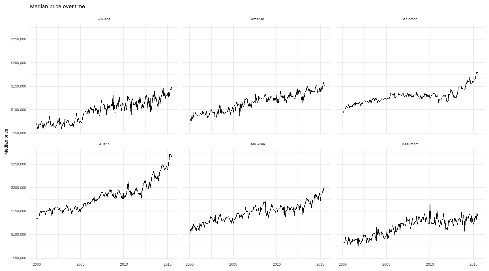
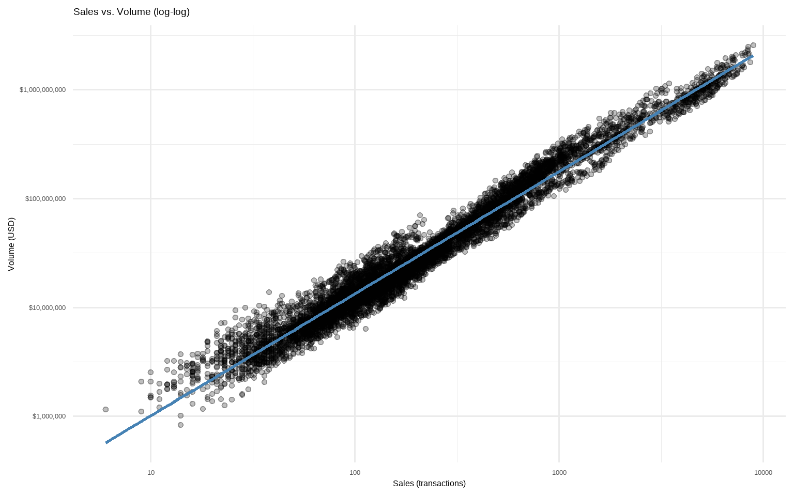

# Exploratory Data Analysis {#sec-exploratory-data-analysis}

::: {.chapter-abstract}
**Abstract.** Exploratory data analysis is where an analyst learns what the data can and cannot support, before any model commits them to an answer. This chapter demonstrates a fast, business-oriented workflow on a housing panel: automated data reports, feature engineering aimed at interpretable marketing and finance constructs, missingness profiling, and error identification. Two distinctions organize that material. The first is the taxonomy separating data missing completely at random, at random, and not at random, which determines whether any repair is possible and which the data themselves cannot settle. The second is the difference between a value that cannot be right and one that is merely extreme, where deletion stops being cleaning and becomes an inferential act. Summary statistics appear in several forms, since the useful summary differs for a collaborator, a referee, and a stakeholder. A closing section takes up the cost of exploration itself, since an analyst who has already seen a pattern cannot afterwards test it as though encountering it for the first time, and weighs the three responses: sample splitting, pre-specification, and accurate description. The chapter also covers the low-code path and a template for scheduled reports that refresh themselves.

**Keywords:** Exploratory data analysis, Data profiling, Feature engineering, Missing data, Outlier detection, Researcher degrees of freedom
:::

Identification, the subject of the chapters on endogeneity, bias, causal graphs
and controls, is a question that can be settled on paper. This chapter asks a
prior question that cannot be: whether the data in hand can support the analysis
at all. The answer comes from looking, and looking is not free. An analyst who
has already seen a pattern cannot afterwards test it as though meeting it for
the first time, which makes exploration a technical subject rather than a
preliminary to one.

Exploratory analysis occupies an uncomfortable position in the standard account of empirical work. It is universally practiced and almost never reported. A paper describes the model it fitted and the tests it ran, not the forty plots that preceded them, and the reader is left to infer that the specification arrived fully formed. It never does. Between the raw file and the first regression there is a long stretch of looking, and what happens in that stretch determines more about the eventual result than the choice of estimator does.

This chapter treats that stretch as a technical subject rather than as preparation for the real work. The argument is not that exploration should be avoided, which is impossible, nor merely that it should be disclosed, which is procedural. It is that exploration should be conducted so that its consequences remain legible: scripted rather than performed by hand, so that what was looked at is recoverable, and understood as consuming evidence, so that the analyst does not later test a hypothesis about a pattern they have already seen as though seeing it for the first time.

## What Exploration Is For

Three questions occupy this stage, and they are worth separating because they fail in different ways.

The first is what the data are. Types, ranges, cardinality, and completeness sound like clerical matters, and they are, right up until a variable assumed to be continuous turns out to be a truncated count, or a panel assumed to be balanced turns out to lose half its units after a particular year. These facts constrain every model that follows. They are cheap to establish now and expensive to discover late.

The second is what the data can support. A question requires variation of a particular kind, in a particular place, and the data either contain it or they do not. If treated and untreated units do not overlap on the covariates that matter, no estimator recovers the contrast. If a key subgroup holds forty observations, no amount of modeling produces a credible subgroup effect. Settling this early prevents an entire analysis from being built on a comparison the data cannot make.

The third is what would have to be true for the analysis to be wrong, which is the question the rest of this volume develops at length. Exploration is where the candidate answers first become visible: the impossible value that suggests a coding error, the discontinuity that suggests a change in how a variable was collected, the association between missingness and the outcome that suggests the absent rows are not absent at random.

Only the first of these is served by running a profiling package and reading its output. The second and third require the analyst to hold a question in mind and interrogate the data against it. The workflow below automates the first so that attention is left over for the others.

The rest of the chapter works through that on `ggplot2::txhousing`, a panel of monthly housing sales for cities in Texas. The sequence is the one an analyst follows in practice: an automated profile of the raw file, features engineered into constructs a marketing or finance audience can interpret, a missingness profile, and a pass for values that cannot be right. Every step is scripted, so the same pass runs again on a new extract without anyone having to remember what was done the first time.


``` r
# Core packages
# install.packages(c(
#   "tidyverse", "lubridate", "DataExplorer", "dataReporter",
#   "skimr", "rpivotTable", "esquisse", "dlookr"
# ))
library(ggplot2)
library(dplyr)
library(tidyr)
library(lubridate)
library(DataExplorer)
library(skimr)
library(dlookr)

# Data: ggplot2 ships with txhousing
data("txhousing", package = "ggplot2")

# Create a clean working copy with business-friendly engineered features
tx <- txhousing %>%
  mutate(
    date = make_date(year, month, 1),
    # Average price per sale (proxy for ARPU-like metric in sales)
    avg_price = ifelse(sales > 0, volume / sales, NA_real_),
    # Absorption-like metric: sales per listing (how fast inventory turns)
    absorption = ifelse(listings > 0, sales / listings, NA_real_),
    # Months of inventory is already provided as `inventory`
    # Seasonal and calendar features
    quarter = factor(quarter(date), labels = c("Q1", "Q2", "Q3", "Q4")),
    ym = factor(format(date, "%Y-%m")),
    city = as.factor(city)
  )

# A couple of quick sanity checks
stopifnot(all(
    c(
        "city",
        "year",
        "month",
        "sales",
        "volume",
        "median",
        "listings",
        "inventory"
    ) %in% names(tx)
))

# Preview
dplyr::glimpse(tx)
#> Rows: 8,602
#> Columns: 13
#> $ city       <fct> Abilene, Abilene, Abilene, Abilene, Abilene, Abilen…
#> $ year       <int> 2000, 2000, 2000, 2000, 2000, 2000, 2000, 2000, 200…
#> $ month      <int> 1, 2, 3, 4, 5, 6, 7, 8, 9, 10, 11, 12, 1, 2, 3, 4, …
#> $ sales      <dbl> 72, 98, 130, 98, 141, 156, 152, 131, 104, 101, 100,…
#> $ volume     <dbl> 5380000, 6505000, 9285000, 9730000, 10590000, 13910…
#> $ median     <dbl> 71400, 58700, 58100, 68600, 67300, 66900, 73500, 75…
#> $ listings   <dbl> 701, 746, 784, 785, 794, 780, 742, 765, 771, 764, 7…
#> $ inventory  <dbl> 6.3, 6.6, 6.8, 6.9, 6.8, 6.6, 6.2, 6.4, 6.5, 6.6, 6…
#> $ date       <date> 2000-01-01, 2000-02-01, 2000-03-01, 2000-04-01, 20…
#> $ avg_price  <dbl> 74722.22, 66377.55, 71423.08, 99285.71, 75106.38, 8…
#> $ absorption <dbl> 0.10271041, 0.13136729, 0.16581633, 0.12484076, 0.1…
#> $ quarter    <fct> Q1, Q1, Q1, Q2, Q2, Q2, Q3, Q3, Q3, Q4, Q4, Q4, Q1,…
#> $ ym         <fct> 2000-01, 2000-02, 2000-03, 2000-04, 2000-05, 2000-0…
```

## Data Report

Automate a first-pass profile to see dimensions, types, basic completeness, and distributions.

Automation matters here for a reason beyond convenience. A profile produced by a script can be regenerated when the data are refreshed, diffed against the previous version, and inspected by someone who was not present the first time. A profile produced by clicking through a spreadsheet is none of those things, and its findings survive only in the analyst's memory. The tools below reveal nothing a careful analyst could not find by hand. What they change is that the finding becomes reproducible and the cost of repeating it falls to nearly zero.


``` r
# High-level overview
introduce(tx)
```

Figure \@ref(fig:eda-intro) gives the shape of the file at a glance, which is
the first of the three questions above.


``` r
# Structural intro plots. The default title reports memory use, and each
# bar is already named on the axis, so both title and legend are dropped.
plot_intro(tx, theme_config = list(plot.title = element_blank(),
                                   legend.position = "none"))
```

<div class="figure" style="text-align: center">

<p class="caption">(\#fig:eda-intro)Structure of the Texas housing data: the split between discrete and continuous columns, the share of missing values, and the proportion of rows that are complete.</p>
</div>

Figure \@ref(fig:eda-histograms) then shows the shape of each numeric column,
which is where skew and heavy tails become visible.


``` r
# Quick distribution sweep for numerics (great to spot skew and heavy tails).
# plot_histogram(tx) draws the same grid but prints large values in
# scientific notation, so the grid is built directly with short labels
# (100K, 2B) above 10,000 and plain numbers below, which keeps years intact.
short_num <- function(x) {
  big <- scales::label_number(scale_cut = scales::cut_short_scale())(x)
  ifelse(abs(x) < 1e4, format(x, trim = TRUE, scientific = FALSE), big)
}

tx %>%
  select(where(is.numeric)) %>%
  pivot_longer(everything(), names_to = "variable") %>%
  ggplot(aes(value)) +
  geom_histogram(bins = 30, na.rm = TRUE) +
  facet_wrap(~ variable, ncol = 3, scales = "free") +
  scale_x_continuous(labels = short_num) +
  labs(x = NULL, y = "Frequency")
```

<div class="figure" style="text-align: center">

<p class="caption">(\#fig:eda-histograms)Distribution of every numeric column in the Texas housing data. Sales, volume, and listings are strongly right skewed.</p>
</div>

Figures \@ref(fig:eda-correlation) and \@ref(fig:eda-correlation-discrete) cover
the continuous and the discrete columns respectively. The discrete view needs
some preparation. `DataExplorer` silently drops any factor with more than
`maxcat = 20` levels, and `city` has 46, so passing it as it stands leaves only
the quarter dummies, which correlate with one another by construction and say
nothing. The chunk therefore keeps the five markets with the largest dollar
volume and lumps the rest into Other, and it adds two discrete columns that
carry a question: the period, before or from 2008, and whether `listings` was
recorded.


``` r
# Pairwise correlations among continuous columns, a multicollinearity hint.
# For a dataset with many numerics, set cor_args = list(use = "pairwise.complete.obs")
plot_correlation(tx, type = "continuous",
                 cor_args = list(use = "pairwise.complete.obs"))
```

<div class="figure" style="text-align: center">

<p class="caption">(\#fig:eda-correlation)Pairwise correlations among the continuous columns, which is a first check for multicollinearity.</p>
</div>


``` r
# DataExplorer drops factors with more than maxcat = 20 levels, so city
# (46 levels) must be lumped to appear at all. Keep the five largest
# markets by dollar volume, and add period and a missing-listings flag.
tx_discrete <- tx %>%
  transmute(
    city = forcats::fct_lump_n(city, n = 5, w = coalesce(volume, 0),
                               other_level = "Other"),
    # Dummy names would otherwise turn spaces into dots (San.Antonio)
    city = forcats::fct_relabel(city, ~ gsub(" ", "_", .x)),
    quarter,
    period = factor(year < 2008, c(TRUE, FALSE), c("pre2008", "from2008")),
    listings = factor(is.na(listings), c(FALSE, TRUE),
                      c("recorded", "missing"))
  )
plot_correlation(tx_discrete, type = "discrete")
```

<div class="figure" style="text-align: center">

<p class="caption">(\#fig:eda-correlation-discrete)Associations among the discrete columns: city, lumped to the five largest markets by dollar volume plus Other, quarter, period, and whether listings was recorded. Missing listings go with the smaller markets and with the years before 2008, not with the season.</p>
</div>

The panel is balanced, so every city has the same share of every quarter and
period, and those blocks of the matrix are zero. The informative cells are in
the last two columns. Whether `listings` was recorded is unrelated to the
season, but it is related to when and where the row comes from: gaps
concentrate before 2008 and in the smaller markets lumped into Other. That is
already evidence against treating the missing values as missing completely at
random, a point the section on missing data below takes up.

Figures \@ref(fig:eda-pca-1) and \@ref(fig:eda-pca-2) reduce the same numeric columns to their principal
components, which is useful when the correlation matrix is too large to read.
The first shows how much of the variance each component explains, and the
second shows which variables load on each component.


``` r
# PCA of the standardized numeric columns. DataExplorer::plot_prcomp()
# draws the same two views but titles the loadings axis Relative Importance,
# so both are built from prcomp(), keeping components up to 80 percent of
# the variance as plot_prcomp() does.
tx_num <- tx %>% select(where(is.numeric)) %>% na.omit()
pca <- prcomp(tx_num, scale. = TRUE)
pc_var <- tibble(
  pc = paste0("PC", seq_along(pca$sdev)),
  share = pca$sdev^2 / sum(pca$sdev^2),
  cum_share = cumsum(share)
) %>%
  filter(cum_share <= 0.8)

ggplot(pc_var, aes(reorder(pc, share), share)) +
  geom_col() +
  geom_label(aes(label = scales::percent(cum_share, accuracy = 1))) +
  scale_y_continuous(labels = scales::percent) +
  coord_flip() +
  labs(x = "Principal component", y = "Share of variance explained")
```

<div class="figure" style="text-align: center">

<p class="caption">(\#fig:eda-pca-1)Share of the variance in the standardized numeric columns explained by each of the first three principal components, with cumulative shares as bar labels.</p>
</div>

``` r

as_tibble(pca$rotation[, pc_var$pc], rownames = "variable") %>%
  pivot_longer(-variable, names_to = "pc", values_to = "loading") %>%
  ggplot(aes(variable, loading)) +
  geom_col() +
  coord_flip() +
  facet_wrap(~ pc, scales = "free_x") +
  labs(x = NULL, y = "Loading")
```

<div class="figure" style="text-align: center">

<p class="caption">(\#fig:eda-pca-2)Loadings of each standardized numeric column on the first three principal components.</p>
</div>

*Tip:* For very wide tables, use `maxcat` in `DataExplorer` functions to cap cardinality for cleaner plots.

## Feature Engineering

Business-minded transforms often beat fancy models. The goal is interpretability and better signal-to-noise.

The warning attached to this step is that feature engineering is where exploration most easily becomes specification search. Constructing a ratio because it corresponds to a quantity the field already reasons about is defensible. Constructing forty ratios and keeping the three that correlate with the outcome is a specification search conducted before the specification exists, and it leaves no trace in the model that eventually gets reported. The distinction is not visible in the code, which is identical either way. It lies in whether the construct was motivated before its relationship to the outcome was inspected. Where a transform was chosen by looking, the honest description of the resulting estimate is exploratory, and Section \@ref(sec-publication-bias-phacking) sets out what that costs.


``` r
fe_tx <- tx %>%
  mutate(
    # Year-month numeric for time-aware models
    t_index = as.integer(zoo::as.yearmon(date)),
    # Price momentum: rolling median (by city) as a simple trend proxy
    median_roll3 = dplyr::lag(slider::slide_dbl(median, mean, .before = 2, .complete = TRUE), 0), 
    # Volume-per-listing: marketing pipeline proxy (dollars per active listing)
    vol_per_listing = ifelse(listings > 0, volume / listings, NA_real_),
    # Seasonality flags
    is_peak_summer = month(date) %in% 6:8,
    is_december = month(date) == 12
  )
head(fe_tx)
#> # A tibble: 6 × 18
#>   city     year month sales  volume median listings inventory date      
#>   <fct>   <int> <int> <dbl>   <dbl>  <dbl>    <dbl>     <dbl> <date>    
#> 1 Abilene  2000     1    72  5.38e6  71400      701       6.3 2000-01-01
#> 2 Abilene  2000     2    98  6.51e6  58700      746       6.6 2000-02-01
#> 3 Abilene  2000     3   130  9.28e6  58100      784       6.8 2000-03-01
#> 4 Abilene  2000     4    98  9.73e6  68600      785       6.9 2000-04-01
#> 5 Abilene  2000     5   141  1.06e7  67300      794       6.8 2000-05-01
#> 6 Abilene  2000     6   156  1.39e7  66900      780       6.6 2000-06-01
#> # ℹ 9 more variables: avg_price <dbl>, absorption <dbl>, quarter <fct>,
#> #   ym <fct>, t_index <int>, median_roll3 <dbl>, vol_per_listing <dbl>,
#> #   is_peak_summer <lgl>, is_december <lgl>
```

One-hot encode high-utility discrete features (keep top cities to avoid huge design matrices)

**Note**: `dummify()` will create binary indicators and drop the original variable by default.

To avoid exploding dimensions, we lump rare cities first.


``` r
fe_tx_small <- fe_tx %>%
    mutate(city_lumped = forcats::fct_lump_n(city, n = 10, other_level = "Other"))
tx_dummy <-
    dummify(fe_tx_small %>% select(-city), select = "city_lumped")
names(tx_dummy)[1:15]
#>  [1] "year"            "month"           "sales"          
#>  [4] "volume"          "median"          "listings"       
#>  [7] "inventory"       "avg_price"       "absorption"     
#> [10] "t_index"         "median_roll3"    "vol_per_listing"
#> [13] "date"            "quarter"         "ym"
```


``` r
# Separate continuous and discrete columns for targeted transformations/modeling
spl <- split_columns(tx)
names(spl)
#> [1] "discrete"        "continuous"      "num_discrete"   
#> [4] "num_continuous"  "num_all_missing"
```

*Rules of thumb:*

-   Normalize skewed monetary variables (e.g., $\log(\text{volume}+1)$) before linear modeling.
-   Group rare categories and avoid too many dummies relative to $n$.
-   Create business KPIs: `avg_price`, `absorption`, `vol_per_listing`, and simple momentum features.

## Missing Data

Missingness is information. First detect, then decide: delete, impute, or model it explicitly.

Detection does not settle the decision, because the same missingness rate can arise from mechanisms with entirely different consequences. The standard taxonomy separates three. Values are missing completely at random when the probability of absence is unrelated to anything, observed or not, and dropping incomplete rows then costs precision and nothing else. Values are missing at random when that probability depends on observed variables. Complete-case analysis is now biased, but the bias is repairable, because the variables driving the absence are available to condition on. Values are missing not at random when the probability depends on the unobserved value itself, and this is the case no imputation procedure repairs, because the information required to repair it is exactly what is absent.

Nothing in the data distinguishes the second case from the third. The pattern of missingness is observable. The mechanism generating it is an assumption, of the same kind as the identifying assumptions treated elsewhere in this volume. That is why the profiling below is worth doing carefully and is still not decisive on its own. It shows where the holes are and which observed variables predict them, which is enough to rule out the first case and to argue about the other two, but not enough to establish which obtains. Where the choice changes the conclusion, it belongs in the sensitivity analysis rather than in a preprocessing step nobody reports.

One practical corollary: keep an indicator for what was missing. If the missingness is informative, the indicator carries signal that imputation would otherwise destroy. If it is not, the indicator is harmless.


``` r
# Counts by variable
profile_missing(tx)
#> # A tibble: 13 × 3
#>    feature    num_missing pct_missing
#>    <fct>            <int>       <dbl>
#>  1 city                 0      0     
#>  2 year                 0      0     
#>  3 month                0      0     
#>  4 sales              568      0.0660
#>  5 volume             568      0.0660
#>  6 median             616      0.0716
#>  7 listings          1424      0.166 
#>  8 inventory         1467      0.171 
#>  9 date                 0      0     
#> 10 avg_price          568      0.0660
#> 11 absorption        1427      0.166 
#> 12 quarter              0      0     
#> 13 ym                   0      0
```

Figure \@ref(fig:eda-missing) puts the same counts on a common scale, which
makes it easy to see which columns are the weak ones.


``` r
plot_missing(tx)
```

<div class="figure" style="text-align: center">

<p class="caption">(\#fig:eda-missing)Share of missing values in each column of the Texas housing data. Inventory and listings are absent for roughly a sixth of the rows.</p>
</div>


``` r
# Simple tidy summary (counts and proportions)
tx %>%
    summarise(across(everything(),
                     ~ sprintf(
                         "%d (%.1f%%)", sum(is.na(.)), 100 * mean(is.na(.))
                     ),
                     .names = "{.col}")) %>%
    pivot_longer(everything(), names_to = "variable", values_to = "n_pct_na") %>%
    arrange(desc(n_pct_na)) %>%
    head(12)
#> # A tibble: 12 × 2
#>    variable   n_pct_na    
#>    <chr>      <chr>       
#>  1 median     616 (7.2%)  
#>  2 sales      568 (6.6%)  
#>  3 volume     568 (6.6%)  
#>  4 avg_price  568 (6.6%)  
#>  5 inventory  1467 (17.1%)
#>  6 absorption 1427 (16.6%)
#>  7 listings   1424 (16.6%)
#>  8 city       0 (0.0%)    
#>  9 year       0 (0.0%)    
#> 10 month      0 (0.0%)    
#> 11 date       0 (0.0%)    
#> 12 quarter    0 (0.0%)
```

Table \@ref(tab:eda-skim-imputed) summarizes the four numeric columns after median imputation, which is the quickest way to confirm that filling the gaps has not moved a distribution somewhere it should not go.


``` r
# Example: median imputation for a few numerics (for demonstration only)
# (In modeling, prefer imputations *within* resampling using recipes/caret/tidymodels.)
tx_imputed <- tx %>%
  mutate(
    sales     = ifelse(is.na(sales),     median(sales,     na.rm = TRUE), sales),
    listings  = ifelse(is.na(listings),  median(listings,  na.rm = TRUE), listings),
    inventory = ifelse(is.na(inventory), median(inventory, na.rm = TRUE), inventory),
    median    = ifelse(is.na(median),    median(median,    na.rm = TRUE), median)
  )

# skim() prints its own header block and unicode spark histograms, neither of
# which survives conversion to LaTeX, so pull out the numeric partition and
# render it as an ordinary table instead.
skim_numeric <- function(d, caption) {
    skimr::skim_without_charts(d) |>
        skimr::yank("numeric") |>
        as.data.frame() |>
        dplyr::select(Variable = skim_variable, Missing = n_missing,
                      Mean = mean, SD = sd, Min = p0, Q1 = p25,
                      Median = p50, Q3 = p75, Max = p100) |>
        knitr::kable(booktabs = TRUE, digits = 1, caption = caption,
                     format.args = list(scientific = FALSE)) |>
        # Nine columns of six-figure numbers are wider than the text block.
        # scale_down shrinks only when the table would otherwise overrun, and
        # is a no-op in the HTML build.
        kableExtra::kable_styling(latex_options = "scale_down")
}

skim_numeric(tx_imputed |> select(sales, listings, inventory, median),
             "Numeric summary of the four columns after median imputation.")
```

<table class="table" style="margin-left: auto; margin-right: auto;">
<caption>(\#tab:eda-skim-imputed)(\#tab:eda-skim-imputed)Numeric summary of the four columns after median imputation.</caption>
 <thead>
  <tr>
   <th style="text-align:left;"> Variable </th>
   <th style="text-align:right;"> Missing </th>
   <th style="text-align:right;"> Mean </th>
   <th style="text-align:right;"> SD </th>
   <th style="text-align:right;"> Min </th>
   <th style="text-align:right;"> Q1 </th>
   <th style="text-align:right;"> Median </th>
   <th style="text-align:right;"> Q3 </th>
   <th style="text-align:right;"> Max </th>
  </tr>
 </thead>
<tbody>
  <tr>
   <td style="text-align:left;"> sales </td>
   <td style="text-align:right;"> 0 </td>
   <td style="text-align:right;"> 524.4 </td>
   <td style="text-align:right;"> 1077.6 </td>
   <td style="text-align:right;"> 6 </td>
   <td style="text-align:right;"> 90.0 </td>
   <td style="text-align:right;"> 169.0 </td>
   <td style="text-align:right;"> 432.0 </td>
   <td style="text-align:right;"> 8945.0 </td>
  </tr>
  <tr>
   <td style="text-align:left;"> listings </td>
   <td style="text-align:right;"> 0 </td>
   <td style="text-align:right;"> 2896.8 </td>
   <td style="text-align:right;"> 5499.1 </td>
   <td style="text-align:right;"> 0 </td>
   <td style="text-align:right;"> 756.0 </td>
   <td style="text-align:right;"> 1283.0 </td>
   <td style="text-align:right;"> 2527.8 </td>
   <td style="text-align:right;"> 43107.0 </td>
  </tr>
  <tr>
   <td style="text-align:left;"> inventory </td>
   <td style="text-align:right;"> 0 </td>
   <td style="text-align:right;"> 7.0 </td>
   <td style="text-align:right;"> 4.2 </td>
   <td style="text-align:right;"> 0 </td>
   <td style="text-align:right;"> 5.2 </td>
   <td style="text-align:right;"> 6.2 </td>
   <td style="text-align:right;"> 7.6 </td>
   <td style="text-align:right;"> 55.9 </td>
  </tr>
  <tr>
   <td style="text-align:left;"> median </td>
   <td style="text-align:right;"> 0 </td>
   <td style="text-align:right;"> 127821.3 </td>
   <td style="text-align:right;"> 36014.2 </td>
   <td style="text-align:right;"> 50000 </td>
   <td style="text-align:right;"> 101725.0 </td>
   <td style="text-align:right;"> 123800.0 </td>
   <td style="text-align:right;"> 147900.0 </td>
   <td style="text-align:right;"> 304200.0 </td>
  </tr>
</tbody>
</table>


Figure \@ref(fig:eda-na-pareto) orders the same columns by how much is missing,
which is the view to use when deciding what to drop and what to impute.


``` r
# dlookr helpers (diagnose and visualize NA concentration)
diagnose(tx)
#> # A tibble: 13 × 6
#>    variables  types   missing_count missing_percent unique_count
#>    <chr>      <chr>           <int>           <dbl>        <int>
#>  1 city       factor              0            0              46
#>  2 year       integer             0            0              16
#>  3 month      integer             0            0              12
#>  4 sales      numeric           568            6.60         1712
#>  5 volume     numeric           568            6.60         7495
#>  6 median     numeric           616            7.16         1538
#>  7 listings   numeric          1424           16.6          3703
#>  8 inventory  numeric          1467           17.1           296
#>  9 date       Date                0            0             187
#> 10 avg_price  numeric           568            6.60         7917
#> 11 absorption numeric          1427           16.6          6880
#> 12 quarter    factor              0            0               4
#> 13 ym         factor              0            0             187
#> # ℹ 1 more variable: unique_rate <dbl>
# clip = "off" keeps the label on the tallest bar from being cut off.
# The fill scale is restated with drop = TRUE so that grades no column
# reaches (Bad, Remove) do not appear in the legend without a swatch.
grade_fill <- c(Good = "#FFFFB2", OK = "#FECC5C", NotBad = "#FD8D3C",
                Bad = "#F03B20", Remove = "#BD0026")
grade_labels <- c(Good = "Good\n(<=5%)", OK = "OK\n(<=10%)",
                  NotBad = "NotBad\n(<=20%)", Bad = "Bad\n(<=50%)",
                  Remove = "Remove\n(<=100%)")
plot_na_pareto(tx) +
  coord_cartesian(clip = "off") +
  scale_fill_manual(values = grade_fill, labels = grade_labels,
                    name = "Missing Grade", drop = TRUE)
```

<div class="figure" style="text-align: center">

<p class="caption">(\#fig:eda-na-pareto)Pareto chart of missing values by column, ordered by the count absent.</p>
</div>

*Best practice:* Impute inside a modeling pipeline, for example with `recipes::step_impute_median()`, and consider adding a "was missing" flag for each repaired column, so that the pattern of missingness stays available to the model.

## Error Identification

Catch anomalies early: impossible values, data entry glitches, or KPI mismatches.

The category deserves more care than it usually gets, because two very different things travel under the name outlier. One is a value that cannot be right: a negative price, a sale recorded before its listing, a month with more transactions than there were listings to transact. These are errors, they have a cause in the recording process, and removing them is a cleaning decision any reader would endorse. The other is a value that is extreme but entirely possible, and here removal is not cleaning but an inferential act. Dropping the observations that sit furthest from the fitted relationship will improve the fit, always, and the improvement carries no information about whether the relationship is real.

The operational test is whether the exclusion rule can be stated without reference to the outcome. A rule that removes months where sales exceed listings is mechanical, checkable, and independent of any model. A rule that removes the twelve cities with the largest residuals is none of those. It is a specification choice, and it should be reported as one and varied among the robustness checks. The diagnostics below identify candidates. They do not license deletion.

1.  Logical constraints


``` r

violations <- tx %>%
  mutate(
    v_sales_negative   = sales < 0,
    v_volume_negative  = volume < 0,
    v_listings_negative= listings < 0,
    v_inventory_negative = inventory < 0
  ) %>%
  summarise(across(starts_with("v_"), ~sum(.x, na.rm = TRUE)))
violations
#> # A tibble: 1 × 4
#>   v_sales_negative v_volume_negative v_listings_negative
#>              <int>             <int>               <int>
#> 1                0                 0                   0
#> # ℹ 1 more variable: v_inventory_negative <int>
```

2.  Price coherence: median vs. average price (avg_price = volume/sales)

Large gaps are not necessarily errors, but extreme ratios can flag data issues.


``` r
coherence <- tx %>%
  mutate(avg_price = ifelse(sales > 0, volume / sales, NA_real_),
         ratio = median / avg_price) %>%
  filter(!is.na(ratio), is.finite(ratio)) %>%
  summarise(
    n = n(),
    ratio_p01 = quantile(ratio, 0.01),
    ratio_p99 = quantile(ratio, 0.99),
    extreme = sum(ratio < 0.25 | ratio > 4, na.rm = TRUE)
  )
coherence
#> # A tibble: 1 × 4
#>       n ratio_p01 ratio_p99 extreme
#>   <int>     <dbl>     <dbl>   <int>
#> 1  7985     0.682     0.992       0
```

3.  Outliers (univariate) with `dlookr`


``` r
out_summary <- diagnose_outlier(tx %>% select(sales, volume, median, listings, inventory, avg_price))
out_summary %>% arrange(desc(outliers_cnt)) %>% head(10)
#> # A tibble: 6 × 6
#>   variables outliers_cnt outliers_ratio outliers_mean    with_mean
#>   <chr>            <int>          <dbl>         <dbl>        <dbl>
#> 1 volume            1116          13.0    563924698.  106858621.  
#> 2 sales              899          10.5         3057.        550.  
#> 3 listings           742           8.63       17522.       3217.  
#> 4 inventory          437           5.08          20.8         7.17
#> 5 median             147           1.71      248251.     128131.  
#> 6 avg_price          143           1.66      300786.     153202.  
#> # ℹ 1 more variable: without_mean <dbl>
```


``` r
# Full, human-readable data quality report (HTML) with dataReporter
# install.packages("dataReporter")
library(dataReporter)
makeDataReport(tx)  # Generates an HTML report in your working directory
```

## Summary statistics

Concise summaries for continuous and categorical variables, plus grouped business KPIs.

The reason to produce several of these rather than one is that a summary table serves three audiences with incompatible needs. A collaborator wants completeness, including the variables that turned out not to matter, because they are checking the work rather than reading a result. A referee wants the quantities that bear on credibility: cell sizes, missingness rates, and the dispersion of the variables carrying identification, since those determine whether the design can support the claim at all. A stakeholder wants the three numbers that change a decision and will not read past them. Producing one table and asking all three to use it guarantees that at least two are served badly.


``` r
# Dollar volume runs to ten figures, which would push the table past the text
# block, so report it in millions.
skim_numeric(tx |> mutate(volume = volume / 1e6),
             paste("Numeric summary of the Texas housing data.",
                   "Dollar volume is in millions."))
```

<table class="table" style="margin-left: auto; margin-right: auto;">
<caption>(\#tab:unnamed-chunk-11)(\#tab:unnamed-chunk-11)Numeric summary of the Texas housing data. Dollar volume is in millions.</caption>
 <thead>
  <tr>
   <th style="text-align:left;"> Variable </th>
   <th style="text-align:right;"> Missing </th>
   <th style="text-align:right;"> Mean </th>
   <th style="text-align:right;"> SD </th>
   <th style="text-align:right;"> Min </th>
   <th style="text-align:right;"> Q1 </th>
   <th style="text-align:right;"> Median </th>
   <th style="text-align:right;"> Q3 </th>
   <th style="text-align:right;"> Max </th>
  </tr>
 </thead>
<tbody>
  <tr>
   <td style="text-align:left;"> year </td>
   <td style="text-align:right;"> 0 </td>
   <td style="text-align:right;"> 2007.3 </td>
   <td style="text-align:right;"> 4.5 </td>
   <td style="text-align:right;"> 2000.0 </td>
   <td style="text-align:right;"> 2003.0 </td>
   <td style="text-align:right;"> 2007.0 </td>
   <td style="text-align:right;"> 2011.0 </td>
   <td style="text-align:right;"> 2015.0 </td>
  </tr>
  <tr>
   <td style="text-align:left;"> month </td>
   <td style="text-align:right;"> 0 </td>
   <td style="text-align:right;"> 6.4 </td>
   <td style="text-align:right;"> 3.4 </td>
   <td style="text-align:right;"> 1.0 </td>
   <td style="text-align:right;"> 3.0 </td>
   <td style="text-align:right;"> 6.0 </td>
   <td style="text-align:right;"> 9.0 </td>
   <td style="text-align:right;"> 12.0 </td>
  </tr>
  <tr>
   <td style="text-align:left;"> sales </td>
   <td style="text-align:right;"> 568 </td>
   <td style="text-align:right;"> 549.6 </td>
   <td style="text-align:right;"> 1110.7 </td>
   <td style="text-align:right;"> 6.0 </td>
   <td style="text-align:right;"> 86.0 </td>
   <td style="text-align:right;"> 169.0 </td>
   <td style="text-align:right;"> 467.0 </td>
   <td style="text-align:right;"> 8945.0 </td>
  </tr>
  <tr>
   <td style="text-align:left;"> volume </td>
   <td style="text-align:right;"> 568 </td>
   <td style="text-align:right;"> 106.9 </td>
   <td style="text-align:right;"> 244.9 </td>
   <td style="text-align:right;"> 0.8 </td>
   <td style="text-align:right;"> 10.8 </td>
   <td style="text-align:right;"> 23.0 </td>
   <td style="text-align:right;"> 75.1 </td>
   <td style="text-align:right;"> 2568.2 </td>
  </tr>
  <tr>
   <td style="text-align:left;"> median </td>
   <td style="text-align:right;"> 616 </td>
   <td style="text-align:right;"> 128131.4 </td>
   <td style="text-align:right;"> 37359.6 </td>
   <td style="text-align:right;"> 50000.0 </td>
   <td style="text-align:right;"> 100000.0 </td>
   <td style="text-align:right;"> 123800.0 </td>
   <td style="text-align:right;"> 150000.0 </td>
   <td style="text-align:right;"> 304200.0 </td>
  </tr>
  <tr>
   <td style="text-align:left;"> listings </td>
   <td style="text-align:right;"> 1424 </td>
   <td style="text-align:right;"> 3216.9 </td>
   <td style="text-align:right;"> 5968.3 </td>
   <td style="text-align:right;"> 0.0 </td>
   <td style="text-align:right;"> 682.0 </td>
   <td style="text-align:right;"> 1283.0 </td>
   <td style="text-align:right;"> 2953.8 </td>
   <td style="text-align:right;"> 43107.0 </td>
  </tr>
  <tr>
   <td style="text-align:left;"> inventory </td>
   <td style="text-align:right;"> 1467 </td>
   <td style="text-align:right;"> 7.2 </td>
   <td style="text-align:right;"> 4.6 </td>
   <td style="text-align:right;"> 0.0 </td>
   <td style="text-align:right;"> 4.9 </td>
   <td style="text-align:right;"> 6.2 </td>
   <td style="text-align:right;"> 8.1 </td>
   <td style="text-align:right;"> 55.9 </td>
  </tr>
  <tr>
   <td style="text-align:left;"> avg_price </td>
   <td style="text-align:right;"> 568 </td>
   <td style="text-align:right;"> 153202.4 </td>
   <td style="text-align:right;"> 48189.0 </td>
   <td style="text-align:right;"> 54782.6 </td>
   <td style="text-align:right;"> 118099.8 </td>
   <td style="text-align:right;"> 142510.9 </td>
   <td style="text-align:right;"> 181806.1 </td>
   <td style="text-align:right;"> 362688.2 </td>
  </tr>
  <tr>
   <td style="text-align:left;"> absorption </td>
   <td style="text-align:right;"> 1427 </td>
   <td style="text-align:right;"> 0.2 </td>
   <td style="text-align:right;"> 0.1 </td>
   <td style="text-align:right;"> 0.0 </td>
   <td style="text-align:right;"> 0.1 </td>
   <td style="text-align:right;"> 0.2 </td>
   <td style="text-align:right;"> 0.2 </td>
   <td style="text-align:right;"> 1.6 </td>
  </tr>
</tbody>
</table>


The table answers the collaborator's question and part of the referee's. Every
numeric column is present, and the missingness column shows immediately that
`inventory` and `listings` are the weak spots, absent for roughly a sixth of
the rows, while `year`, `month`, and `date` are complete by construction. The
quartiles matter more than the means here, because `sales`, `volume`, and
`listings` are all strongly right skewed: in each case the mean sits above the
third quartile, which is the signature of a long upper tail driven by the large
metropolitan areas. Reporting a mean and a standard deviation alone for these
columns would describe a distribution that does not exist.


``` r
# City-level yearly KPIs
city_year <- tx %>%
    group_by(city, year) %>%
    summarise(
        n_months      = n(),
        sales_total   = sum(sales, na.rm = TRUE),
        volume_total  = sum(volume, na.rm = TRUE),
        median_price  = median(median, na.rm = TRUE),
        avg_inventory = mean(inventory, na.rm = TRUE),
        .groups = "drop"
    ) %>%
    arrange(city, year)
head(city_year, 10)
#> # A tibble: 10 × 7
#>    city     year n_months sales_total volume_total median_price
#>    <fct>   <int>    <int>       <dbl>        <dbl>        <dbl>
#>  1 Abilene  2000       12        1375    108575000        67100
#>  2 Abilene  2001       12        1431    114365000        70050
#>  3 Abilene  2002       12        1516    118675000        67100
#>  4 Abilene  2003       12        1632    135675000        71850
#>  5 Abilene  2004       12        1830    159670000        73200
#>  6 Abilene  2005       12        1977    198855000        92400
#>  7 Abilene  2006       12        1997    227530000        99900
#>  8 Abilene  2007       12        2003    232062585       102800
#>  9 Abilene  2008       12        1651    192520335       106900
#> 10 Abilene  2009       12        1634    202357756       109050
#> # ℹ 1 more variable: avg_inventory <dbl>
```

Figure \@ref(fig:eda-price-over-time) traces the monthly median sale price for the six Texas markets with the largest total dollar volume of sales over the whole period. Every market has the same number of rows in this balanced panel, so a count of observations cannot pick out the largest ones, and dollar volume is used instead.


``` r
# Price over time for the six markets with the largest dollar volume.
# Every city has 187 rows, so count(city) cannot rank them.
top_cities <- tx %>%
    group_by(city) %>%
    summarise(total_volume = sum(volume, na.rm = TRUE)) %>%
    slice_max(total_volume, n = 6) %>%
    pull(city) %>%
    as.character()

tx %>%
    filter(city %in% top_cities) %>%
    mutate(city = factor(city, levels = top_cities)) %>%
    ggplot(aes(date, median)) +
    geom_line(linewidth = 0.5) +
    facet_wrap(~ city) +
    scale_y_continuous(labels = scales::dollar_format()) +
    labs(
        title = "Median sale price over time",
        x = NULL,
        y = "Median sale price"
    ) +
    theme_minimal(base_size = 12)
```

<div class="figure" style="text-align: center">

<p class="caption">(\#fig:eda-price-over-time)Monthly median sale price, 2000 to 2015, for the six Texas markets with the largest total dollar volume of sales, ordered from largest to smallest.</p>
</div>

Figure \@ref(fig:eda-volume-vs-sales) plots transaction volume against sales count on log-log axes, with an OLS smoother to highlight the bivariate relationship.


``` r
# Volume vs. Sales (log-scale to reduce skew)
tx %>%
    filter(sales > 0, volume > 0) %>%
    ggplot(aes(sales, volume)) +
    geom_point(alpha = 0.25) +
    scale_x_log10() +
    scale_y_log10(labels = scales::dollar_format()) +
    geom_smooth(method = "lm",
                se = FALSE,
                color = "steelblue") +
    labs(title = "Volume vs. sales (log-log)",
         x = "Sales (transactions)",
         y = "Volume (USD)") +
    theme_minimal(base_size = 12)
```

<div class="figure" style="text-align: center">

<p class="caption">(\#fig:eda-volume-vs-sales)Volume against sales (log-log) across all Texas city-month observations, with an OLS smoother.</p>
</div>

## Exploration and Confirmation

Everything above changes what the analyst knows, and that is the difficulty. A hypothesis test asks how surprising the observed data would be if the null were true, and the calculation assumes the hypothesis was fixed before the data were seen. An analyst who has already plotted the outcome against a dozen candidate predictors, noticed which relationship looked strongest, and then tested that one has not performed the test the $p$-value describes. The reported figure answers a question nobody asked: how surprising this result would be under the null, had this particular comparison been chosen in advance. It was not chosen in advance. It was chosen by looking.

The problem does not require any intent to deceive, and it does not require running many tests and reporting the best. It is enough to have made a sequence of reasonable decisions, each defensible on its own, each informed by a glance at the data: to have excluded a period that looked anomalous, pooled two categories that behaved similarly, used the log because the raw variable was skewed. Every one of those may be the right call. Collectively they define a path through a garden of alternatives, and the analysis that emerges at the end has been fitted to the data in ways the standard errors do not know about. Section \@ref(sec-publication-bias-phacking) treats the literature-level consequences.

Three responses are available, and they are not equivalent.

The first is to separate the samples. Explore on one partition, confirm on another held back and untouched, and the confirmatory test recovers its meaning because the data it uses were not consulted while the specification was being formed. This is the cleanest solution and the most expensive, since it spends observations on discipline, and it is unavailable when the sample is small or the interesting variation sits in a subgroup too thin to split.

The second is to fix the analysis in advance. A pre-specified plan converts exploratory freedom into a commitment made before the outcome is visible. It is not free either: real data surprise the analyst, and a plan rigid enough to bind is often a plan that turns out to have specified the wrong model. The usual compromise is to pre-specify the primary analysis and label everything else as what it is.

The third, always available and too rarely taken, is to describe the analysis accurately. An exploratory result reported as exploratory is a contribution: it identifies a pattern worth testing on data that do not yet exist. The same result reported as a confirmatory test of a hypothesis is a claim the evidence does not support. What makes the difference is a sentence in the text, and the discipline to write it. Chapter \@ref(sec-replication) takes up the mechanism by which such patterns eventually become knowledge, which is that somebody collects new data and looks again.

## Not so code-y process

### Quick and dirty way to look at your data


``` r
# install.packages("rpivotTable")
library(rpivotTable)

# Works best in HTML output. Drag-and-drop just like Excel PivotTables
rpivotTable(
  data = tx,
  rows = "city",
  cols = "year",
  vals = "sales",
  aggregatorName = "Sum",
  rendererName = "Heatmap"
)
```

### Code generation and wrangling (visual)


``` r
# install.packages("esquisse")
library(esquisse)
# Launch the GUI to build ggplots and dplyr pipelines interactively
esquisse::esquisser(tx)
```

## Shiny-app based Tableau style

The skeleton below sketches a minimal Shiny dashboard that lets the user pick a city and renders the corresponding median-price trend line.


``` r
# Minimal Shiny-style dashboard idea (skeleton)
# shinyApp(
#   ui = fluidPage(
#     titlePanel("TX Housing Explorer"),
#     sidebarLayout(
#       sidebarPanel(selectInput("city", "City", choices = sort(unique(tx$city)), selected = "Houston")),
#       mainPanel(plotOutput("trend"))
#     )
#   ),
#   server = function(input, output, session) {
#     output$trend <- renderPlot({
#       tx %>%
#         filter(city == input$city) %>%
#         ggplot(aes(date, median)) + geom_line() +
#         labs(x = NULL, y = "Median Price") +
#         theme_minimal()
#     })
#   }
# )
```

## Customize your daily/automatic report


``` r
# Option A: One-liner automated HTML report (DataExplorer)
DataExplorer::create_report(tx, y = "median")  # sets target variable for focus

# Option B: Knit this Rmd on a schedule (cron/Task Scheduler)
# rmarkdown::render("eda_txhousing.Rmd", output_format = "html_document")
```


``` r
# Optionally explore additional EDA helpers
# install.packages(c("chronicle","descriptr"))
library(chronicle)
library(descriptr)
# Tip: use these packages selectively, since their APIs evolve.
# Prefer the stable verbs above and consult vignettes for current functions.
```

### Appendix: Small "gotchas" to keep in mind

-   For correlation heatmaps, ensure you're not mixing units without scaling, and use `scale. = TRUE` in PCA.
-   For discrete correlations, high-cardinality features (like many cities) can make matrices unwieldy. Thus, lump or select top-$k$ first.
-   Imputation should be inside resampling to avoid leakage.
-   KPI checks (e.g., `median` vs `volume/sales`) are *diagnostics*, not proofs of error. Hence, investigate outliers before removal.

What links these four is that each one is a place where an exploratory
convenience quietly becomes an inferential claim. Scaling and lumping are
presentational choices until they change which correlations are visible, at
which point they have decided what the analyst will go on to model. Imputing
before resampling is a workflow shortcut until it lets information from the
held-out fold reach the fitted model, at which point the validation estimate is
optimistic and no longer means what it says. Deleting an outlier flagged by a
KPI check is tidying until the deleted rows turn out to share something, at
which point it is a sample restriction that belongs in the paper. The rule that
covers all four is to record the choice at the moment it is made, because each
of them is invisible in the final output and none of them can be recovered from
the fitted model afterwards.

## Looking Ahead

Exploration ends with an analyst who knows what the data can support and what it
cost to find out. Neither is visible to a reader unless the write-up makes them
so, which is the subject of Chapter \@ref(sec-reporting): which artifacts a
manuscript has to carry, in what form, and how to keep every number traceable to
the code that produced it.
